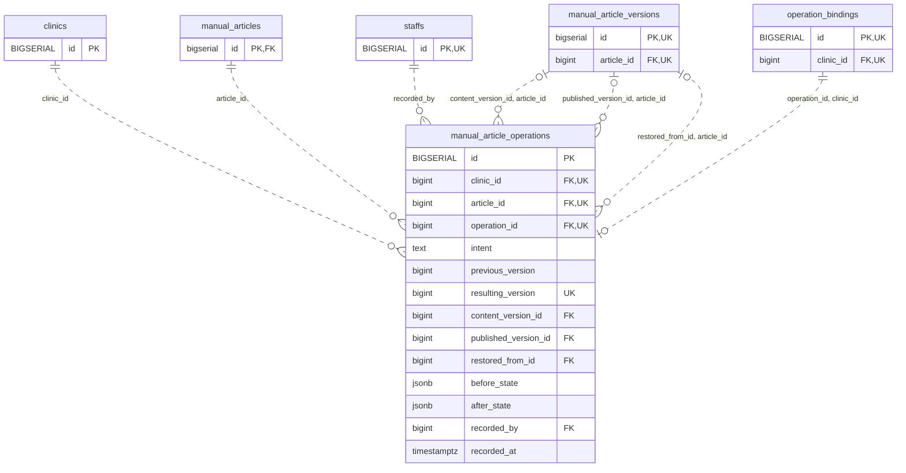

<!-- GENERATED: scripts/tools/generate-erd-detail.py; do not edit -->
# `manual_article_operations`

[詳細ERD一覧](index.md) · [概要ERD](../erd.md)

このページは、マイグレーションをファイル名順に静的解析した最終定義です。稼働DBの状態は未確認です。

## カラム

型・DEFAULTはDDLの宣言表記です。`bigserial` は採番宣言であり、DBカタログ上の型名ではありません。

| カラム | 型（DDL） | NULL | DEFAULT（DDL） | キー構成列 | 定義元 |
|:---|:---|:---|:---|:---|:---|
| `id` | `BIGSERIAL` | NOT NULL | — | PK | [001_init.sql:10008](../../../backend/migrations/001_init.sql#L10008) |
| `clinic_id` | `bigint` | NOT NULL | — | FK, UK | [001_init.sql:10008](../../../backend/migrations/001_init.sql#L10008) |
| `article_id` | `bigint` | NOT NULL | — | FK, UK | [001_init.sql:10009](../../../backend/migrations/001_init.sql#L10009) |
| `operation_id` | `bigint` | NOT NULL | — | FK, UK | [001_init.sql:10010](../../../backend/migrations/001_init.sql#L10010) |
| `intent` | `text` | NOT NULL | — | — | [001_init.sql:10010](../../../backend/migrations/001_init.sql#L10010) |
| `previous_version` | `bigint` | NOT NULL | — | — | [001_init.sql:10011](../../../backend/migrations/001_init.sql#L10011) |
| `resulting_version` | `bigint` | NOT NULL | — | UK | [001_init.sql:10011](../../../backend/migrations/001_init.sql#L10011) |
| `content_version_id` | `bigint` | NULL | — | FK | [001_init.sql:10012](../../../backend/migrations/001_init.sql#L10012) |
| `published_version_id` | `bigint` | NULL | — | FK | [001_init.sql:10012](../../../backend/migrations/001_init.sql#L10012) |
| `restored_from_id` | `bigint` | NULL | — | FK | [001_init.sql:10012](../../../backend/migrations/001_init.sql#L10012) |
| `before_state` | `jsonb` | NOT NULL | — | — | [001_init.sql:10013](../../../backend/migrations/001_init.sql#L10013) |
| `after_state` | `jsonb` | NOT NULL | — | — | [001_init.sql:10013](../../../backend/migrations/001_init.sql#L10013) |
| `recorded_by` | `bigint` | NOT NULL | — | FK | [001_init.sql:10014](../../../backend/migrations/001_init.sql#L10014) |
| `recorded_at` | `timestamptz` | NOT NULL | `clock_timestamp()` | — | [001_init.sql:10014](../../../backend/migrations/001_init.sql#L10014) |

PK/FK/UKはキーの構成列を示します。複合キーの各列が単独で一意という意味ではありません。部分uniqueは下記indexの述語を参照してください。

## ERD

このテーブルの全カラムと、すべての参照先を表示します。参照先はFKの対象列だけを表示し、全カラムは各テーブルのページに置きます。

親側の任意参照はFK列のNULL可否、子側の最大1件は無条件のPK/UNIQUEから導出します。部分uniqueによる条件付きの最大件数は図に反映せず、index一覧に記録します。実線はFK全列が子のPKに含まれる識別関係、破線はそれ以外です。

## 外部キー（全件）

| 制約 | 子の列（順序あり） | 参照先 | 親の列（順序あり） | 削除時の動作 | 定義元 |
|:---|:---|:---|:---|:---|:---|
| `manual_article_operations_clinic_id_fkey` | `clinic_id` | [clinics](clinics.md) | `id` | `ON DELETE RESTRICT` | [001_init.sql:10008](../../../backend/migrations/001_init.sql#L10008) |
| `manual_article_operations_article_id_fkey` | `article_id` | [manual_articles](manual_articles.md) | `id` | `ON DELETE RESTRICT` | [001_init.sql:10009](../../../backend/migrations/001_init.sql#L10009) |
| `manual_article_operations_recorded_by_fkey` | `recorded_by` | [staffs](staffs.md) | `id` | `ON DELETE RESTRICT` | [001_init.sql:10014](../../../backend/migrations/001_init.sql#L10014) |
| `manual_article_operations_content_version_id_article_id_fkey` | `content_version_id, article_id` | [manual_article_versions](manual_article_versions.md) | `id, article_id` | `ON DELETE RESTRICT` | [001_init.sql:10016](../../../backend/migrations/001_init.sql#L10016) |
| `manual_article_operations_published_version_id_article_id_fkey` | `published_version_id, article_id` | [manual_article_versions](manual_article_versions.md) | `id, article_id` | `ON DELETE RESTRICT` | [001_init.sql:10017](../../../backend/migrations/001_init.sql#L10017) |
| `manual_article_operations_restored_from_id_article_id_fkey` | `restored_from_id, article_id` | [manual_article_versions](manual_article_versions.md) | `id, article_id` | `ON DELETE RESTRICT` | [001_init.sql:10018](../../../backend/migrations/001_init.sql#L10018) |
| `manual_article_operations_operation_id_clinic_id_fkey` | `operation_id, clinic_id` | [operation_bindings](operation_bindings.md) | `id, clinic_id` | `ON DELETE RESTRICT` | [001_init.sql:10019](../../../backend/migrations/001_init.sql#L10019) |

正確なON UPDATE・MATCH・DEFERRABLE等を含む制約DDL:

- `manual_article_operations_clinic_id_fkey`: `REFERENCES clinics(id) ON DELETE RESTRICT`
- `manual_article_operations_article_id_fkey`: `REFERENCES manual_articles(id) ON DELETE RESTRICT`
- `manual_article_operations_recorded_by_fkey`: `REFERENCES staffs(id) ON DELETE RESTRICT`
- `manual_article_operations_content_version_id_article_id_fkey`: `FOREIGN KEY(content_version_id,article_id) REFERENCES manual_article_versions(id,article_id) ON DELETE RESTRICT`
- `manual_article_operations_published_version_id_article_id_fkey`: `FOREIGN KEY(published_version_id,article_id) REFERENCES manual_article_versions(id,article_id) ON DELETE RESTRICT`
- `manual_article_operations_restored_from_id_article_id_fkey`: `FOREIGN KEY(restored_from_id,article_id) REFERENCES manual_article_versions(id,article_id) ON DELETE RESTRICT`
- `manual_article_operations_operation_id_clinic_id_fkey`: `FOREIGN KEY(operation_id,clinic_id) REFERENCES operation_bindings(id,clinic_id) ON DELETE RESTRICT`

## その他の制約

| 制約 | 種別 | DDL | 定義元 |
|:---|:---|:---|:---|
| `manual_article_operations_pkey` | primary | `PRIMARY KEY` | [001_init.sql:10008](../../../backend/migrations/001_init.sql#L10008) |
| `manual_article_operations_intent_check` | check | `CHECK(intent IN('edit','publish','restore','hide','remove_override'))` | [001_init.sql:10010](../../../backend/migrations/001_init.sql#L10010) |
| `manual_article_operations_previous_version_check` | check | `CHECK(previous_version>0)` | [001_init.sql:10011](../../../backend/migrations/001_init.sql#L10011) |
| `manual_article_operations_check` | check | `CHECK(resulting_version=previous_version+1)` | [001_init.sql:10011](../../../backend/migrations/001_init.sql#L10011) |
| `manual_article_operations_before_state_check` | check | `CHECK(jsonb_typeof(before_state)='object')` | [001_init.sql:10013](../../../backend/migrations/001_init.sql#L10013) |
| `manual_article_operations_after_state_check` | check | `CHECK(jsonb_typeof(after_state)='object')` | [001_init.sql:10013](../../../backend/migrations/001_init.sql#L10013) |
| `manual_article_operations_article_id_resulting_version_key` | unique | `UNIQUE(article_id,resulting_version)` | [001_init.sql:10015](../../../backend/migrations/001_init.sql#L10015) |
| `manual_article_operations_clinic_id_operation_id_key` | unique | `UNIQUE(clinic_id,operation_id)` | [001_init.sql:10015](../../../backend/migrations/001_init.sql#L10015) |
| `manual_article_operations_check1` | check | `CHECK(intent<>'restore' OR(restored_from_id IS NOT NULL AND content_version_id IS NOT NULL))` | [001_init.sql:10020](../../../backend/migrations/001_init.sql#L10020) |
| `manual_article_operations_check2` | check | `CHECK(intent<>'publish' OR published_version_id IS NOT NULL)` | [001_init.sql:10021](../../../backend/migrations/001_init.sql#L10021) |

## インデックス

明示的なCREATE INDEXなし。PK/UNIQUEに付随する暗黙のindexは制約欄を参照してください。
