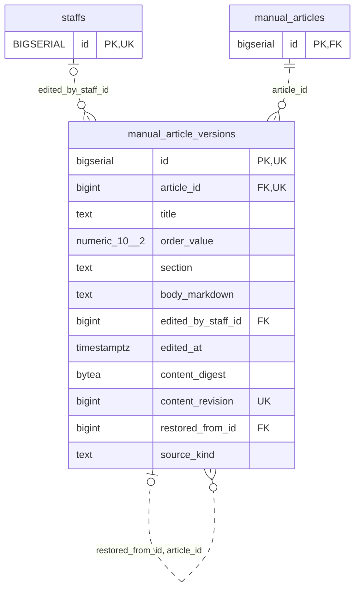

<!-- GENERATED: scripts/tools/generate-erd-detail.py; do not edit -->
# `manual_article_versions`

[詳細ERD一覧](index.md) · [概要ERD](../erd.md)

このページは、マイグレーションをファイル名順に静的解析した最終定義です。稼働DBの状態は未確認です。

## カラム

型・DEFAULTはDDLの宣言表記です。`bigserial` は採番宣言であり、DBカタログ上の型名ではありません。

| カラム | 型（DDL） | NULL | DEFAULT（DDL） | キー構成列 | 定義元 |
|:---|:---|:---|:---|:---|:---|
| `id` | `bigserial` | NOT NULL | — | PK, UK | [001_init.sql:2910](../../../backend/migrations/001_init.sql#L2910) |
| `article_id` | `bigint` | NOT NULL | — | FK, UK | [001_init.sql:2911](../../../backend/migrations/001_init.sql#L2911) |
| `title` | `text` | NOT NULL | — | — | [001_init.sql:2912](../../../backend/migrations/001_init.sql#L2912) |
| `order_value` | `numeric(10, 2)` | NOT NULL | — | — | [001_init.sql:2913](../../../backend/migrations/001_init.sql#L2913) |
| `section` | `text` | NOT NULL | — | — | [001_init.sql:2914](../../../backend/migrations/001_init.sql#L2914) |
| `body_markdown` | `text` | NOT NULL | — | — | [001_init.sql:2915](../../../backend/migrations/001_init.sql#L2915) |
| `edited_by_staff_id` | `bigint` | NULL | — | FK | [001_init.sql:2916](../../../backend/migrations/001_init.sql#L2916) |
| `edited_at` | `timestamptz` | NOT NULL | `now()` | — | [001_init.sql:2917](../../../backend/migrations/001_init.sql#L2917) |
| `content_digest` | `bytea` | NULL | — | — | [001_init.sql:9998](../../../backend/migrations/001_init.sql#L9998) |
| `content_revision` | `bigint` | NULL | — | UK | [001_init.sql:9999](../../../backend/migrations/001_init.sql#L9999) |
| `restored_from_id` | `bigint` | NULL | — | FK | [001_init.sql:10000](../../../backend/migrations/001_init.sql#L10000) |
| `source_kind` | `text` | NULL | — | — | [001_init.sql:10001](../../../backend/migrations/001_init.sql#L10001) |

PK/FK/UKはキーの構成列を示します。複合キーの各列が単独で一意という意味ではありません。部分uniqueは下記indexの述語を参照してください。

## ERD

このテーブルの全カラムと、すべての参照先を表示します。参照先はFKの対象列だけを表示し、全カラムは各テーブルのページに置きます。

親側の任意参照はFK列のNULL可否、子側の最大1件は無条件のPK/UNIQUEから導出します。部分uniqueによる条件付きの最大件数は図に反映せず、index一覧に記録します。実線はFK全列が子のPKに含まれる識別関係、破線はそれ以外です。

## 外部キー（全件）

| 制約 | 子の列（順序あり） | 参照先 | 親の列（順序あり） | 削除時の動作 | 定義元 |
|:---|:---|:---|:---|:---|:---|
| `manual_article_versions_edited_by_staff_id_fkey` | `edited_by_staff_id` | [staffs](staffs.md) | `id` | `ON DELETE SET NULL` | [001_init.sql:2916](../../../backend/migrations/001_init.sql#L2916) |
| `fk_manual_version_article` | `article_id` | [manual_articles](manual_articles.md) | `id` | `ON DELETE RESTRICT` | [001_init.sql:9997](../../../backend/migrations/001_init.sql#L9997) |
| `fk_manual_restore` | `restored_from_id, article_id` | [manual_article_versions](manual_article_versions.md) | `id, article_id` | `ON DELETE RESTRICT` | [001_init.sql:10004](../../../backend/migrations/001_init.sql#L10004) |

正確なON UPDATE・MATCH・DEFERRABLE等を含む制約DDL:

- `manual_article_versions_edited_by_staff_id_fkey`: `REFERENCES staffs(id) ON DELETE SET NULL`
- `fk_manual_version_article`: `CONSTRAINT fk_manual_version_article FOREIGN KEY(article_id) REFERENCES manual_articles(id) ON DELETE RESTRICT`
- `fk_manual_restore`: `CONSTRAINT fk_manual_restore FOREIGN KEY(restored_from_id,article_id) REFERENCES manual_article_versions(id,article_id) ON DELETE RESTRICT`

## その他の制約

| 制約 | 種別 | DDL | 定義元 |
|:---|:---|:---|:---|
| `manual_article_versions_pkey` | primary | `PRIMARY KEY` | [001_init.sql:2910](../../../backend/migrations/001_init.sql#L2910) |
| `manual_article_versions_content_digest_check` | check | `CHECK(octet_length(content_digest)=32)` | [001_init.sql:9998](../../../backend/migrations/001_init.sql#L9998) |
| `manual_article_versions_content_revision_check` | check | `CHECK(content_revision>0)` | [001_init.sql:9999](../../../backend/migrations/001_init.sql#L9999) |
| `manual_article_versions_source_kind_check` | check | `CHECK(source_kind IN('static','override','edited','restored','legacy_unknown'))` | [001_init.sql:10001](../../../backend/migrations/001_init.sql#L10001) |
| `uq_manual_version_article` | unique | `CONSTRAINT uq_manual_version_article UNIQUE(id,article_id)` | [001_init.sql:10002](../../../backend/migrations/001_init.sql#L10002) |
| `uq_manual_content_revision` | unique | `CONSTRAINT uq_manual_content_revision UNIQUE(article_id,content_revision)` | [001_init.sql:10003](../../../backend/migrations/001_init.sql#L10003) |

## インデックス

| 名前 | UNIQUE | 述語 | DDL | 定義元 |
|:---|:---|:---|:---|:---|
| `idx_manual_article_versions_article` | NO | — | `CREATE INDEX idx_manual_article_versions_article ON manual_article_versions(article_id, edited_at DESC)` | [001_init.sql:2920](../../../backend/migrations/001_init.sql#L2920) |
