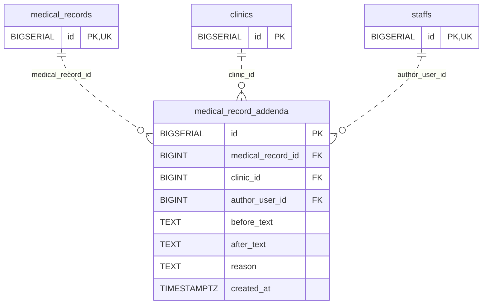

<!-- GENERATED: scripts/tools/generate-erd-detail.py; do not edit -->
# `medical_record_addenda`

[詳細ERD一覧](index.md) · [概要ERD](../erd.md)

このページは、マイグレーションをファイル名順に静的解析した最終定義です。稼働DBの状態は未確認です。

## カラム

型・DEFAULTはDDLの宣言表記です。`bigserial` は採番宣言であり、DBカタログ上の型名ではありません。

| カラム | 型（DDL） | NULL | DEFAULT（DDL） | キー構成列 | 定義元 |
|:---|:---|:---|:---|:---|:---|
| `id` | `BIGSERIAL` | NOT NULL | — | PK | [001_init.sql:1478](../../../backend/migrations/001_init.sql#L1478) |
| `medical_record_id` | `BIGINT` | NOT NULL | — | FK | [001_init.sql:1479](../../../backend/migrations/001_init.sql#L1479) |
| `clinic_id` | `BIGINT` | NOT NULL | — | FK | [001_init.sql:1480](../../../backend/migrations/001_init.sql#L1480) |
| `author_user_id` | `BIGINT` | NOT NULL | — | FK | [001_init.sql:1481](../../../backend/migrations/001_init.sql#L1481) |
| `before_text` | `TEXT` | NOT NULL | `''` | — | [001_init.sql:1482](../../../backend/migrations/001_init.sql#L1482) |
| `after_text` | `TEXT` | NOT NULL | — | — | [001_init.sql:1483](../../../backend/migrations/001_init.sql#L1483) |
| `reason` | `TEXT` | NOT NULL | — | — | [001_init.sql:1484](../../../backend/migrations/001_init.sql#L1484) |
| `created_at` | `TIMESTAMPTZ` | NOT NULL | `NOW()` | — | [001_init.sql:1485](../../../backend/migrations/001_init.sql#L1485) |

PK/FK/UKはキーの構成列を示します。複合キーの各列が単独で一意という意味ではありません。部分uniqueは下記indexの述語を参照してください。

## ERD

このテーブルの全カラムと、すべての参照先を表示します。参照先はFKの対象列だけを表示し、全カラムは各テーブルのページに置きます。

親側の任意参照はFK列のNULL可否、子側の最大1件は無条件のPK/UNIQUEから導出します。部分uniqueによる条件付きの最大件数は図に反映せず、index一覧に記録します。実線はFK全列が子のPKに含まれる識別関係、破線はそれ以外です。

## 外部キー（全件）

| 制約 | 子の列（順序あり） | 参照先 | 親の列（順序あり） | 削除時の動作 | 定義元 |
|:---|:---|:---|:---|:---|:---|
| `medical_record_addenda_medical_record_id_fkey` | `medical_record_id` | [medical_records](medical_records.md) | `id` | `ON DELETE RESTRICT` | [001_init.sql:1479](../../../backend/migrations/001_init.sql#L1479) |
| `medical_record_addenda_clinic_id_fkey` | `clinic_id` | [clinics](clinics.md) | `id` | `ON DELETE RESTRICT` | [001_init.sql:1480](../../../backend/migrations/001_init.sql#L1480) |
| `medical_record_addenda_author_user_id_fkey` | `author_user_id` | [staffs](staffs.md) | `id` | `ON DELETE RESTRICT` | [001_init.sql:1481](../../../backend/migrations/001_init.sql#L1481) |

正確なON UPDATE・MATCH・DEFERRABLE等を含む制約DDL:

- `medical_record_addenda_medical_record_id_fkey`: `REFERENCES medical_records(id) ON DELETE RESTRICT`
- `medical_record_addenda_clinic_id_fkey`: `REFERENCES clinics(id)         ON DELETE RESTRICT`
- `medical_record_addenda_author_user_id_fkey`: `REFERENCES staffs(id)          ON DELETE RESTRICT`

## その他の制約

| 制約 | 種別 | DDL | 定義元 |
|:---|:---|:---|:---|
| `medical_record_addenda_pkey` | primary | `PRIMARY KEY` | [001_init.sql:1478](../../../backend/migrations/001_init.sql#L1478) |

## インデックス

| 名前 | UNIQUE | 述語 | DDL | 定義元 |
|:---|:---|:---|:---|:---|
| `idx_medical_record_addenda_medical_record_id` | NO | — | `CREATE INDEX idx_medical_record_addenda_medical_record_id ON medical_record_addenda (medical_record_id)` | [001_init.sql:1488](../../../backend/migrations/001_init.sql#L1488) |
| `idx_medical_record_addenda_clinic_id` | NO | — | `CREATE INDEX idx_medical_record_addenda_clinic_id         ON medical_record_addenda (clinic_id)` | [001_init.sql:1489](../../../backend/migrations/001_init.sql#L1489) |
| `idx_medical_record_addenda_created_at` | NO | — | `CREATE INDEX idx_medical_record_addenda_created_at        ON medical_record_addenda (created_at)` | [001_init.sql:1490](../../../backend/migrations/001_init.sql#L1490) |
