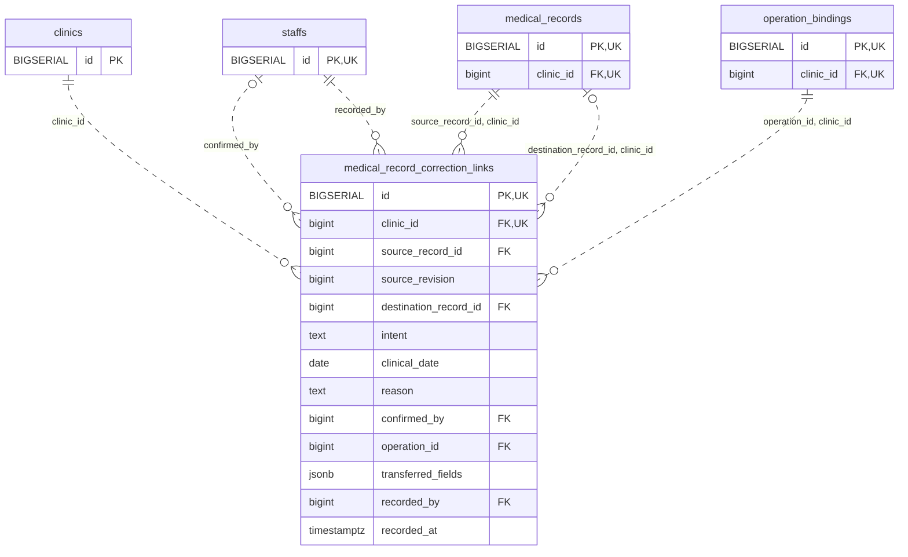

<!-- GENERATED: scripts/tools/generate-erd-detail.py; do not edit -->
# `medical_record_correction_links`

[詳細ERD一覧](index.md) · [概要ERD](../erd.md)

このページは、マイグレーションをファイル名順に静的解析した最終定義です。稼働DBの状態は未確認です。

## カラム

型・DEFAULTはDDLの宣言表記です。`bigserial` は採番宣言であり、DBカタログ上の型名ではありません。

| カラム | 型（DDL） | NULL | DEFAULT（DDL） | キー構成列 | 定義元 |
|:---|:---|:---|:---|:---|:---|
| `id` | `BIGSERIAL` | NOT NULL | — | PK, UK | [001_init.sql:9066](../../../backend/migrations/001_init.sql#L9066) |
| `clinic_id` | `bigint` | NOT NULL | — | FK, UK | [001_init.sql:9067](../../../backend/migrations/001_init.sql#L9067) |
| `source_record_id` | `bigint` | NOT NULL | — | FK | [001_init.sql:9068](../../../backend/migrations/001_init.sql#L9068) |
| `source_revision` | `bigint` | NOT NULL | — | — | [001_init.sql:9069](../../../backend/migrations/001_init.sql#L9069) |
| `destination_record_id` | `bigint` | NULL | — | FK | [001_init.sql:9070](../../../backend/migrations/001_init.sql#L9070) |
| `intent` | `text` | NOT NULL | — | — | [001_init.sql:9071](../../../backend/migrations/001_init.sql#L9071) |
| `clinical_date` | `date` | NULL | — | — | [001_init.sql:9072](../../../backend/migrations/001_init.sql#L9072) |
| `reason` | `text` | NOT NULL | — | — | [001_init.sql:9073](../../../backend/migrations/001_init.sql#L9073) |
| `confirmed_by` | `bigint` | NULL | — | FK | [001_init.sql:9074](../../../backend/migrations/001_init.sql#L9074) |
| `operation_id` | `bigint` | NOT NULL | — | FK | [001_init.sql:9075](../../../backend/migrations/001_init.sql#L9075) |
| `transferred_fields` | `jsonb` | NOT NULL | — | — | [001_init.sql:9076](../../../backend/migrations/001_init.sql#L9076) |
| `recorded_by` | `bigint` | NOT NULL | — | FK | [001_init.sql:9077](../../../backend/migrations/001_init.sql#L9077) |
| `recorded_at` | `timestamptz` | NOT NULL | `clock_timestamp()` | — | [001_init.sql:9078](../../../backend/migrations/001_init.sql#L9078) |

PK/FK/UKはキーの構成列を示します。複合キーの各列が単独で一意という意味ではありません。部分uniqueは下記indexの述語を参照してください。

## ERD

このテーブルの全カラムと、すべての参照先を表示します。参照先はFKの対象列だけを表示し、全カラムは各テーブルのページに置きます。

親側の任意参照はFK列のNULL可否、子側の最大1件は無条件のPK/UNIQUEから導出します。部分uniqueによる条件付きの最大件数は図に反映せず、index一覧に記録します。実線はFK全列が子のPKに含まれる識別関係、破線はそれ以外です。

## 外部キー（全件）

| 制約 | 子の列（順序あり） | 参照先 | 親の列（順序あり） | 削除時の動作 | 定義元 |
|:---|:---|:---|:---|:---|:---|
| `medical_record_correction_links_clinic_id_fkey` | `clinic_id` | [clinics](clinics.md) | `id` | `ON DELETE RESTRICT` | [001_init.sql:9067](../../../backend/migrations/001_init.sql#L9067) |
| `medical_record_correction_links_confirmed_by_fkey` | `confirmed_by` | [staffs](staffs.md) | `id` | `ON DELETE RESTRICT` | [001_init.sql:9074](../../../backend/migrations/001_init.sql#L9074) |
| `medical_record_correction_links_recorded_by_fkey` | `recorded_by` | [staffs](staffs.md) | `id` | `ON DELETE RESTRICT` | [001_init.sql:9077](../../../backend/migrations/001_init.sql#L9077) |
| `medical_record_correction_links_source_record_id_clinic_id_fkey` | `source_record_id, clinic_id` | [medical_records](medical_records.md) | `id, clinic_id` | `ON DELETE RESTRICT` | [001_init.sql:9079](../../../backend/migrations/001_init.sql#L9079) |
| `medical_record_correction_lin_destination_record_id_clinic_fkey` | `destination_record_id, clinic_id` | [medical_records](medical_records.md) | `id, clinic_id` | `ON DELETE RESTRICT` | [001_init.sql:9080](../../../backend/migrations/001_init.sql#L9080) |
| `medical_record_correction_links_operation_id_clinic_id_fkey` | `operation_id, clinic_id` | [operation_bindings](operation_bindings.md) | `id, clinic_id` | `ON DELETE RESTRICT` | [001_init.sql:9081](../../../backend/migrations/001_init.sql#L9081) |

正確なON UPDATE・MATCH・DEFERRABLE等を含む制約DDL:

- `medical_record_correction_links_clinic_id_fkey`: `REFERENCES clinics(id) ON DELETE RESTRICT`
- `medical_record_correction_links_confirmed_by_fkey`: `REFERENCES staffs(id) ON DELETE RESTRICT`
- `medical_record_correction_links_recorded_by_fkey`: `REFERENCES staffs(id) ON DELETE RESTRICT`
- `medical_record_correction_links_source_record_id_clinic_id_fkey`: `FOREIGN KEY (source_record_id,clinic_id) REFERENCES medical_records(id,clinic_id) ON DELETE RESTRICT`
- `medical_record_correction_lin_destination_record_id_clinic_fkey`: `FOREIGN KEY (destination_record_id,clinic_id) REFERENCES medical_records(id,clinic_id) ON DELETE RESTRICT`
- `medical_record_correction_links_operation_id_clinic_id_fkey`: `FOREIGN KEY (operation_id,clinic_id) REFERENCES operation_bindings(id,clinic_id) ON DELETE RESTRICT`

## その他の制約

| 制約 | 種別 | DDL | 定義元 |
|:---|:---|:---|:---|
| `medical_record_correction_links_pkey` | primary | `PRIMARY KEY` | [001_init.sql:9066](../../../backend/migrations/001_init.sql#L9066) |
| `medical_record_correction_links_source_revision_check` | check | `CHECK (source_revision > 0)` | [001_init.sql:9069](../../../backend/migrations/001_init.sql#L9069) |
| `medical_record_correction_links_intent_check` | check | `CHECK (intent IN ('patient_correction','past_visit','postmortem_prior_care','addendum'))` | [001_init.sql:9071](../../../backend/migrations/001_init.sql#L9071) |
| `medical_record_correction_links_reason_check` | check | `CHECK (btrim(reason)<>'')` | [001_init.sql:9073](../../../backend/migrations/001_init.sql#L9073) |
| `medical_record_correction_links_transferred_fields_check` | check | `CHECK (jsonb_typeof(transferred_fields)='object')` | [001_init.sql:9076](../../../backend/migrations/001_init.sql#L9076) |
| `uq_record_correction_id_clinic` | unique | `CONSTRAINT uq_record_correction_id_clinic UNIQUE(id,clinic_id)` | [001_init.sql:10069](../../../backend/migrations/001_init.sql#L10069) |

## インデックス

明示的なCREATE INDEXなし。PK/UNIQUEに付随する暗黙のindexは制約欄を参照してください。
