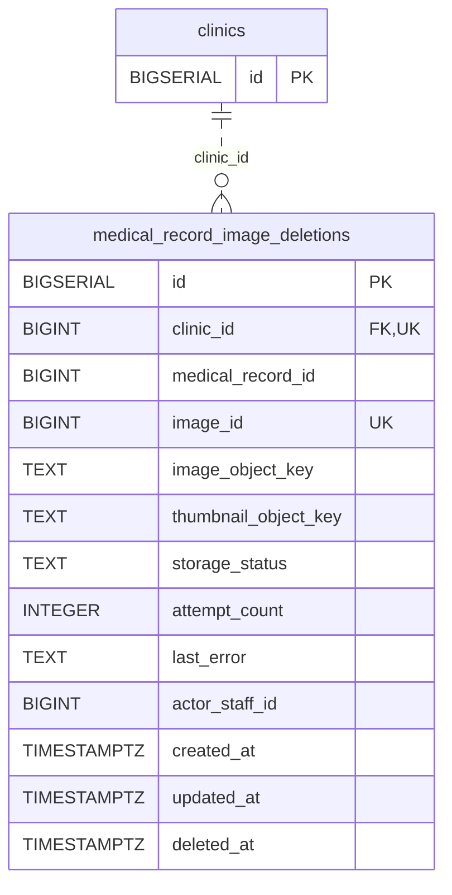

<!-- GENERATED: scripts/tools/generate-erd-detail.py; do not edit -->
# `medical_record_image_deletions`

[詳細ERD一覧](index.md) · [概要ERD](../erd.md)

このページは、マイグレーションをファイル名順に静的解析した最終定義です。稼働DBの状態は未確認です。

## カラム

型・DEFAULTはDDLの宣言表記です。`bigserial` は採番宣言であり、DBカタログ上の型名ではありません。

| カラム | 型（DDL） | NULL | DEFAULT（DDL） | キー構成列 | 定義元 |
|:---|:---|:---|:---|:---|:---|
| `id` | `BIGSERIAL` | NOT NULL | — | PK | [021_medical_record_image_deletions.sql:7](../../../backend/migrations/021_medical_record_image_deletions.sql#L7) |
| `clinic_id` | `BIGINT` | NOT NULL | — | FK, UK | [021_medical_record_image_deletions.sql:8](../../../backend/migrations/021_medical_record_image_deletions.sql#L8) |
| `medical_record_id` | `BIGINT` | NOT NULL | — | — | [021_medical_record_image_deletions.sql:9](../../../backend/migrations/021_medical_record_image_deletions.sql#L9) |
| `image_id` | `BIGINT` | NOT NULL | — | UK | [021_medical_record_image_deletions.sql:10](../../../backend/migrations/021_medical_record_image_deletions.sql#L10) |
| `image_object_key` | `TEXT` | NOT NULL | `''` | — | [021_medical_record_image_deletions.sql:11](../../../backend/migrations/021_medical_record_image_deletions.sql#L11) |
| `thumbnail_object_key` | `TEXT` | NOT NULL | `''` | — | [021_medical_record_image_deletions.sql:12](../../../backend/migrations/021_medical_record_image_deletions.sql#L12) |
| `storage_status` | `TEXT` | NOT NULL | — | — | [021_medical_record_image_deletions.sql:13](../../../backend/migrations/021_medical_record_image_deletions.sql#L13) |
| `attempt_count` | `INTEGER` | NOT NULL | `0` | — | [021_medical_record_image_deletions.sql:14](../../../backend/migrations/021_medical_record_image_deletions.sql#L14) |
| `last_error` | `TEXT` | NOT NULL | `''` | — | [021_medical_record_image_deletions.sql:15](../../../backend/migrations/021_medical_record_image_deletions.sql#L15) |
| `actor_staff_id` | `BIGINT` | NOT NULL | — | — | [021_medical_record_image_deletions.sql:16](../../../backend/migrations/021_medical_record_image_deletions.sql#L16) |
| `created_at` | `TIMESTAMPTZ` | NOT NULL | `NOW()` | — | [021_medical_record_image_deletions.sql:17](../../../backend/migrations/021_medical_record_image_deletions.sql#L17) |
| `updated_at` | `TIMESTAMPTZ` | NOT NULL | `NOW()` | — | [021_medical_record_image_deletions.sql:18](../../../backend/migrations/021_medical_record_image_deletions.sql#L18) |
| `deleted_at` | `TIMESTAMPTZ` | NULL | — | — | [021_medical_record_image_deletions.sql:19](../../../backend/migrations/021_medical_record_image_deletions.sql#L19) |

PK/FK/UKはキーの構成列を示します。複合キーの各列が単独で一意という意味ではありません。部分uniqueは下記indexの述語を参照してください。

## ERD

このテーブルの全カラムと、すべての参照先を表示します。参照先はFKの対象列だけを表示し、全カラムは各テーブルのページに置きます。

親側の任意参照はFK列のNULL可否、子側の最大1件は無条件のPK/UNIQUEから導出します。部分uniqueによる条件付きの最大件数は図に反映せず、index一覧に記録します。実線はFK全列が子のPKに含まれる識別関係、破線はそれ以外です。

## 外部キー（全件）

| 制約 | 子の列（順序あり） | 参照先 | 親の列（順序あり） | 削除時の動作 | 定義元 |
|:---|:---|:---|:---|:---|:---|
| `medical_record_image_deletions_clinic_id_fkey` | `clinic_id` | [clinics](clinics.md) | `id` | `ON DELETE RESTRICT` | [021_medical_record_image_deletions.sql:8](../../../backend/migrations/021_medical_record_image_deletions.sql#L8) |

正確なON UPDATE・MATCH・DEFERRABLE等を含む制約DDL:

- `medical_record_image_deletions_clinic_id_fkey`: `REFERENCES clinics(id) ON DELETE RESTRICT`

## その他の制約

| 制約 | 種別 | DDL | 定義元 |
|:---|:---|:---|:---|
| `medical_record_image_deletions_pkey` | primary | `PRIMARY KEY` | [021_medical_record_image_deletions.sql:7](../../../backend/migrations/021_medical_record_image_deletions.sql#L7) |
| `medical_record_image_deletions_status_check` | check | `CONSTRAINT medical_record_image_deletions_status_check         CHECK (storage_status IN ('pending_storage', 'storage_deleted', 'retained_shared'))` | [021_medical_record_image_deletions.sql:20](../../../backend/migrations/021_medical_record_image_deletions.sql#L20) |
| `medical_record_image_deletions_clinic_image_uidx` | unique | `CONSTRAINT medical_record_image_deletions_clinic_image_uidx         UNIQUE (clinic_id, image_id)` | [021_medical_record_image_deletions.sql:22](../../../backend/migrations/021_medical_record_image_deletions.sql#L22) |

## インデックス

| 名前 | UNIQUE | 述語 | DDL | 定義元 |
|:---|:---|:---|:---|:---|
| `idx_medical_record_image_deletions_clinic_record` | NO | — | `CREATE INDEX idx_medical_record_image_deletions_clinic_record     ON medical_record_image_deletions (clinic_id, medical_record_id)` | [021_medical_record_image_deletions.sql:26](../../../backend/migrations/021_medical_record_image_deletions.sql#L26) |
