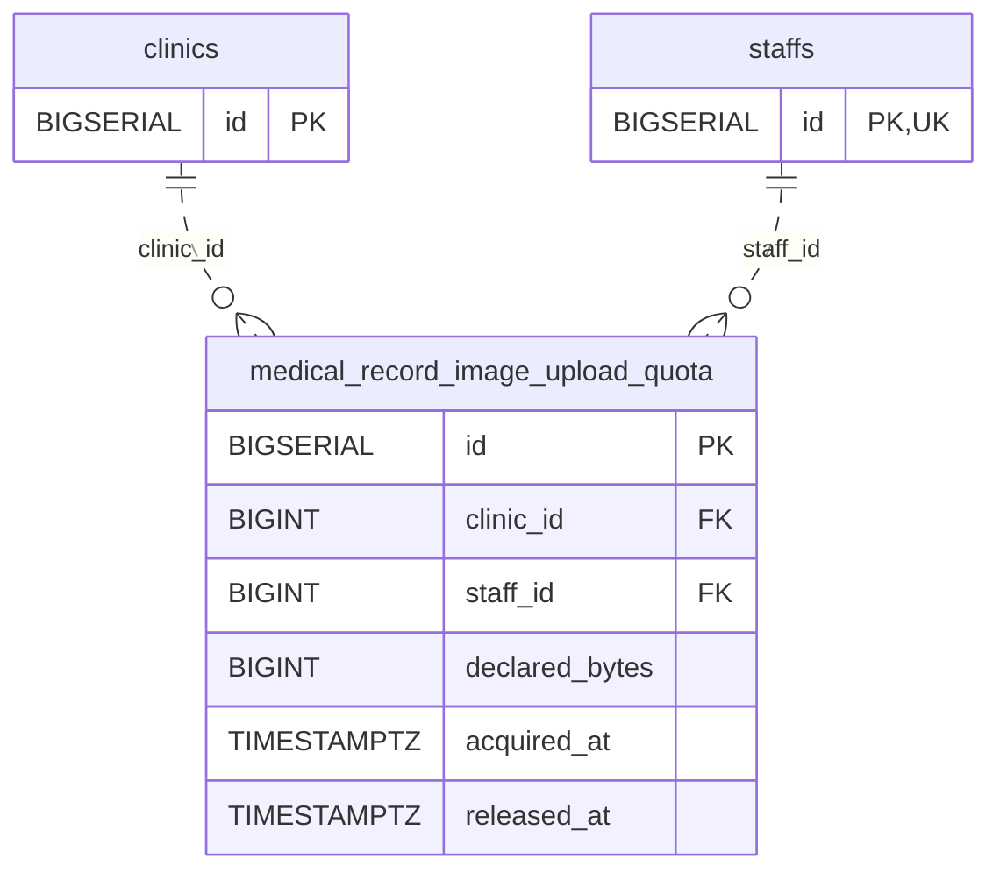

<!-- GENERATED: scripts/tools/generate-erd-detail.py; do not edit -->
# `medical_record_image_upload_quota`

[詳細ERD一覧](index.md) · [概要ERD](../erd.md)

このページは、マイグレーションをファイル名順に静的解析した最終定義です。稼働DBの状態は未確認です。

## カラム

型・DEFAULTはDDLの宣言表記です。`bigserial` は採番宣言であり、DBカタログ上の型名ではありません。

| カラム | 型（DDL） | NULL | DEFAULT（DDL） | キー構成列 | 定義元 |
|:---|:---|:---|:---|:---|:---|
| `id` | `BIGSERIAL` | NOT NULL | — | PK | [001_init.sql:4782](../../../backend/migrations/001_init.sql#L4782) |
| `clinic_id` | `BIGINT` | NOT NULL | — | FK | [001_init.sql:4783](../../../backend/migrations/001_init.sql#L4783) |
| `staff_id` | `BIGINT` | NOT NULL | — | FK | [001_init.sql:4784](../../../backend/migrations/001_init.sql#L4784) |
| `declared_bytes` | `BIGINT` | NOT NULL | — | — | [001_init.sql:4785](../../../backend/migrations/001_init.sql#L4785) |
| `acquired_at` | `TIMESTAMPTZ` | NOT NULL | `now()` | — | [001_init.sql:4786](../../../backend/migrations/001_init.sql#L4786) |
| `released_at` | `TIMESTAMPTZ` | NULL | — | — | [001_init.sql:4787](../../../backend/migrations/001_init.sql#L4787) |

PK/FK/UKはキーの構成列を示します。複合キーの各列が単独で一意という意味ではありません。部分uniqueは下記indexの述語を参照してください。

## ERD

このテーブルの全カラムと、すべての参照先を表示します。参照先はFKの対象列だけを表示し、全カラムは各テーブルのページに置きます。

親側の任意参照はFK列のNULL可否、子側の最大1件は無条件のPK/UNIQUEから導出します。部分uniqueによる条件付きの最大件数は図に反映せず、index一覧に記録します。実線はFK全列が子のPKに含まれる識別関係、破線はそれ以外です。

## 外部キー（全件）

| 制約 | 子の列（順序あり） | 参照先 | 親の列（順序あり） | 削除時の動作 | 定義元 |
|:---|:---|:---|:---|:---|:---|
| `fk_medical_record_image_upload_quota_clinic` | `clinic_id` | [clinics](clinics.md) | `id` | `ON DELETE RESTRICT` | [001_init.sql:4801](../../../backend/migrations/001_init.sql#L4801) |
| `fk_medical_record_image_upload_quota_staff` | `staff_id` | [staffs](staffs.md) | `id` | `ON DELETE RESTRICT` | [017_multiclinic_staff_fk_fix.sql:40](../../../backend/migrations/017_multiclinic_staff_fk_fix.sql#L40) |

正確なON UPDATE・MATCH・DEFERRABLE等を含む制約DDL:

- `fk_medical_record_image_upload_quota_clinic`: `CONSTRAINT fk_medical_record_image_upload_quota_clinic     FOREIGN KEY (clinic_id)     REFERENCES clinics (id)     ON DELETE RESTRICT`
- `fk_medical_record_image_upload_quota_staff`: `CONSTRAINT fk_medical_record_image_upload_quota_staff         FOREIGN KEY (staff_id) REFERENCES staffs (id) ON DELETE RESTRICT`

## その他の制約

| 制約 | 種別 | DDL | 定義元 |
|:---|:---|:---|:---|
| `medical_record_image_upload_quota_pkey` | primary | `PRIMARY KEY` | [001_init.sql:4782](../../../backend/migrations/001_init.sql#L4782) |
| `medical_record_image_upload_quota_declared_bytes_check` | check | `CHECK (declared_bytes >= 0)` | [001_init.sql:4785](../../../backend/migrations/001_init.sql#L4785) |

## インデックス

| 名前 | UNIQUE | 述語 | DDL | 定義元 |
|:---|:---|:---|:---|:---|
| `idx_mri_upload_quota_clinic_acquired` | NO | — | `CREATE INDEX IF NOT EXISTS idx_mri_upload_quota_clinic_acquired   ON medical_record_image_upload_quota (clinic_id, acquired_at)` | [001_init.sql:4790](../../../backend/migrations/001_init.sql#L4790) |
| `idx_mri_upload_quota_staff_acquired` | NO | — | `CREATE INDEX IF NOT EXISTS idx_mri_upload_quota_staff_acquired   ON medical_record_image_upload_quota (clinic_id, staff_id, acquired_at)` | [001_init.sql:4793](../../../backend/migrations/001_init.sql#L4793) |
| `idx_mri_upload_quota_inflight` | NO | `released_at IS NULL` | `CREATE INDEX IF NOT EXISTS idx_mri_upload_quota_inflight   ON medical_record_image_upload_quota (clinic_id, staff_id)   WHERE released_at IS NULL` | [001_init.sql:4796](../../../backend/migrations/001_init.sql#L4796) |
