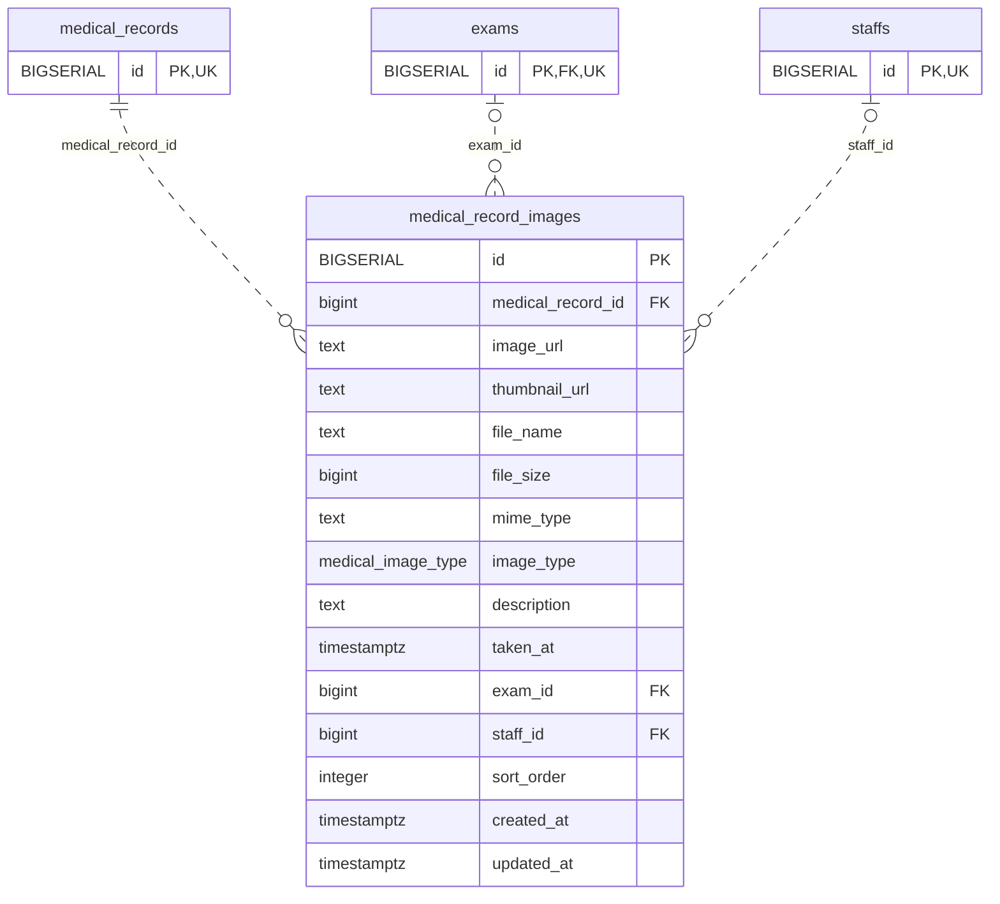

<!-- GENERATED: scripts/tools/generate-erd-detail.py; do not edit -->
# `medical_record_images`

[詳細ERD一覧](index.md) · [概要ERD](../erd.md)

このページは、マイグレーションをファイル名順に静的解析した最終定義です。稼働DBの状態は未確認です。

## カラム

型・DEFAULTはDDLの宣言表記です。`bigserial` は採番宣言であり、DBカタログ上の型名ではありません。

| カラム | 型（DDL） | NULL | DEFAULT（DDL） | キー構成列 | 定義元 |
|:---|:---|:---|:---|:---|:---|
| `id` | `BIGSERIAL` | NOT NULL | — | PK | [001_init.sql:1648](../../../backend/migrations/001_init.sql#L1648) |
| `medical_record_id` | `bigint` | NOT NULL | — | FK | [001_init.sql:1649](../../../backend/migrations/001_init.sql#L1649) |
| `image_url` | `text` | NOT NULL | `''` | — | [001_init.sql:1650](../../../backend/migrations/001_init.sql#L1650) |
| `thumbnail_url` | `text` | NOT NULL | `''` | — | [001_init.sql:1651](../../../backend/migrations/001_init.sql#L1651) |
| `file_name` | `text` | NOT NULL | `''` | — | [001_init.sql:1652](../../../backend/migrations/001_init.sql#L1652) |
| `file_size` | `bigint` | NULL | `0` | — | [001_init.sql:1653](../../../backend/migrations/001_init.sql#L1653) |
| `mime_type` | `text` | NOT NULL | `''` | — | [001_init.sql:1654](../../../backend/migrations/001_init.sql#L1654) |
| `image_type` | `medical_image_type` | NOT NULL | `'other'` | — | [001_init.sql:1655](../../../backend/migrations/001_init.sql#L1655) |
| `description` | `text` | NOT NULL | `''` | — | [001_init.sql:1656](../../../backend/migrations/001_init.sql#L1656) |
| `taken_at` | `timestamptz` | NULL | — | — | [001_init.sql:1657](../../../backend/migrations/001_init.sql#L1657) |
| `exam_id` | `bigint` | NULL | — | FK | [001_init.sql:1658](../../../backend/migrations/001_init.sql#L1658) |
| `staff_id` | `bigint` | NULL | — | FK | [001_init.sql:1659](../../../backend/migrations/001_init.sql#L1659) |
| `sort_order` | `integer` | NULL | `0` | — | [001_init.sql:1660](../../../backend/migrations/001_init.sql#L1660) |
| `created_at` | `timestamptz` | NOT NULL | `now()` | — | [001_init.sql:1661](../../../backend/migrations/001_init.sql#L1661) |
| `updated_at` | `timestamptz` | NOT NULL | `now()` | — | [001_init.sql:1662](../../../backend/migrations/001_init.sql#L1662) |

PK/FK/UKはキーの構成列を示します。複合キーの各列が単独で一意という意味ではありません。部分uniqueは下記indexの述語を参照してください。

## ERD

このテーブルの全カラムと、すべての参照先を表示します。参照先はFKの対象列だけを表示し、全カラムは各テーブルのページに置きます。

親側の任意参照はFK列のNULL可否、子側の最大1件は無条件のPK/UNIQUEから導出します。部分uniqueによる条件付きの最大件数は図に反映せず、index一覧に記録します。実線はFK全列が子のPKに含まれる識別関係、破線はそれ以外です。

## 外部キー（全件）

| 制約 | 子の列（順序あり） | 参照先 | 親の列（順序あり） | 削除時の動作 | 定義元 |
|:---|:---|:---|:---|:---|:---|
| `medical_record_images_medical_record_id_fkey` | `medical_record_id` | [medical_records](medical_records.md) | `id` | `ON DELETE CASCADE` | [001_init.sql:1649](../../../backend/migrations/001_init.sql#L1649) |
| `medical_record_images_exam_id_fkey` | `exam_id` | [exams](exams.md) | `id` | `ON DELETE SET NULL` | [001_init.sql:1658](../../../backend/migrations/001_init.sql#L1658) |
| `medical_record_images_staff_id_fkey` | `staff_id` | [staffs](staffs.md) | `id` | `ON DELETE SET NULL` | [001_init.sql:1659](../../../backend/migrations/001_init.sql#L1659) |

正確なON UPDATE・MATCH・DEFERRABLE等を含む制約DDL:

- `medical_record_images_medical_record_id_fkey`: `REFERENCES medical_records(id) ON DELETE CASCADE`
- `medical_record_images_exam_id_fkey`: `REFERENCES exams(id) ON DELETE SET NULL`
- `medical_record_images_staff_id_fkey`: `REFERENCES staffs(id) ON DELETE SET NULL`

## その他の制約

| 制約 | 種別 | DDL | 定義元 |
|:---|:---|:---|:---|
| `medical_record_images_pkey` | primary | `PRIMARY KEY` | [001_init.sql:1648](../../../backend/migrations/001_init.sql#L1648) |

## インデックス

| 名前 | UNIQUE | 述語 | DDL | 定義元 |
|:---|:---|:---|:---|:---|
| `idx_medical_record_images_medical_record_id` | NO | — | `CREATE INDEX idx_medical_record_images_medical_record_id ON medical_record_images(medical_record_id)` | [001_init.sql:2294](../../../backend/migrations/001_init.sql#L2294) |
| `idx_medical_record_images_image_type` | NO | — | `CREATE INDEX idx_medical_record_images_image_type ON medical_record_images(image_type)` | [001_init.sql:2321](../../../backend/migrations/001_init.sql#L2321) |
| `idx_medical_record_images_taken_at` | NO | — | `CREATE INDEX idx_medical_record_images_taken_at ON medical_record_images(taken_at DESC)` | [001_init.sql:2322](../../../backend/migrations/001_init.sql#L2322) |
| `idx_medical_record_images_exam_id` | NO | `exam_id IS NOT NULL` | `CREATE INDEX idx_medical_record_images_exam_id ON medical_record_images(exam_id) WHERE exam_id IS NOT NULL` | [001_init.sql:2323](../../../backend/migrations/001_init.sql#L2323) |
