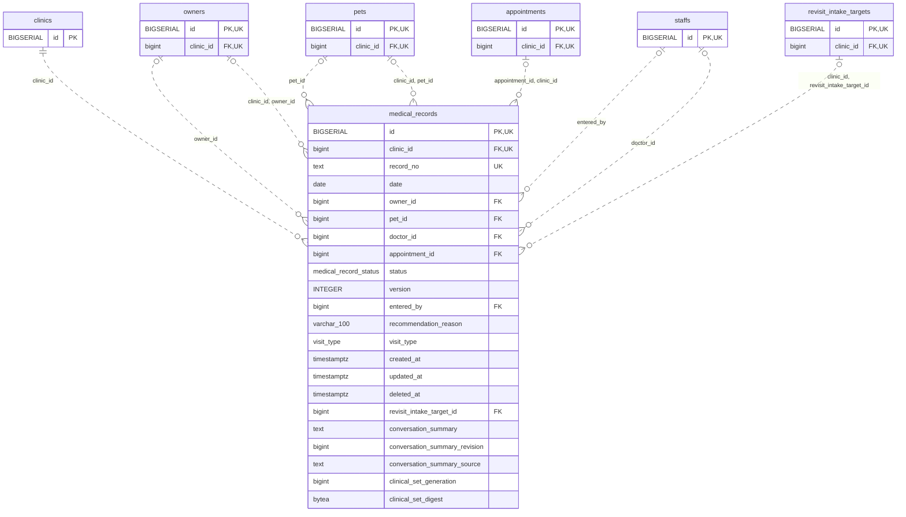

<!-- GENERATED: scripts/tools/generate-erd-detail.py; do not edit -->
# `medical_records`

[詳細ERD一覧](index.md) · [概要ERD](../erd.md)

このページは、マイグレーションをファイル名順に静的解析した最終定義です。稼働DBの状態は未確認です。

## カラム

型・DEFAULTはDDLの宣言表記です。`bigserial` は採番宣言であり、DBカタログ上の型名ではありません。

| カラム | 型（DDL） | NULL | DEFAULT（DDL） | キー構成列 | 定義元 |
|:---|:---|:---|:---|:---|:---|
| `id` | `BIGSERIAL` | NOT NULL | — | PK, UK | [001_init.sql:1421](../../../backend/migrations/001_init.sql#L1421) |
| `clinic_id` | `bigint` | NOT NULL | — | FK, UK | [001_init.sql:1422](../../../backend/migrations/001_init.sql#L1422) |
| `record_no` | `text` | NOT NULL | — | UK | [001_init.sql:1423](../../../backend/migrations/001_init.sql#L1423) |
| `date` | `date` | NOT NULL | — | — | [001_init.sql:1424](../../../backend/migrations/001_init.sql#L1424) |
| `owner_id` | `bigint` | NULL | — | FK | [001_init.sql:1425](../../../backend/migrations/001_init.sql#L1425) |
| `pet_id` | `bigint` | NULL | — | FK | [001_init.sql:1426](../../../backend/migrations/001_init.sql#L1426) |
| `doctor_id` | `bigint` | NULL | — | FK | [001_init.sql:1427](../../../backend/migrations/001_init.sql#L1427) |
| `appointment_id` | `bigint` | NULL | — | FK | [001_init.sql:1428](../../../backend/migrations/001_init.sql#L1428) |
| `status` | `medical_record_status` | NULL | `'draft'` | — | [001_init.sql:1429](../../../backend/migrations/001_init.sql#L1429) |
| `version` | `INTEGER` | NOT NULL | `1` | — | [001_init.sql:1430](../../../backend/migrations/001_init.sql#L1430) |
| `entered_by` | `bigint` | NULL | — | FK | [001_init.sql:1431](../../../backend/migrations/001_init.sql#L1431) |
| `recommendation_reason` | `varchar(100)` | NULL | — | — | [001_init.sql:1434](../../../backend/migrations/001_init.sql#L1434) |
| `visit_type` | `visit_type` | NULL | — | — | [001_init.sql:1435](../../../backend/migrations/001_init.sql#L1435) |
| `created_at` | `timestamptz` | NOT NULL | `now()` | — | [001_init.sql:1436](../../../backend/migrations/001_init.sql#L1436) |
| `updated_at` | `timestamptz` | NOT NULL | `now()` | — | [001_init.sql:1437](../../../backend/migrations/001_init.sql#L1437) |
| `deleted_at` | `timestamptz` | NULL | — | — | [001_init.sql:1438](../../../backend/migrations/001_init.sql#L1438) |
| `revisit_intake_target_id` | `bigint` | NULL | — | FK | [001_init.sql:7853](../../../backend/migrations/001_init.sql#L7853) |
| `conversation_summary` | `text` | NULL | — | — | [001_init.sql:7883](../../../backend/migrations/001_init.sql#L7883) |
| `conversation_summary_revision` | `bigint` | NULL | — | — | [001_init.sql:7884](../../../backend/migrations/001_init.sql#L7884) |
| `conversation_summary_source` | `text` | NULL | — | — | [001_init.sql:7885](../../../backend/migrations/001_init.sql#L7885) |
| `clinical_set_generation` | `bigint` | NULL | — | — | [001_init.sql:8148](../../../backend/migrations/001_init.sql#L8148) |
| `clinical_set_digest` | `bytea` | NULL | — | — | [001_init.sql:8806](../../../backend/migrations/001_init.sql#L8806) |

PK/FK/UKはキーの構成列を示します。複合キーの各列が単独で一意という意味ではありません。部分uniqueは下記indexの述語を参照してください。

## ERD

このテーブルの全カラムと、すべての参照先を表示します。参照先はFKの対象列だけを表示し、全カラムは各テーブルのページに置きます。

親側の任意参照はFK列のNULL可否、子側の最大1件は無条件のPK/UNIQUEから導出します。部分uniqueによる条件付きの最大件数は図に反映せず、index一覧に記録します。実線はFK全列が子のPKに含まれる識別関係、破線はそれ以外です。

## 外部キー（全件）

| 制約 | 子の列（順序あり） | 参照先 | 親の列（順序あり） | 削除時の動作 | 定義元 |
|:---|:---|:---|:---|:---|:---|
| `medical_records_clinic_id_fkey` | `clinic_id` | [clinics](clinics.md) | `id` | `ON DELETE RESTRICT` | [001_init.sql:1422](../../../backend/migrations/001_init.sql#L1422) |
| `medical_records_owner_id_fkey` | `owner_id` | [owners](owners.md) | `id` | `ON DELETE RESTRICT` | [001_init.sql:1425](../../../backend/migrations/001_init.sql#L1425) |
| `medical_records_pet_id_fkey` | `pet_id` | [pets](pets.md) | `id` | `ON DELETE RESTRICT` | [001_init.sql:1426](../../../backend/migrations/001_init.sql#L1426) |
| `fk_medical_records_clinic_pet` | `clinic_id, pet_id` | [pets](pets.md) | `clinic_id, id` | `ON DELETE RESTRICT` | [001_init.sql:4329](../../../backend/migrations/001_init.sql#L4329) |
| `fk_medical_records_clinic_owner` | `clinic_id, owner_id` | [owners](owners.md) | `clinic_id, id` | `ON DELETE RESTRICT` | [001_init.sql:4335](../../../backend/migrations/001_init.sql#L4335) |
| `fk_medical_records_appointment_clinic` | `appointment_id, clinic_id` | [appointments](appointments.md) | `id, clinic_id` | `ON DELETE SET NULL (appointment_id)` | [001_init.sql:5830](../../../backend/migrations/001_init.sql#L5830) |
| `fk_medical_records_entered_by` | `entered_by` | [staffs](staffs.md) | `id` | `ON DELETE RESTRICT` | [001_init.sql:6284](../../../backend/migrations/001_init.sql#L6284) |
| `fk_medical_records_doctor` | `doctor_id` | [staffs](staffs.md) | `id` | `ON DELETE SET NULL` | [001_init.sql:6782](../../../backend/migrations/001_init.sql#L6782) |
| `fk_medical_record_revisit_target` | `clinic_id, revisit_intake_target_id` | [revisit_intake_targets](revisit_intake_targets.md) | `clinic_id, id` | `ON DELETE RESTRICT` | [001_init.sql:7854](../../../backend/migrations/001_init.sql#L7854) |

正確なON UPDATE・MATCH・DEFERRABLE等を含む制約DDL:

- `medical_records_clinic_id_fkey`: `REFERENCES clinics(id) ON DELETE RESTRICT`
- `medical_records_owner_id_fkey`: `REFERENCES owners(id) ON DELETE RESTRICT`
- `medical_records_pet_id_fkey`: `REFERENCES pets(id) ON DELETE RESTRICT`
- `fk_medical_records_clinic_pet`: `CONSTRAINT fk_medical_records_clinic_pet     FOREIGN KEY (clinic_id, pet_id)     REFERENCES pets (clinic_id, id)     ON DELETE RESTRICT`
- `fk_medical_records_clinic_owner`: `CONSTRAINT fk_medical_records_clinic_owner     FOREIGN KEY (clinic_id, owner_id)     REFERENCES owners (clinic_id, id)     ON DELETE RESTRICT`
- `fk_medical_records_appointment_clinic`: `CONSTRAINT fk_medical_records_appointment_clinic         FOREIGN KEY (appointment_id, clinic_id)         REFERENCES appointments (id, clinic_id)         ON DELETE SET NULL (appointment_id)`
- `fk_medical_records_entered_by`: `CONSTRAINT fk_medical_records_entered_by         FOREIGN KEY (entered_by)         REFERENCES staffs (id)         ON DELETE RESTRICT`
- `fk_medical_records_doctor`: `CONSTRAINT fk_medical_records_doctor         FOREIGN KEY (doctor_id) REFERENCES staffs (id) ON DELETE SET NULL`
- `fk_medical_record_revisit_target`: `CONSTRAINT fk_medical_record_revisit_target     FOREIGN KEY (clinic_id, revisit_intake_target_id)     REFERENCES revisit_intake_targets(clinic_id, id) ON DELETE RESTRICT`

## その他の制約

| 制約 | 種別 | DDL | 定義元 |
|:---|:---|:---|:---|
| `medical_records_pkey` | primary | `PRIMARY KEY` | [001_init.sql:1421](../../../backend/migrations/001_init.sql#L1421) |
| `uq_medical_records_id_clinic` | unique | `CONSTRAINT uq_medical_records_id_clinic UNIQUE (id, clinic_id)` | [001_init.sql:4294](../../../backend/migrations/001_init.sql#L4294) |
| `ck_conversation_summary_metadata` | check | `CONSTRAINT ck_conversation_summary_metadata CHECK (       (conversation_summary IS NULL AND conversation_summary_revision IS NULL AND conversation_summary_source IS NULL)       OR (conversation_summary IS NOT NULL AND conversation_summary_revision > 0           AND conversation_summary_revision IS NOT NULL AND conversation_summary_source IS NOT NULL           AND btrim(conversation_summary_source) <> '')     )` | [001_init.sql:7886](../../../backend/migrations/001_init.sql#L7886) |
| `medical_records_clinical_set_generation_check` | check | `CHECK (clinical_set_generation > 0)` | [001_init.sql:8148](../../../backend/migrations/001_init.sql#L8148) |
| `medical_records_clinical_set_digest_check` | check | `CHECK (octet_length(clinical_set_digest)=32)` | [001_init.sql:8806](../../../backend/migrations/001_init.sql#L8806) |

## インデックス

| 名前 | UNIQUE | 述語 | DDL | 定義元 |
|:---|:---|:---|:---|:---|
| `idx_medical_records_clinic_record_no` | YES | — | `CREATE UNIQUE INDEX idx_medical_records_clinic_record_no ON medical_records(clinic_id, record_no)` | [001_init.sql:2193](../../../backend/migrations/001_init.sql#L2193) |
| `idx_medical_records_clinic_date` | NO | `deleted_at IS NULL` | `CREATE INDEX idx_medical_records_clinic_date   ON medical_records(clinic_id, date DESC)   WHERE deleted_at IS NULL` | [001_init.sql:2365](../../../backend/migrations/001_init.sql#L2365) |
| `idx_medical_records_clinic_pet` | NO | `deleted_at IS NULL` | `CREATE INDEX idx_medical_records_clinic_pet   ON medical_records(clinic_id, pet_id)   WHERE deleted_at IS NULL` | [001_init.sql:2369](../../../backend/migrations/001_init.sql#L2369) |
| `idx_medical_records_clinic_owner` | NO | `deleted_at IS NULL` | `CREATE INDEX idx_medical_records_clinic_owner   ON medical_records(clinic_id, owner_id)   WHERE deleted_at IS NULL` | [001_init.sql:2373](../../../backend/migrations/001_init.sql#L2373) |
| `idx_medical_records_clinic_status` | NO | `deleted_at IS NULL` | `CREATE INDEX idx_medical_records_clinic_status   ON medical_records(clinic_id, status)   WHERE deleted_at IS NULL` | [001_init.sql:2377](../../../backend/migrations/001_init.sql#L2377) |
| `idx_medical_records_doctor_id` | NO | `doctor_id IS NOT NULL` | `CREATE INDEX idx_medical_records_doctor_id ON medical_records(doctor_id) WHERE doctor_id IS NOT NULL` | [001_init.sql:2440](../../../backend/migrations/001_init.sql#L2440) |
| `idx_medical_records_entered_by` | NO | `entered_by IS NOT NULL` | `CREATE INDEX idx_medical_records_entered_by ON medical_records(entered_by) WHERE entered_by IS NOT NULL` | [001_init.sql:2441](../../../backend/migrations/001_init.sql#L2441) |
| `idx_medical_records_appointment_id` | NO | `appointment_id IS NOT NULL` | `CREATE INDEX IF NOT EXISTS idx_medical_records_appointment_id     ON medical_records (appointment_id)     WHERE appointment_id IS NOT NULL` | [001_init.sql:3886](../../../backend/migrations/001_init.sql#L3886) |
| `uq_medical_records_clinic_appointment_active` | YES | `appointment_id IS NOT NULL AND deleted_at IS NULL` | `CREATE UNIQUE INDEX uq_medical_records_clinic_appointment_active     ON medical_records (clinic_id, appointment_id)     WHERE appointment_id IS NOT NULL AND deleted_at IS NULL` | [001_init.sql:3890](../../../backend/migrations/001_init.sql#L3890) |
| `idx_medical_records_record_no_trgm` | NO | — | `CREATE INDEX idx_medical_records_record_no_trgm   ON medical_records USING gin (record_no gin_trgm_ops)` | [001_init.sql:6705](../../../backend/migrations/001_init.sql#L6705) |
| `idx_medical_records_clinic_revisit_target` | NO | `revisit_intake_target_id IS NOT NULL` | `CREATE INDEX idx_medical_records_clinic_revisit_target     ON medical_records(clinic_id, revisit_intake_target_id)     WHERE revisit_intake_target_id IS NOT NULL` | [001_init.sql:7857](../../../backend/migrations/001_init.sql#L7857) |
