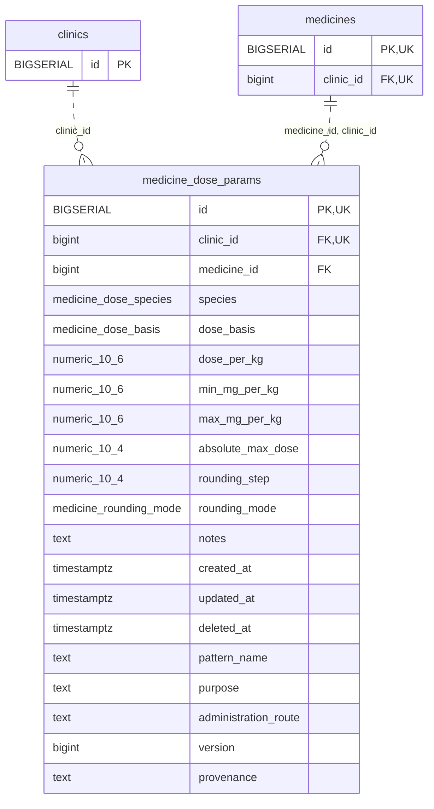

<!-- GENERATED: scripts/tools/generate-erd-detail.py; do not edit -->
# `medicine_dose_params`

[詳細ERD一覧](index.md) · [概要ERD](../erd.md)

このページは、マイグレーションをファイル名順に静的解析した最終定義です。稼働DBの状態は未確認です。

## カラム

型・DEFAULTはDDLの宣言表記です。`bigserial` は採番宣言であり、DBカタログ上の型名ではありません。

| カラム | 型（DDL） | NULL | DEFAULT（DDL） | キー構成列 | 定義元 |
|:---|:---|:---|:---|:---|:---|
| `id` | `BIGSERIAL` | NOT NULL | — | PK, UK | [001_init.sql:3507](../../../backend/migrations/001_init.sql#L3507) |
| `clinic_id` | `bigint` | NOT NULL | — | FK, UK | [001_init.sql:3509](../../../backend/migrations/001_init.sql#L3509) |
| `medicine_id` | `bigint` | NOT NULL | — | FK | [001_init.sql:3510](../../../backend/migrations/001_init.sql#L3510) |
| `species` | `medicine_dose_species` | NOT NULL | — | — | [001_init.sql:3511](../../../backend/migrations/001_init.sql#L3511) |
| `dose_basis` | `medicine_dose_basis` | NOT NULL | `'per_administration'` | — | [001_init.sql:3512](../../../backend/migrations/001_init.sql#L3512) |
| `dose_per_kg` | `numeric(10,6)` | NOT NULL | — | — | [001_init.sql:3513](../../../backend/migrations/001_init.sql#L3513) |
| `min_mg_per_kg` | `numeric(10,6)` | NULL | — | — | [001_init.sql:3514](../../../backend/migrations/001_init.sql#L3514) |
| `max_mg_per_kg` | `numeric(10,6)` | NULL | — | — | [001_init.sql:3515](../../../backend/migrations/001_init.sql#L3515) |
| `absolute_max_dose` | `numeric(10,4)` | NULL | — | — | [001_init.sql:3516](../../../backend/migrations/001_init.sql#L3516) |
| `rounding_step` | `numeric(10,4)` | NULL | — | — | [001_init.sql:3517](../../../backend/migrations/001_init.sql#L3517) |
| `rounding_mode` | `medicine_rounding_mode` | NULL | — | — | [001_init.sql:3518](../../../backend/migrations/001_init.sql#L3518) |
| `notes` | `text` | NOT NULL | `''` | — | [001_init.sql:3519](../../../backend/migrations/001_init.sql#L3519) |
| `created_at` | `timestamptz` | NOT NULL | `now()` | — | [001_init.sql:3520](../../../backend/migrations/001_init.sql#L3520) |
| `updated_at` | `timestamptz` | NOT NULL | `now()` | — | [001_init.sql:3521](../../../backend/migrations/001_init.sql#L3521) |
| `deleted_at` | `timestamptz` | NULL | — | — | [001_init.sql:3522](../../../backend/migrations/001_init.sql#L3522) |
| `pattern_name` | `text` | NULL | — | — | [001_init.sql:9142](../../../backend/migrations/001_init.sql#L9142) |
| `purpose` | `text` | NULL | — | — | [001_init.sql:9143](../../../backend/migrations/001_init.sql#L9143) |
| `administration_route` | `text` | NULL | — | — | [001_init.sql:9144](../../../backend/migrations/001_init.sql#L9144) |
| `version` | `bigint` | NOT NULL | `1` | — | [001_init.sql:9145](../../../backend/migrations/001_init.sql#L9145) |
| `provenance` | `text` | NULL | — | — | [001_init.sql:9146](../../../backend/migrations/001_init.sql#L9146) |

PK/FK/UKはキーの構成列を示します。複合キーの各列が単独で一意という意味ではありません。部分uniqueは下記indexの述語を参照してください。

## ERD

このテーブルの全カラムと、すべての参照先を表示します。参照先はFKの対象列だけを表示し、全カラムは各テーブルのページに置きます。

親側の任意参照はFK列のNULL可否、子側の最大1件は無条件のPK/UNIQUEから導出します。部分uniqueによる条件付きの最大件数は図に反映せず、index一覧に記録します。実線はFK全列が子のPKに含まれる識別関係、破線はそれ以外です。

## 外部キー（全件）

| 制約 | 子の列（順序あり） | 参照先 | 親の列（順序あり） | 削除時の動作 | 定義元 |
|:---|:---|:---|:---|:---|:---|
| `medicine_dose_params_clinic_id_fkey` | `clinic_id` | [clinics](clinics.md) | `id` | `ON DELETE RESTRICT` | [001_init.sql:3509](../../../backend/migrations/001_init.sql#L3509) |
| `fk_dose_params_medicine_clinic` | `medicine_id, clinic_id` | [medicines](medicines.md) | `id, clinic_id` | `ON DELETE RESTRICT` | [001_init.sql:3543](../../../backend/migrations/001_init.sql#L3543) |

正確なON UPDATE・MATCH・DEFERRABLE等を含む制約DDL:

- `medicine_dose_params_clinic_id_fkey`: `REFERENCES clinics(id) ON DELETE RESTRICT`
- `fk_dose_params_medicine_clinic`: `CONSTRAINT fk_dose_params_medicine_clinic         FOREIGN KEY (medicine_id, clinic_id) REFERENCES medicines(id, clinic_id) ON DELETE RESTRICT`

## その他の制約

| 制約 | 種別 | DDL | 定義元 |
|:---|:---|:---|:---|
| `medicine_dose_params_pkey` | primary | `PRIMARY KEY` | [001_init.sql:3507](../../../backend/migrations/001_init.sql#L3507) |
| `ck_dose_per_kg_positive` | check | `CONSTRAINT ck_dose_per_kg_positive         CHECK (dose_per_kg > 0)` | [001_init.sql:3523](../../../backend/migrations/001_init.sql#L3523) |
| `ck_dose_min_positive` | check | `CONSTRAINT ck_dose_min_positive         CHECK (min_mg_per_kg IS NULL OR min_mg_per_kg > 0)` | [001_init.sql:3525](../../../backend/migrations/001_init.sql#L3525) |
| `ck_dose_max_positive` | check | `CONSTRAINT ck_dose_max_positive         CHECK (max_mg_per_kg IS NULL OR max_mg_per_kg > 0)` | [001_init.sql:3527](../../../backend/migrations/001_init.sql#L3527) |
| `ck_dose_absolute_max_positive` | check | `CONSTRAINT ck_dose_absolute_max_positive         CHECK (absolute_max_dose IS NULL OR absolute_max_dose > 0)` | [001_init.sql:3529](../../../backend/migrations/001_init.sql#L3529) |
| `ck_dose_min_max` | check | `CONSTRAINT ck_dose_min_max         CHECK (min_mg_per_kg IS NULL OR max_mg_per_kg IS NULL OR min_mg_per_kg <= max_mg_per_kg)` | [001_init.sql:3531](../../../backend/migrations/001_init.sql#L3531) |
| `ck_dose_upper_bound_required` | check | `CONSTRAINT ck_dose_upper_bound_required         CHECK (max_mg_per_kg IS NOT NULL OR absolute_max_dose IS NOT NULL)` | [001_init.sql:3534](../../../backend/migrations/001_init.sql#L3534) |
| `ck_dose_rounding_step_positive` | check | `CONSTRAINT ck_dose_rounding_step_positive         CHECK (rounding_step IS NULL OR rounding_step > 0)` | [001_init.sql:3536](../../../backend/migrations/001_init.sql#L3536) |
| `ck_dose_rounding_pair` | check | `CONSTRAINT ck_dose_rounding_pair         CHECK ((rounding_step IS NULL) = (rounding_mode IS NULL))` | [001_init.sql:3539](../../../backend/migrations/001_init.sql#L3539) |
| `medicine_dose_params_version_check` | check | `CHECK (version > 0)` | [001_init.sql:9145](../../../backend/migrations/001_init.sql#L9145) |
| `uq_medicine_dose_params_id_clinic` | unique | `CONSTRAINT uq_medicine_dose_params_id_clinic UNIQUE(id,clinic_id)` | [001_init.sql:9147](../../../backend/migrations/001_init.sql#L9147) |

## インデックス

| 名前 | UNIQUE | 述語 | DDL | 定義元 |
|:---|:---|:---|:---|:---|
| `idx_dose_params_clinic_medicine` | NO | — | `CREATE INDEX idx_dose_params_clinic_medicine     ON medicine_dose_params (clinic_id, medicine_id)` | [001_init.sql:3553](../../../backend/migrations/001_init.sql#L3553) |
| `idx_dose_params_med_species` | NO | `deleted_at IS NULL` | `CREATE INDEX idx_dose_params_med_species ON medicine_dose_params(clinic_id,medicine_id,species) WHERE deleted_at IS NULL` | [001_init.sql:9140](../../../backend/migrations/001_init.sql#L9140) |
