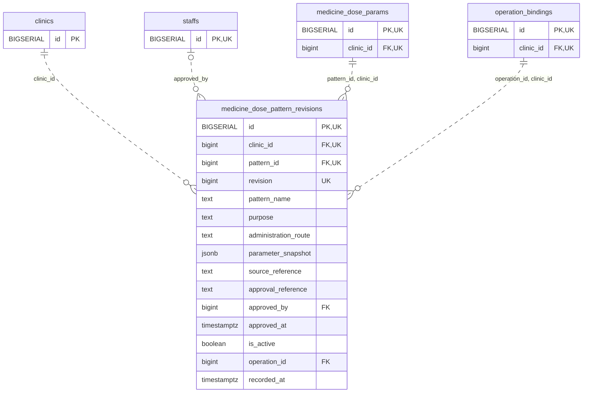

<!-- GENERATED: scripts/tools/generate-erd-detail.py; do not edit -->
# `medicine_dose_pattern_revisions`

[詳細ERD一覧](index.md) · [概要ERD](../erd.md)

このページは、マイグレーションをファイル名順に静的解析した最終定義です。稼働DBの状態は未確認です。

## カラム

型・DEFAULTはDDLの宣言表記です。`bigserial` は採番宣言であり、DBカタログ上の型名ではありません。

| カラム | 型（DDL） | NULL | DEFAULT（DDL） | キー構成列 | 定義元 |
|:---|:---|:---|:---|:---|:---|
| `id` | `BIGSERIAL` | NOT NULL | — | PK, UK | [001_init.sql:9133](../../../backend/migrations/001_init.sql#L9133) |
| `clinic_id` | `bigint` | NOT NULL | — | FK, UK | [001_init.sql:9134](../../../backend/migrations/001_init.sql#L9134) |
| `pattern_id` | `bigint` | NOT NULL | — | FK, UK | [001_init.sql:9135](../../../backend/migrations/001_init.sql#L9135) |
| `revision` | `bigint` | NOT NULL | — | UK | [001_init.sql:9136](../../../backend/migrations/001_init.sql#L9136) |
| `pattern_name` | `text` | NULL | — | — | [001_init.sql:9137](../../../backend/migrations/001_init.sql#L9137) |
| `purpose` | `text` | NULL | — | — | [001_init.sql:9138](../../../backend/migrations/001_init.sql#L9138) |
| `administration_route` | `text` | NULL | — | — | [001_init.sql:9139](../../../backend/migrations/001_init.sql#L9139) |
| `parameter_snapshot` | `jsonb` | NOT NULL | — | — | [001_init.sql:9140](../../../backend/migrations/001_init.sql#L9140) |
| `source_reference` | `text` | NULL | — | — | [001_init.sql:9141](../../../backend/migrations/001_init.sql#L9141) |
| `approval_reference` | `text` | NULL | — | — | [001_init.sql:9142](../../../backend/migrations/001_init.sql#L9142) |
| `approved_by` | `bigint` | NULL | — | FK | [001_init.sql:9143](../../../backend/migrations/001_init.sql#L9143) |
| `approved_at` | `timestamptz` | NULL | — | — | [001_init.sql:9144](../../../backend/migrations/001_init.sql#L9144) |
| `is_active` | `boolean` | NOT NULL | — | — | [001_init.sql:9145](../../../backend/migrations/001_init.sql#L9145) |
| `operation_id` | `bigint` | NOT NULL | — | FK | [001_init.sql:9146](../../../backend/migrations/001_init.sql#L9146) |
| `recorded_at` | `timestamptz` | NOT NULL | `clock_timestamp()` | — | [001_init.sql:9147](../../../backend/migrations/001_init.sql#L9147) |

PK/FK/UKはキーの構成列を示します。複合キーの各列が単独で一意という意味ではありません。部分uniqueは下記indexの述語を参照してください。

## ERD

このテーブルの全カラムと、すべての参照先を表示します。参照先はFKの対象列だけを表示し、全カラムは各テーブルのページに置きます。

親側の任意参照はFK列のNULL可否、子側の最大1件は無条件のPK/UNIQUEから導出します。部分uniqueによる条件付きの最大件数は図に反映せず、index一覧に記録します。実線はFK全列が子のPKに含まれる識別関係、破線はそれ以外です。

## 外部キー（全件）

| 制約 | 子の列（順序あり） | 参照先 | 親の列（順序あり） | 削除時の動作 | 定義元 |
|:---|:---|:---|:---|:---|:---|
| `medicine_dose_pattern_revisions_clinic_id_fkey` | `clinic_id` | [clinics](clinics.md) | `id` | `ON DELETE RESTRICT` | [001_init.sql:9134](../../../backend/migrations/001_init.sql#L9134) |
| `medicine_dose_pattern_revisions_approved_by_fkey` | `approved_by` | [staffs](staffs.md) | `id` | `ON DELETE RESTRICT` | [001_init.sql:9143](../../../backend/migrations/001_init.sql#L9143) |
| `medicine_dose_pattern_revisions_pattern_id_clinic_id_fkey` | `pattern_id, clinic_id` | [medicine_dose_params](medicine_dose_params.md) | `id, clinic_id` | `ON DELETE RESTRICT` | [001_init.sql:9151](../../../backend/migrations/001_init.sql#L9151) |
| `medicine_dose_pattern_revisions_operation_id_clinic_id_fkey` | `operation_id, clinic_id` | [operation_bindings](operation_bindings.md) | `id, clinic_id` | `ON DELETE RESTRICT` | [001_init.sql:9152](../../../backend/migrations/001_init.sql#L9152) |

正確なON UPDATE・MATCH・DEFERRABLE等を含む制約DDL:

- `medicine_dose_pattern_revisions_clinic_id_fkey`: `REFERENCES clinics(id) ON DELETE RESTRICT`
- `medicine_dose_pattern_revisions_approved_by_fkey`: `REFERENCES staffs(id) ON DELETE RESTRICT`
- `medicine_dose_pattern_revisions_pattern_id_clinic_id_fkey`: `FOREIGN KEY (pattern_id,clinic_id) REFERENCES medicine_dose_params(id,clinic_id) ON DELETE RESTRICT`
- `medicine_dose_pattern_revisions_operation_id_clinic_id_fkey`: `FOREIGN KEY (operation_id,clinic_id) REFERENCES operation_bindings(id,clinic_id) ON DELETE RESTRICT`

## その他の制約

| 制約 | 種別 | DDL | 定義元 |
|:---|:---|:---|:---|
| `medicine_dose_pattern_revisions_pkey` | primary | `PRIMARY KEY` | [001_init.sql:9133](../../../backend/migrations/001_init.sql#L9133) |
| `medicine_dose_pattern_revisions_revision_check` | check | `CHECK (revision > 0)` | [001_init.sql:9136](../../../backend/migrations/001_init.sql#L9136) |
| `medicine_dose_pattern_revisions_parameter_snapshot_check` | check | `CHECK (jsonb_typeof(parameter_snapshot)='object')` | [001_init.sql:9140](../../../backend/migrations/001_init.sql#L9140) |
| `medicine_dose_pattern_revisions_id_clinic_id_key` | unique | `UNIQUE (id,clinic_id)` | [001_init.sql:9148](../../../backend/migrations/001_init.sql#L9148) |
| `medicine_dose_pattern_revisio_clinic_id_pattern_id_revision_key` | unique | `UNIQUE (clinic_id,pattern_id,revision)` | [001_init.sql:9149](../../../backend/migrations/001_init.sql#L9149) |
| `medicine_dose_pattern_revisions_check` | check | `CHECK ((approved_by IS NULL AND approved_at IS NULL) OR (approved_by IS NOT NULL AND approved_at IS NOT NULL AND approval_reference IS NOT NULL))` | [001_init.sql:9150](../../../backend/migrations/001_init.sql#L9150) |

## インデックス

明示的なCREATE INDEXなし。PK/UNIQUEに付随する暗黙のindexは制約欄を参照してください。
