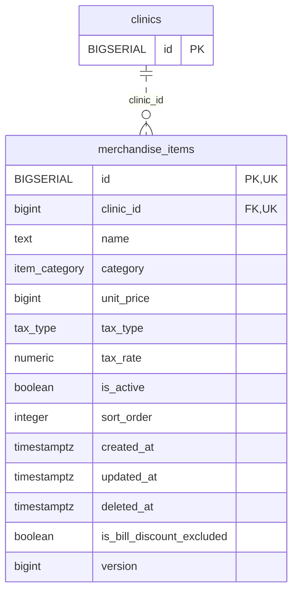

<!-- GENERATED: scripts/tools/generate-erd-detail.py; do not edit -->
# `merchandise_items`

[詳細ERD一覧](index.md) · [概要ERD](../erd.md)

このページは、マイグレーションをファイル名順に静的解析した最終定義です。稼働DBの状態は未確認です。

## カラム

型・DEFAULTはDDLの宣言表記です。`bigserial` は採番宣言であり、DBカタログ上の型名ではありません。

| カラム | 型（DDL） | NULL | DEFAULT（DDL） | キー構成列 | 定義元 |
|:---|:---|:---|:---|:---|:---|
| `id` | `BIGSERIAL` | NOT NULL | — | PK, UK | [001_init.sql:1830](../../../backend/migrations/001_init.sql#L1830) |
| `clinic_id` | `bigint` | NOT NULL | — | FK, UK | [001_init.sql:1831](../../../backend/migrations/001_init.sql#L1831) |
| `name` | `text` | NOT NULL | `''` | — | [001_init.sql:1832](../../../backend/migrations/001_init.sql#L1832) |
| `category` | `item_category` | NOT NULL | `'goods'` | — | [001_init.sql:1833](../../../backend/migrations/001_init.sql#L1833) |
| `unit_price` | `bigint` | NOT NULL | `0` | — | [001_init.sql:1834](../../../backend/migrations/001_init.sql#L1834) |
| `tax_type` | `tax_type` | NOT NULL | `'excluded'` | — | [001_init.sql:1835](../../../backend/migrations/001_init.sql#L1835) |
| `tax_rate` | `numeric` | NOT NULL | `0.10` | — | [001_init.sql:1836](../../../backend/migrations/001_init.sql#L1836) |
| `is_active` | `boolean` | NOT NULL | `true` | — | [001_init.sql:1837](../../../backend/migrations/001_init.sql#L1837) |
| `sort_order` | `integer` | NOT NULL | `0` | — | [001_init.sql:1838](../../../backend/migrations/001_init.sql#L1838) |
| `created_at` | `timestamptz` | NOT NULL | `now()` | — | [001_init.sql:1839](../../../backend/migrations/001_init.sql#L1839) |
| `updated_at` | `timestamptz` | NOT NULL | `now()` | — | [001_init.sql:1840](../../../backend/migrations/001_init.sql#L1840) |
| `deleted_at` | `timestamptz` | NULL | — | — | [001_init.sql:1841](../../../backend/migrations/001_init.sql#L1841) |
| `is_bill_discount_excluded` | `boolean` | NULL | — | — | [001_init.sql:11628](../../../backend/migrations/001_init.sql#L11628) |
| `version` | `bigint` | NOT NULL | `1` | — | [001_init.sql:11644](../../../backend/migrations/001_init.sql#L11644) |

PK/FK/UKはキーの構成列を示します。複合キーの各列が単独で一意という意味ではありません。部分uniqueは下記indexの述語を参照してください。

## ERD

このテーブルの全カラムと、すべての参照先を表示します。参照先はFKの対象列だけを表示し、全カラムは各テーブルのページに置きます。

親側の任意参照はFK列のNULL可否、子側の最大1件は無条件のPK/UNIQUEから導出します。部分uniqueによる条件付きの最大件数は図に反映せず、index一覧に記録します。実線はFK全列が子のPKに含まれる識別関係、破線はそれ以外です。

## 外部キー（全件）

| 制約 | 子の列（順序あり） | 参照先 | 親の列（順序あり） | 削除時の動作 | 定義元 |
|:---|:---|:---|:---|:---|:---|
| `merchandise_items_clinic_id_fkey` | `clinic_id` | [clinics](clinics.md) | `id` | `ON DELETE RESTRICT` | [001_init.sql:1831](../../../backend/migrations/001_init.sql#L1831) |

正確なON UPDATE・MATCH・DEFERRABLE等を含む制約DDL:

- `merchandise_items_clinic_id_fkey`: `REFERENCES clinics(id) ON DELETE RESTRICT`

## その他の制約

| 制約 | 種別 | DDL | 定義元 |
|:---|:---|:---|:---|
| `merchandise_items_pkey` | primary | `PRIMARY KEY` | [001_init.sql:1830](../../../backend/migrations/001_init.sql#L1830) |
| `uq_merchandise_items_id_clinic` | unique | `CONSTRAINT uq_merchandise_items_id_clinic UNIQUE (id, clinic_id)` | [001_init.sql:11227](../../../backend/migrations/001_init.sql#L11227) |
| `ck_merchandise_items_positive_version` | check | `CONSTRAINT ck_merchandise_items_positive_version CHECK (version > 0)` | [001_init.sql:11645](../../../backend/migrations/001_init.sql#L11645) |

## インデックス

| 名前 | UNIQUE | 述語 | DDL | 定義元 |
|:---|:---|:---|:---|:---|
| `idx_merchandise_items_clinic` | NO | `deleted_at IS NULL` | `CREATE INDEX idx_merchandise_items_clinic ON merchandise_items(clinic_id) WHERE deleted_at IS NULL` | [001_init.sql:2270](../../../backend/migrations/001_init.sql#L2270) |
| `idx_merchandise_items_category` | NO | `deleted_at IS NULL` | `CREATE INDEX idx_merchandise_items_category ON merchandise_items(clinic_id, category) WHERE deleted_at IS NULL` | [001_init.sql:2271](../../../backend/migrations/001_init.sql#L2271) |
| `idx_merchandise_items_sort` | NO | — | `CREATE INDEX idx_merchandise_items_sort ON merchandise_items(clinic_id, sort_order)` | [001_init.sql:2272](../../../backend/migrations/001_init.sql#L2272) |
| `idx_merchandise_items_clinic_name` | YES | `is_active = true AND deleted_at IS NULL` | `CREATE UNIQUE INDEX idx_merchandise_items_clinic_name ON merchandise_items(clinic_id, name) WHERE is_active = true AND deleted_at IS NULL` | [001_init.sql:2488](../../../backend/migrations/001_init.sql#L2488) |
