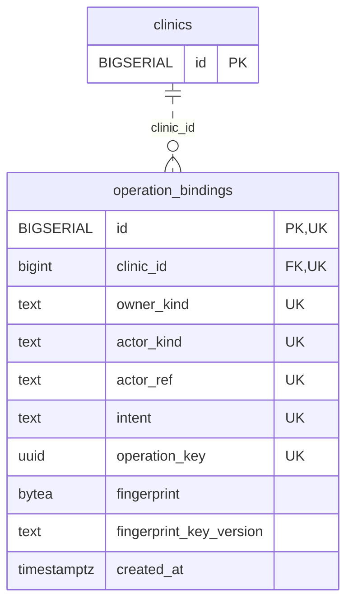

<!-- GENERATED: scripts/tools/generate-erd-detail.py; do not edit -->
# `operation_bindings`

[詳細ERD一覧](index.md) · [概要ERD](../erd.md)

このページは、マイグレーションをファイル名順に静的解析した最終定義です。稼働DBの状態は未確認です。

## カラム

型・DEFAULTはDDLの宣言表記です。`bigserial` は採番宣言であり、DBカタログ上の型名ではありません。

| カラム | 型（DDL） | NULL | DEFAULT（DDL） | キー構成列 | 定義元 |
|:---|:---|:---|:---|:---|:---|
| `id` | `BIGSERIAL` | NOT NULL | — | PK, UK | [001_init.sql:8863](../../../backend/migrations/001_init.sql#L8863) |
| `clinic_id` | `bigint` | NOT NULL | — | FK, UK | [001_init.sql:8864](../../../backend/migrations/001_init.sql#L8864) |
| `owner_kind` | `text` | NOT NULL | — | UK | [001_init.sql:8865](../../../backend/migrations/001_init.sql#L8865) |
| `actor_kind` | `text` | NOT NULL | — | UK | [001_init.sql:8866](../../../backend/migrations/001_init.sql#L8866) |
| `actor_ref` | `text` | NOT NULL | — | UK | [001_init.sql:8867](../../../backend/migrations/001_init.sql#L8867) |
| `intent` | `text` | NOT NULL | — | UK | [001_init.sql:8868](../../../backend/migrations/001_init.sql#L8868) |
| `operation_key` | `uuid` | NOT NULL | — | UK | [001_init.sql:8869](../../../backend/migrations/001_init.sql#L8869) |
| `fingerprint` | `bytea` | NOT NULL | — | — | [001_init.sql:8870](../../../backend/migrations/001_init.sql#L8870) |
| `fingerprint_key_version` | `text` | NOT NULL | — | — | [001_init.sql:8871](../../../backend/migrations/001_init.sql#L8871) |
| `created_at` | `timestamptz` | NOT NULL | `clock_timestamp()` | — | [001_init.sql:8872](../../../backend/migrations/001_init.sql#L8872) |

PK/FK/UKはキーの構成列を示します。複合キーの各列が単独で一意という意味ではありません。部分uniqueは下記indexの述語を参照してください。

## ERD

このテーブルの全カラムと、すべての参照先を表示します。参照先はFKの対象列だけを表示し、全カラムは各テーブルのページに置きます。

親側の任意参照はFK列のNULL可否、子側の最大1件は無条件のPK/UNIQUEから導出します。部分uniqueによる条件付きの最大件数は図に反映せず、index一覧に記録します。実線はFK全列が子のPKに含まれる識別関係、破線はそれ以外です。

## 外部キー（全件）

| 制約 | 子の列（順序あり） | 参照先 | 親の列（順序あり） | 削除時の動作 | 定義元 |
|:---|:---|:---|:---|:---|:---|
| `operation_bindings_clinic_id_fkey` | `clinic_id` | [clinics](clinics.md) | `id` | `ON DELETE RESTRICT` | [001_init.sql:8864](../../../backend/migrations/001_init.sql#L8864) |

正確なON UPDATE・MATCH・DEFERRABLE等を含む制約DDL:

- `operation_bindings_clinic_id_fkey`: `REFERENCES clinics(id) ON DELETE RESTRICT`

## その他の制約

| 制約 | 種別 | DDL | 定義元 |
|:---|:---|:---|:---|
| `operation_bindings_pkey` | primary | `PRIMARY KEY` | [001_init.sql:8863](../../../backend/migrations/001_init.sql#L8863) |
| `operation_bindings_owner_kind_check` | check | `CHECK (btrim(owner_kind)<>'')` | [001_init.sql:8865](../../../backend/migrations/001_init.sql#L8865) |
| `operation_bindings_actor_kind_check` | check | `CHECK (actor_kind IN ('staff','customer','system'))` | [001_init.sql:8866](../../../backend/migrations/001_init.sql#L8866) |
| `operation_bindings_actor_ref_check` | check | `CHECK (btrim(actor_ref)<>'')` | [001_init.sql:8867](../../../backend/migrations/001_init.sql#L8867) |
| `operation_bindings_intent_check` | check | `CHECK (btrim(intent)<>'')` | [001_init.sql:8868](../../../backend/migrations/001_init.sql#L8868) |
| `operation_bindings_fingerprint_check` | check | `CHECK (octet_length(fingerprint)=32)` | [001_init.sql:8870](../../../backend/migrations/001_init.sql#L8870) |
| `operation_bindings_fingerprint_key_version_check` | check | `CHECK (btrim(fingerprint_key_version)<>'')` | [001_init.sql:8871](../../../backend/migrations/001_init.sql#L8871) |
| `operation_bindings_id_clinic_id_key` | unique | `UNIQUE (id,clinic_id)` | [001_init.sql:8873](../../../backend/migrations/001_init.sql#L8873) |
| `operation_bindings_clinic_id_owner_kind_actor_kind_actor_re_key` | unique | `UNIQUE (clinic_id,owner_kind,actor_kind,actor_ref,intent,operation_key)` | [001_init.sql:8874](../../../backend/migrations/001_init.sql#L8874) |

## インデックス

明示的なCREATE INDEXなし。PK/UNIQUEに付随する暗黙のindexは制約欄を参照してください。
