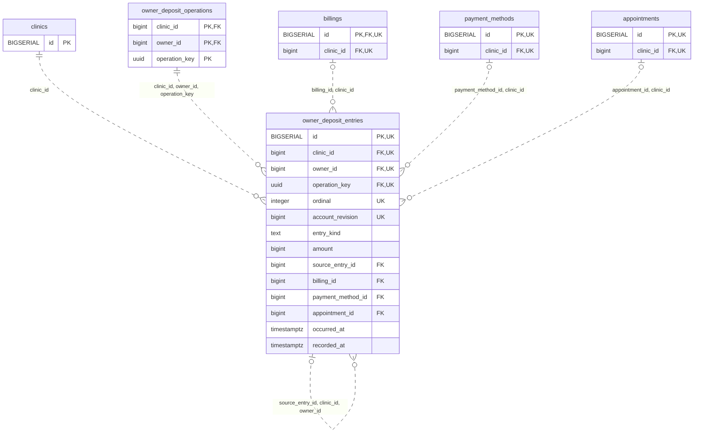

<!-- GENERATED: scripts/tools/generate-erd-detail.py; do not edit -->
# `owner_deposit_entries`

[詳細ERD一覧](index.md) · [概要ERD](../erd.md)

このページは、マイグレーションをファイル名順に静的解析した最終定義です。稼働DBの状態は未確認です。

## カラム

型・DEFAULTはDDLの宣言表記です。`bigserial` は採番宣言であり、DBカタログ上の型名ではありません。

| カラム | 型（DDL） | NULL | DEFAULT（DDL） | キー構成列 | 定義元 |
|:---|:---|:---|:---|:---|:---|
| `id` | `BIGSERIAL` | NOT NULL | — | PK, UK | [001_init.sql:8425](../../../backend/migrations/001_init.sql#L8425) |
| `clinic_id` | `bigint` | NOT NULL | — | FK, UK | [001_init.sql:8426](../../../backend/migrations/001_init.sql#L8426) |
| `owner_id` | `bigint` | NOT NULL | — | FK, UK | [001_init.sql:8427](../../../backend/migrations/001_init.sql#L8427) |
| `operation_key` | `uuid` | NOT NULL | — | FK, UK | [001_init.sql:8428](../../../backend/migrations/001_init.sql#L8428) |
| `ordinal` | `integer` | NOT NULL | — | UK | [001_init.sql:8429](../../../backend/migrations/001_init.sql#L8429) |
| `account_revision` | `bigint` | NOT NULL | — | UK | [001_init.sql:8430](../../../backend/migrations/001_init.sql#L8430) |
| `entry_kind` | `text` | NOT NULL | — | — | [001_init.sql:8431](../../../backend/migrations/001_init.sql#L8431) |
| `amount` | `bigint` | NOT NULL | — | — | [001_init.sql:8432](../../../backend/migrations/001_init.sql#L8432) |
| `source_entry_id` | `bigint` | NULL | — | FK | [001_init.sql:8433](../../../backend/migrations/001_init.sql#L8433) |
| `billing_id` | `bigint` | NULL | — | FK | [001_init.sql:8434](../../../backend/migrations/001_init.sql#L8434) |
| `payment_method_id` | `bigint` | NULL | — | FK | [001_init.sql:8435](../../../backend/migrations/001_init.sql#L8435) |
| `appointment_id` | `bigint` | NULL | — | FK | [001_init.sql:8436](../../../backend/migrations/001_init.sql#L8436) |
| `occurred_at` | `timestamptz` | NOT NULL | — | — | [001_init.sql:8437](../../../backend/migrations/001_init.sql#L8437) |
| `recorded_at` | `timestamptz` | NOT NULL | `clock_timestamp()` | — | [001_init.sql:8438](../../../backend/migrations/001_init.sql#L8438) |

PK/FK/UKはキーの構成列を示します。複合キーの各列が単独で一意という意味ではありません。部分uniqueは下記indexの述語を参照してください。

## ERD

このテーブルの全カラムと、すべての参照先を表示します。参照先はFKの対象列だけを表示し、全カラムは各テーブルのページに置きます。

親側の任意参照はFK列のNULL可否、子側の最大1件は無条件のPK/UNIQUEから導出します。部分uniqueによる条件付きの最大件数は図に反映せず、index一覧に記録します。実線はFK全列が子のPKに含まれる識別関係、破線はそれ以外です。

## 外部キー（全件）

| 制約 | 子の列（順序あり） | 参照先 | 親の列（順序あり） | 削除時の動作 | 定義元 |
|:---|:---|:---|:---|:---|:---|
| `owner_deposit_entries_clinic_id_fkey` | `clinic_id` | [clinics](clinics.md) | `id` | `ON DELETE RESTRICT` | [001_init.sql:8426](../../../backend/migrations/001_init.sql#L8426) |
| `owner_deposit_entries_clinic_id_owner_id_operation_key_fkey` | `clinic_id, owner_id, operation_key` | [owner_deposit_operations](owner_deposit_operations.md) | `clinic_id, owner_id, operation_key` | `ON DELETE RESTRICT` | [001_init.sql:8446](../../../backend/migrations/001_init.sql#L8446) |
| `owner_deposit_entries_source_entry_id_clinic_id_owner_id_fkey` | `source_entry_id, clinic_id, owner_id` | [owner_deposit_entries](owner_deposit_entries.md) | `id, clinic_id, owner_id` | `ON DELETE RESTRICT` | [001_init.sql:8447](../../../backend/migrations/001_init.sql#L8447) |
| `owner_deposit_entries_billing_id_clinic_id_fkey` | `billing_id, clinic_id` | [billings](billings.md) | `id, clinic_id` | `ON DELETE RESTRICT` | [001_init.sql:8448](../../../backend/migrations/001_init.sql#L8448) |
| `owner_deposit_entries_payment_method_id_clinic_id_fkey` | `payment_method_id, clinic_id` | [payment_methods](payment_methods.md) | `id, clinic_id` | `ON DELETE RESTRICT` | [001_init.sql:8449](../../../backend/migrations/001_init.sql#L8449) |
| `owner_deposit_entries_appointment_id_clinic_id_fkey` | `appointment_id, clinic_id` | [appointments](appointments.md) | `id, clinic_id` | `ON DELETE RESTRICT` | [001_init.sql:8450](../../../backend/migrations/001_init.sql#L8450) |

正確なON UPDATE・MATCH・DEFERRABLE等を含む制約DDL:

- `owner_deposit_entries_clinic_id_fkey`: `REFERENCES clinics(id) ON DELETE RESTRICT`
- `owner_deposit_entries_clinic_id_owner_id_operation_key_fkey`: `FOREIGN KEY (clinic_id,owner_id,operation_key) REFERENCES owner_deposit_operations(clinic_id,owner_id,operation_key) ON DELETE RESTRICT`
- `owner_deposit_entries_source_entry_id_clinic_id_owner_id_fkey`: `FOREIGN KEY (source_entry_id,clinic_id,owner_id) REFERENCES owner_deposit_entries(id,clinic_id,owner_id) ON DELETE RESTRICT`
- `owner_deposit_entries_billing_id_clinic_id_fkey`: `FOREIGN KEY (billing_id,clinic_id) REFERENCES billings(id,clinic_id) ON DELETE RESTRICT`
- `owner_deposit_entries_payment_method_id_clinic_id_fkey`: `FOREIGN KEY (payment_method_id,clinic_id) REFERENCES payment_methods(id,clinic_id) ON DELETE RESTRICT`
- `owner_deposit_entries_appointment_id_clinic_id_fkey`: `FOREIGN KEY (appointment_id,clinic_id) REFERENCES appointments(id,clinic_id) ON DELETE RESTRICT`

## その他の制約

| 制約 | 種別 | DDL | 定義元 |
|:---|:---|:---|:---|
| `owner_deposit_entries_pkey` | primary | `PRIMARY KEY` | [001_init.sql:8425](../../../backend/migrations/001_init.sql#L8425) |
| `owner_deposit_entries_ordinal_check` | check | `CHECK (ordinal > 0)` | [001_init.sql:8429](../../../backend/migrations/001_init.sql#L8429) |
| `owner_deposit_entries_account_revision_check` | check | `CHECK (account_revision > 1)` | [001_init.sql:8430](../../../backend/migrations/001_init.sql#L8430) |
| `owner_deposit_entries_entry_kind_check` | check | `CHECK (entry_kind IN ('receive','apply','release','refund'))` | [001_init.sql:8431](../../../backend/migrations/001_init.sql#L8431) |
| `owner_deposit_entries_amount_check` | check | `CHECK (amount > 0)` | [001_init.sql:8432](../../../backend/migrations/001_init.sql#L8432) |
| `owner_deposit_entries_id_clinic_id_owner_id_key` | unique | `UNIQUE (id,clinic_id,owner_id)` | [001_init.sql:8439](../../../backend/migrations/001_init.sql#L8439) |
| `owner_deposit_entries_clinic_id_owner_id_operation_key_ordi_key` | unique | `UNIQUE (clinic_id,owner_id,operation_key,ordinal)` | [001_init.sql:8440](../../../backend/migrations/001_init.sql#L8440) |
| `owner_deposit_entries_clinic_id_owner_id_account_revision_key` | unique | `UNIQUE (clinic_id,owner_id,account_revision)` | [001_init.sql:8441](../../../backend/migrations/001_init.sql#L8441) |
| `owner_deposit_entries_check` | check | `CHECK ((entry_kind='receive' AND source_entry_id IS NULL AND billing_id IS NULL AND payment_method_id IS NOT NULL)         OR (entry_kind='apply' AND source_entry_id IS NOT NULL AND billing_id IS NOT NULL AND payment_method_id IS NULL AND appointment_id IS NULL)         OR (entry_kind='release' AND source_entry_id IS NOT NULL AND billing_id IS NOT NULL AND payment_method_id IS NULL AND appointment_id IS NULL)         OR (entry_kind='refund' AND source_entry_id IS NOT NULL AND billing_id IS NULL AND payment_method_id IS NOT NULL AND appointment_id IS NULL))` | [001_init.sql:8442](../../../backend/migrations/001_init.sql#L8442) |
| `uq_deposit_entry_id_clinic` | unique | `CONSTRAINT uq_deposit_entry_id_clinic UNIQUE(id,clinic_id)` | [001_init.sql:10104](../../../backend/migrations/001_init.sql#L10104) |

## インデックス

| 名前 | UNIQUE | 述語 | DDL | 定義元 |
|:---|:---|:---|:---|:---|
| `idx_deposit_entries_source` | NO | — | `CREATE INDEX idx_deposit_entries_source ON owner_deposit_entries(clinic_id,owner_id,source_entry_id)` | [001_init.sql:8452](../../../backend/migrations/001_init.sql#L8452) |
| `idx_deposit_entries_billing` | NO | `billing_id IS NOT NULL` | `CREATE INDEX idx_deposit_entries_billing ON owner_deposit_entries(clinic_id,billing_id,id) WHERE billing_id IS NOT NULL` | [001_init.sql:8453](../../../backend/migrations/001_init.sql#L8453) |
