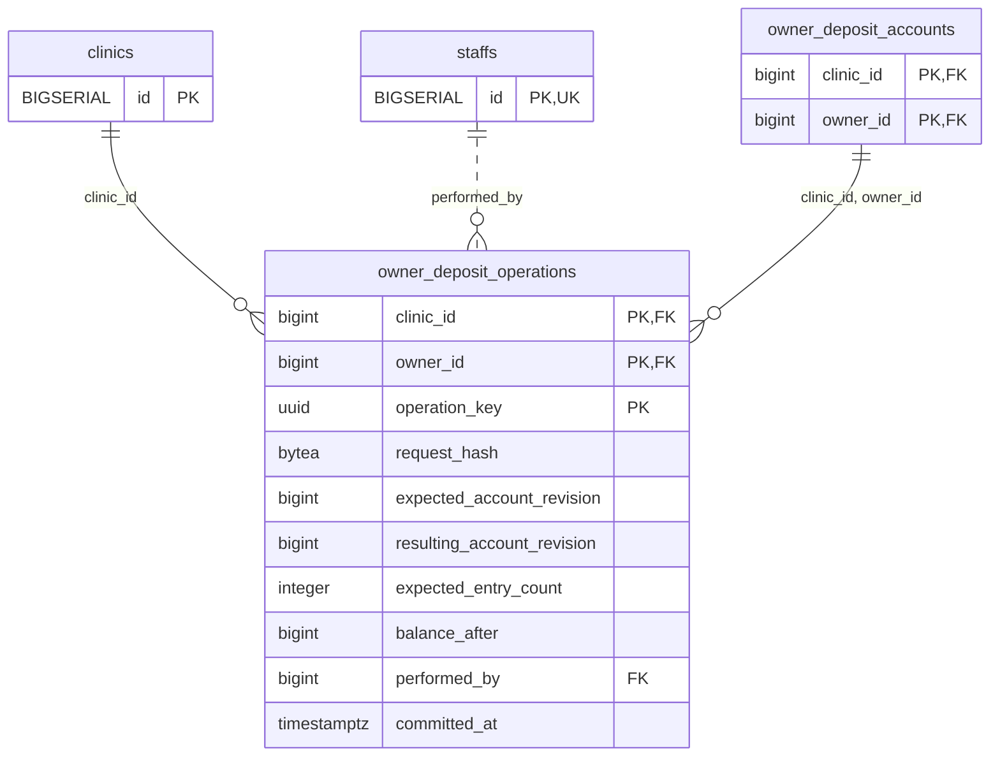

<!-- GENERATED: scripts/tools/generate-erd-detail.py; do not edit -->
# `owner_deposit_operations`

[詳細ERD一覧](index.md) · [概要ERD](../erd.md)

このページは、マイグレーションをファイル名順に静的解析した最終定義です。稼働DBの状態は未確認です。

## カラム

型・DEFAULTはDDLの宣言表記です。`bigserial` は採番宣言であり、DBカタログ上の型名ではありません。

| カラム | 型（DDL） | NULL | DEFAULT（DDL） | キー構成列 | 定義元 |
|:---|:---|:---|:---|:---|:---|
| `clinic_id` | `bigint` | NOT NULL | — | PK, FK | [001_init.sql:8422](../../../backend/migrations/001_init.sql#L8422) |
| `owner_id` | `bigint` | NOT NULL | — | PK, FK | [001_init.sql:8423](../../../backend/migrations/001_init.sql#L8423) |
| `operation_key` | `uuid` | NOT NULL | — | PK | [001_init.sql:8424](../../../backend/migrations/001_init.sql#L8424) |
| `request_hash` | `bytea` | NOT NULL | — | — | [001_init.sql:8425](../../../backend/migrations/001_init.sql#L8425) |
| `expected_account_revision` | `bigint` | NOT NULL | — | — | [001_init.sql:8426](../../../backend/migrations/001_init.sql#L8426) |
| `resulting_account_revision` | `bigint` | NOT NULL | — | — | [001_init.sql:8427](../../../backend/migrations/001_init.sql#L8427) |
| `expected_entry_count` | `integer` | NOT NULL | — | — | [001_init.sql:8428](../../../backend/migrations/001_init.sql#L8428) |
| `balance_after` | `bigint` | NOT NULL | — | — | [001_init.sql:8429](../../../backend/migrations/001_init.sql#L8429) |
| `performed_by` | `bigint` | NOT NULL | — | FK | [001_init.sql:8430](../../../backend/migrations/001_init.sql#L8430) |
| `committed_at` | `timestamptz` | NOT NULL | `clock_timestamp()` | — | [001_init.sql:8431](../../../backend/migrations/001_init.sql#L8431) |

PK/FK/UKはキーの構成列を示します。複合キーの各列が単独で一意という意味ではありません。部分uniqueは下記indexの述語を参照してください。

## ERD

このテーブルの全カラムと、すべての参照先を表示します。参照先はFKの対象列だけを表示し、全カラムは各テーブルのページに置きます。

親側の任意参照はFK列のNULL可否、子側の最大1件は無条件のPK/UNIQUEから導出します。部分uniqueによる条件付きの最大件数は図に反映せず、index一覧に記録します。実線はFK全列が子のPKに含まれる識別関係、破線はそれ以外です。

## 外部キー（全件）

| 制約 | 子の列（順序あり） | 参照先 | 親の列（順序あり） | 削除時の動作 | 定義元 |
|:---|:---|:---|:---|:---|:---|
| `owner_deposit_operations_clinic_id_fkey` | `clinic_id` | [clinics](clinics.md) | `id` | `ON DELETE RESTRICT` | [001_init.sql:8422](../../../backend/migrations/001_init.sql#L8422) |
| `owner_deposit_operations_performed_by_fkey` | `performed_by` | [staffs](staffs.md) | `id` | `ON DELETE RESTRICT` | [001_init.sql:8430](../../../backend/migrations/001_init.sql#L8430) |
| `owner_deposit_operations_clinic_id_owner_id_fkey` | `clinic_id, owner_id` | [owner_deposit_accounts](owner_deposit_accounts.md) | `clinic_id, owner_id` | `ON DELETE RESTRICT` | [001_init.sql:8434](../../../backend/migrations/001_init.sql#L8434) |

正確なON UPDATE・MATCH・DEFERRABLE等を含む制約DDL:

- `owner_deposit_operations_clinic_id_fkey`: `REFERENCES clinics(id) ON DELETE RESTRICT`
- `owner_deposit_operations_performed_by_fkey`: `REFERENCES staffs(id) ON DELETE RESTRICT`
- `owner_deposit_operations_clinic_id_owner_id_fkey`: `FOREIGN KEY (clinic_id,owner_id) REFERENCES owner_deposit_accounts(clinic_id,owner_id) ON DELETE RESTRICT`

## その他の制約

| 制約 | 種別 | DDL | 定義元 |
|:---|:---|:---|:---|
| `owner_deposit_operations_request_hash_check` | check | `CHECK (octet_length(request_hash)=32)` | [001_init.sql:8425](../../../backend/migrations/001_init.sql#L8425) |
| `owner_deposit_operations_expected_account_revision_check` | check | `CHECK (expected_account_revision > 0)` | [001_init.sql:8426](../../../backend/migrations/001_init.sql#L8426) |
| `owner_deposit_operations_check` | check | `CHECK (resulting_account_revision > expected_account_revision)` | [001_init.sql:8427](../../../backend/migrations/001_init.sql#L8427) |
| `owner_deposit_operations_expected_entry_count_check` | check | `CHECK (expected_entry_count > 0)` | [001_init.sql:8428](../../../backend/migrations/001_init.sql#L8428) |
| `owner_deposit_operations_balance_after_check` | check | `CHECK (balance_after >= 0)` | [001_init.sql:8429](../../../backend/migrations/001_init.sql#L8429) |
| `owner_deposit_operations_pkey` | primary | `PRIMARY KEY (clinic_id,owner_id,operation_key)` | [001_init.sql:8432](../../../backend/migrations/001_init.sql#L8432) |
| `owner_deposit_operations_check1` | check | `CHECK (resulting_account_revision=expected_account_revision+expected_entry_count)` | [001_init.sql:8433](../../../backend/migrations/001_init.sql#L8433) |

## インデックス

明示的なCREATE INDEXなし。PK/UNIQUEに付随する暗黙のindexは制約欄を参照してください。
