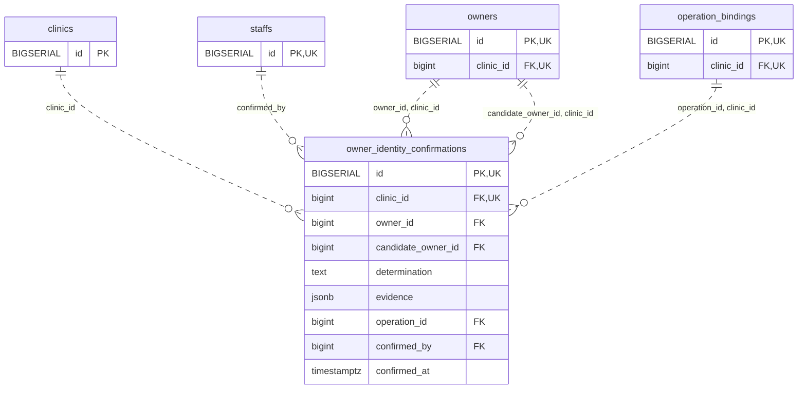

<!-- GENERATED: scripts/tools/generate-erd-detail.py; do not edit -->
# `owner_identity_confirmations`

[詳細ERD一覧](index.md) · [概要ERD](../erd.md)

このページは、マイグレーションをファイル名順に静的解析した最終定義です。稼働DBの状態は未確認です。

## カラム

型・DEFAULTはDDLの宣言表記です。`bigserial` は採番宣言であり、DBカタログ上の型名ではありません。

| カラム | 型（DDL） | NULL | DEFAULT（DDL） | キー構成列 | 定義元 |
|:---|:---|:---|:---|:---|:---|
| `id` | `BIGSERIAL` | NOT NULL | — | PK, UK | [001_init.sql:10387](../../../backend/migrations/001_init.sql#L10387) |
| `clinic_id` | `bigint` | NOT NULL | — | FK, UK | [001_init.sql:10387](../../../backend/migrations/001_init.sql#L10387) |
| `owner_id` | `bigint` | NOT NULL | — | FK | [001_init.sql:10388](../../../backend/migrations/001_init.sql#L10388) |
| `candidate_owner_id` | `bigint` | NOT NULL | — | FK | [001_init.sql:10388](../../../backend/migrations/001_init.sql#L10388) |
| `determination` | `text` | NOT NULL | — | — | [001_init.sql:10388](../../../backend/migrations/001_init.sql#L10388) |
| `evidence` | `jsonb` | NOT NULL | — | — | [001_init.sql:10389](../../../backend/migrations/001_init.sql#L10389) |
| `operation_id` | `bigint` | NOT NULL | — | FK | [001_init.sql:10389](../../../backend/migrations/001_init.sql#L10389) |
| `confirmed_by` | `bigint` | NOT NULL | — | FK | [001_init.sql:10390](../../../backend/migrations/001_init.sql#L10390) |
| `confirmed_at` | `timestamptz` | NOT NULL | — | — | [001_init.sql:10390](../../../backend/migrations/001_init.sql#L10390) |

PK/FK/UKはキーの構成列を示します。複合キーの各列が単独で一意という意味ではありません。部分uniqueは下記indexの述語を参照してください。

## ERD

このテーブルの全カラムと、すべての参照先を表示します。参照先はFKの対象列だけを表示し、全カラムは各テーブルのページに置きます。

親側の任意参照はFK列のNULL可否、子側の最大1件は無条件のPK/UNIQUEから導出します。部分uniqueによる条件付きの最大件数は図に反映せず、index一覧に記録します。実線はFK全列が子のPKに含まれる識別関係、破線はそれ以外です。

## 外部キー（全件）

| 制約 | 子の列（順序あり） | 参照先 | 親の列（順序あり） | 削除時の動作 | 定義元 |
|:---|:---|:---|:---|:---|:---|
| `owner_identity_confirmations_clinic_id_fkey` | `clinic_id` | [clinics](clinics.md) | `id` | `ON DELETE RESTRICT` | [001_init.sql:10387](../../../backend/migrations/001_init.sql#L10387) |
| `owner_identity_confirmations_confirmed_by_fkey` | `confirmed_by` | [staffs](staffs.md) | `id` | `ON DELETE RESTRICT` | [001_init.sql:10390](../../../backend/migrations/001_init.sql#L10390) |
| `owner_identity_confirmations_owner_id_clinic_id_fkey` | `owner_id, clinic_id` | [owners](owners.md) | `id, clinic_id` | `ON DELETE RESTRICT` | [001_init.sql:10392](../../../backend/migrations/001_init.sql#L10392) |
| `owner_identity_confirmations_candidate_owner_id_clinic_id_fkey` | `candidate_owner_id, clinic_id` | [owners](owners.md) | `id, clinic_id` | `ON DELETE RESTRICT` | [001_init.sql:10393](../../../backend/migrations/001_init.sql#L10393) |
| `owner_identity_confirmations_operation_id_clinic_id_fkey` | `operation_id, clinic_id` | [operation_bindings](operation_bindings.md) | `id, clinic_id` | `ON DELETE RESTRICT` | [001_init.sql:10394](../../../backend/migrations/001_init.sql#L10394) |

正確なON UPDATE・MATCH・DEFERRABLE等を含む制約DDL:

- `owner_identity_confirmations_clinic_id_fkey`: `REFERENCES clinics(id) ON DELETE RESTRICT`
- `owner_identity_confirmations_confirmed_by_fkey`: `REFERENCES staffs(id) ON DELETE RESTRICT`
- `owner_identity_confirmations_owner_id_clinic_id_fkey`: `FOREIGN KEY(owner_id,clinic_id) REFERENCES owners(id,clinic_id) ON DELETE RESTRICT`
- `owner_identity_confirmations_candidate_owner_id_clinic_id_fkey`: `FOREIGN KEY(candidate_owner_id,clinic_id) REFERENCES owners(id,clinic_id) ON DELETE RESTRICT`
- `owner_identity_confirmations_operation_id_clinic_id_fkey`: `FOREIGN KEY(operation_id,clinic_id) REFERENCES operation_bindings(id,clinic_id) ON DELETE RESTRICT`

## その他の制約

| 制約 | 種別 | DDL | 定義元 |
|:---|:---|:---|:---|
| `owner_identity_confirmations_pkey` | primary | `PRIMARY KEY` | [001_init.sql:10387](../../../backend/migrations/001_init.sql#L10387) |
| `owner_identity_confirmations_determination_check` | check | `CHECK(determination IN('same_person','different_people'))` | [001_init.sql:10388](../../../backend/migrations/001_init.sql#L10388) |
| `owner_identity_confirmations_evidence_check` | check | `CHECK(jsonb_typeof(evidence)='object')` | [001_init.sql:10389](../../../backend/migrations/001_init.sql#L10389) |
| `owner_identity_confirmations_check` | check | `CHECK(owner_id<>candidate_owner_id)` | [001_init.sql:10391](../../../backend/migrations/001_init.sql#L10391) |
| `owner_identity_confirmations_id_clinic_id_key` | unique | `UNIQUE(id,clinic_id)` | [001_init.sql:10391](../../../backend/migrations/001_init.sql#L10391) |

## インデックス

明示的なCREATE INDEXなし。PK/UNIQUEに付随する暗黙のindexは制約欄を参照してください。
