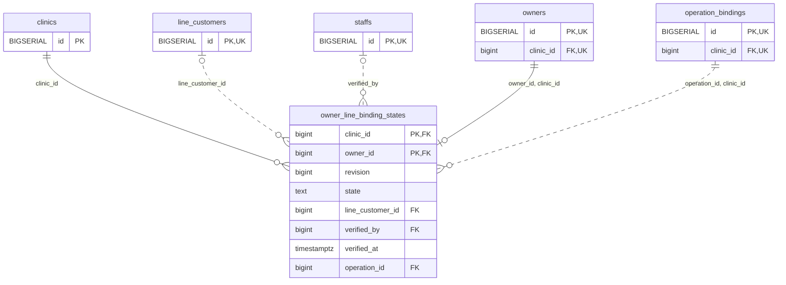

<!-- GENERATED: scripts/tools/generate-erd-detail.py; do not edit -->
# `owner_line_binding_states`

[詳細ERD一覧](index.md) · [概要ERD](../erd.md)

このページは、マイグレーションをファイル名順に静的解析した最終定義です。稼働DBの状態は未確認です。

## カラム

型・DEFAULTはDDLの宣言表記です。`bigserial` は採番宣言であり、DBカタログ上の型名ではありません。

| カラム | 型（DDL） | NULL | DEFAULT（DDL） | キー構成列 | 定義元 |
|:---|:---|:---|:---|:---|:---|
| `clinic_id` | `bigint` | NOT NULL | — | PK, FK | [001_init.sql:10137](../../../backend/migrations/001_init.sql#L10137) |
| `owner_id` | `bigint` | NOT NULL | — | PK, FK | [001_init.sql:10137](../../../backend/migrations/001_init.sql#L10137) |
| `revision` | `bigint` | NOT NULL | `1` | — | [001_init.sql:10138](../../../backend/migrations/001_init.sql#L10138) |
| `state` | `text` | NOT NULL | — | — | [001_init.sql:10138](../../../backend/migrations/001_init.sql#L10138) |
| `line_customer_id` | `bigint` | NULL | — | FK | [001_init.sql:10139](../../../backend/migrations/001_init.sql#L10139) |
| `verified_by` | `bigint` | NULL | — | FK | [001_init.sql:10140](../../../backend/migrations/001_init.sql#L10140) |
| `verified_at` | `timestamptz` | NULL | — | — | [001_init.sql:10140](../../../backend/migrations/001_init.sql#L10140) |
| `operation_id` | `bigint` | NOT NULL | — | FK | [001_init.sql:10141](../../../backend/migrations/001_init.sql#L10141) |

PK/FK/UKはキーの構成列を示します。複合キーの各列が単独で一意という意味ではありません。部分uniqueは下記indexの述語を参照してください。

## ERD

このテーブルの全カラムと、すべての参照先を表示します。参照先はFKの対象列だけを表示し、全カラムは各テーブルのページに置きます。

親側の任意参照はFK列のNULL可否、子側の最大1件は無条件のPK/UNIQUEから導出します。部分uniqueによる条件付きの最大件数は図に反映せず、index一覧に記録します。実線はFK全列が子のPKに含まれる識別関係、破線はそれ以外です。

## 外部キー（全件）

| 制約 | 子の列（順序あり） | 参照先 | 親の列（順序あり） | 削除時の動作 | 定義元 |
|:---|:---|:---|:---|:---|:---|
| `owner_line_binding_states_clinic_id_fkey` | `clinic_id` | [clinics](clinics.md) | `id` | `ON DELETE RESTRICT` | [001_init.sql:10137](../../../backend/migrations/001_init.sql#L10137) |
| `owner_line_binding_states_line_customer_id_fkey` | `line_customer_id` | [line_customers](line_customers.md) | `id` | `ON DELETE RESTRICT` | [001_init.sql:10139](../../../backend/migrations/001_init.sql#L10139) |
| `owner_line_binding_states_verified_by_fkey` | `verified_by` | [staffs](staffs.md) | `id` | `ON DELETE RESTRICT` | [001_init.sql:10140](../../../backend/migrations/001_init.sql#L10140) |
| `owner_line_binding_states_owner_id_clinic_id_fkey` | `owner_id, clinic_id` | [owners](owners.md) | `id, clinic_id` | `ON DELETE RESTRICT` | [001_init.sql:10143](../../../backend/migrations/001_init.sql#L10143) |
| `owner_line_binding_states_operation_id_clinic_id_fkey` | `operation_id, clinic_id` | [operation_bindings](operation_bindings.md) | `id, clinic_id` | `ON DELETE RESTRICT` | [001_init.sql:10144](../../../backend/migrations/001_init.sql#L10144) |

正確なON UPDATE・MATCH・DEFERRABLE等を含む制約DDL:

- `owner_line_binding_states_clinic_id_fkey`: `REFERENCES clinics(id) ON DELETE RESTRICT`
- `owner_line_binding_states_line_customer_id_fkey`: `REFERENCES line_customers(id) ON DELETE RESTRICT`
- `owner_line_binding_states_verified_by_fkey`: `REFERENCES staffs(id) ON DELETE RESTRICT`
- `owner_line_binding_states_owner_id_clinic_id_fkey`: `FOREIGN KEY(owner_id,clinic_id) REFERENCES owners(id,clinic_id) ON DELETE RESTRICT`
- `owner_line_binding_states_operation_id_clinic_id_fkey`: `FOREIGN KEY(operation_id,clinic_id) REFERENCES operation_bindings(id,clinic_id) ON DELETE RESTRICT`

## その他の制約

| 制約 | 種別 | DDL | 定義元 |
|:---|:---|:---|:---|
| `owner_line_binding_states_revision_check` | check | `CHECK(revision>0)` | [001_init.sql:10138](../../../backend/migrations/001_init.sql#L10138) |
| `owner_line_binding_states_state_check` | check | `CHECK(state IN('linked','unlinked','unlink_pending','legacy_unknown'))` | [001_init.sql:10138](../../../backend/migrations/001_init.sql#L10138) |
| `owner_line_binding_states_pkey` | primary | `PRIMARY KEY(clinic_id,owner_id)` | [001_init.sql:10141](../../../backend/migrations/001_init.sql#L10141) |
| `owner_line_binding_states_check` | check | `CHECK(num_nonnulls(verified_by,verified_at) IN(0,2))` | [001_init.sql:10142](../../../backend/migrations/001_init.sql#L10142) |
| `owner_line_binding_states_check1` | check | `CHECK(state<>'linked' OR line_customer_id IS NOT NULL)` | [001_init.sql:10142](../../../backend/migrations/001_init.sql#L10142) |

## インデックス

明示的なCREATE INDEXなし。PK/UNIQUEに付随する暗黙のindexは制約欄を参照してください。
