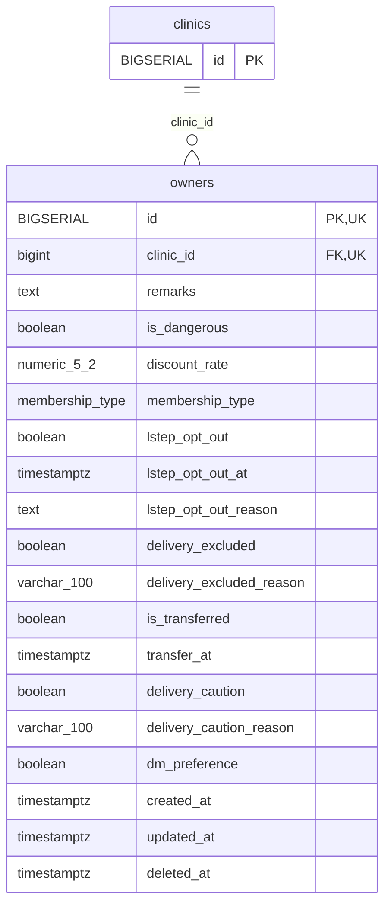

<!-- GENERATED: scripts/tools/generate-erd-detail.py; do not edit -->
# `owners`

[詳細ERD一覧](index.md) · [概要ERD](../erd.md)

このページは、マイグレーションをファイル名順に静的解析した最終定義です。稼働DBの状態は未確認です。

## カラム

型・DEFAULTはDDLの宣言表記です。`bigserial` は採番宣言であり、DBカタログ上の型名ではありません。

| カラム | 型（DDL） | NULL | DEFAULT（DDL） | キー構成列 | 定義元 |
|:---|:---|:---|:---|:---|:---|
| `id` | `BIGSERIAL` | NOT NULL | — | PK, UK | [001_init.sql:302](../../../backend/migrations/001_init.sql#L302) |
| `clinic_id` | `bigint` | NOT NULL | — | FK, UK | [001_init.sql:303](../../../backend/migrations/001_init.sql#L303) |
| `remarks` | `text` | NOT NULL | `''` | — | [001_init.sql:317](../../../backend/migrations/001_init.sql#L317) |
| `is_dangerous` | `boolean` | NOT NULL | `false` | — | [001_init.sql:318](../../../backend/migrations/001_init.sql#L318) |
| `discount_rate` | `numeric(5,2)` | NOT NULL | `0` | — | [001_init.sql:319](../../../backend/migrations/001_init.sql#L319) |
| `membership_type` | `membership_type` | NOT NULL | `'non_member'` | — | [001_init.sql:320](../../../backend/migrations/001_init.sql#L320) |
| `lstep_opt_out` | `boolean` | NOT NULL | `false` | — | [001_init.sql:324](../../../backend/migrations/001_init.sql#L324) |
| `lstep_opt_out_at` | `timestamptz` | NULL | — | — | [001_init.sql:325](../../../backend/migrations/001_init.sql#L325) |
| `lstep_opt_out_reason` | `text` | NULL | — | — | [001_init.sql:326](../../../backend/migrations/001_init.sql#L326) |
| `delivery_excluded` | `boolean` | NOT NULL | `false` | — | [001_init.sql:333](../../../backend/migrations/001_init.sql#L333) |
| `delivery_excluded_reason` | `varchar(100)` | NULL | — | — | [001_init.sql:334](../../../backend/migrations/001_init.sql#L334) |
| `is_transferred` | `boolean` | NOT NULL | `false` | — | [001_init.sql:335](../../../backend/migrations/001_init.sql#L335) |
| `transfer_at` | `timestamptz` | NULL | — | — | [001_init.sql:336](../../../backend/migrations/001_init.sql#L336) |
| `delivery_caution` | `boolean` | NOT NULL | `false` | — | [001_init.sql:338](../../../backend/migrations/001_init.sql#L338) |
| `delivery_caution_reason` | `varchar(100)` | NULL | — | — | [001_init.sql:339](../../../backend/migrations/001_init.sql#L339) |
| `dm_preference` | `boolean` | NULL | — | — | [001_init.sql:341](../../../backend/migrations/001_init.sql#L341) |
| `created_at` | `timestamptz` | NOT NULL | `now()` | — | [001_init.sql:342](../../../backend/migrations/001_init.sql#L342) |
| `updated_at` | `timestamptz` | NOT NULL | `now()` | — | [001_init.sql:343](../../../backend/migrations/001_init.sql#L343) |
| `deleted_at` | `timestamptz` | NULL | — | — | [001_init.sql:344](../../../backend/migrations/001_init.sql#L344) |

PK/FK/UKはキーの構成列を示します。複合キーの各列が単独で一意という意味ではありません。部分uniqueは下記indexの述語を参照してください。

## ERD

このテーブルの全カラムと、すべての参照先を表示します。参照先はFKの対象列だけを表示し、全カラムは各テーブルのページに置きます。

親側の任意参照はFK列のNULL可否、子側の最大1件は無条件のPK/UNIQUEから導出します。部分uniqueによる条件付きの最大件数は図に反映せず、index一覧に記録します。実線はFK全列が子のPKに含まれる識別関係、破線はそれ以外です。

## 外部キー（全件）

| 制約 | 子の列（順序あり） | 参照先 | 親の列（順序あり） | 削除時の動作 | 定義元 |
|:---|:---|:---|:---|:---|:---|
| `owners_clinic_id_fkey` | `clinic_id` | [clinics](clinics.md) | `id` | `ON DELETE RESTRICT` | [001_init.sql:303](../../../backend/migrations/001_init.sql#L303) |

正確なON UPDATE・MATCH・DEFERRABLE等を含む制約DDL:

- `owners_clinic_id_fkey`: `REFERENCES clinics(id) ON DELETE RESTRICT`

## その他の制約

| 制約 | 種別 | DDL | 定義元 |
|:---|:---|:---|:---|
| `owners_pkey` | primary | `PRIMARY KEY` | [001_init.sql:302](../../../backend/migrations/001_init.sql#L302) |
| `uq_owners_clinic_id_id` | unique | `CONSTRAINT uq_owners_clinic_id_id     UNIQUE (clinic_id, id)` | [001_init.sql:4102](../../../backend/migrations/001_init.sql#L4102) |

## インデックス

| 名前 | UNIQUE | 述語 | DDL | 定義元 |
|:---|:---|:---|:---|:---|
| `idx_owners_delivery_excluded` | NO | `deleted_at IS NULL` | `CREATE INDEX idx_owners_delivery_excluded     ON owners (clinic_id, delivery_excluded)     WHERE deleted_at IS NULL` | [001_init.sql:368](../../../backend/migrations/001_init.sql#L368) |
| `idx_owners_is_transferred` | NO | `deleted_at IS NULL` | `CREATE INDEX idx_owners_is_transferred     ON owners (clinic_id, is_transferred)     WHERE deleted_at IS NULL` | [001_init.sql:372](../../../backend/migrations/001_init.sql#L372) |
| `idx_owners_clinic_id` | NO | — | `CREATE INDEX idx_owners_clinic_id ON owners(clinic_id)` | [001_init.sql:2246](../../../backend/migrations/001_init.sql#L2246) |
| `idx_owners_id_text` | NO | — | `CREATE INDEX idx_owners_id_text   ON owners ((id::text))` | [001_init.sql:6693](../../../backend/migrations/001_init.sql#L6693) |
