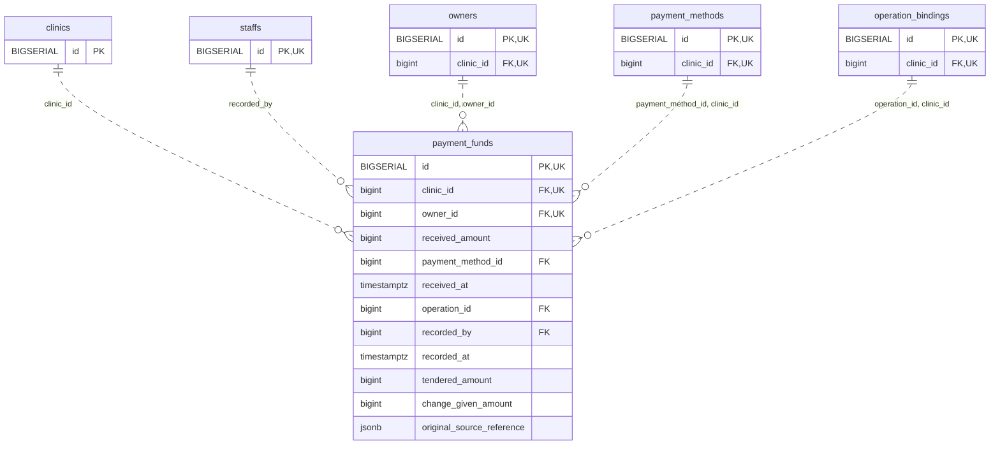

<!-- GENERATED: scripts/tools/generate-erd-detail.py; do not edit -->
# `payment_funds`

[詳細ERD一覧](index.md) · [概要ERD](../erd.md)

このページは、マイグレーションをファイル名順に静的解析した最終定義です。稼働DBの状態は未確認です。

## カラム

型・DEFAULTはDDLの宣言表記です。`bigserial` は採番宣言であり、DBカタログ上の型名ではありません。

| カラム | 型（DDL） | NULL | DEFAULT（DDL） | キー構成列 | 定義元 |
|:---|:---|:---|:---|:---|:---|
| `id` | `BIGSERIAL` | NOT NULL | — | PK, UK | [001_init.sql:9593](../../../backend/migrations/001_init.sql#L9593) |
| `clinic_id` | `bigint` | NOT NULL | — | FK, UK | [001_init.sql:9594](../../../backend/migrations/001_init.sql#L9594) |
| `owner_id` | `bigint` | NOT NULL | — | FK, UK | [001_init.sql:9595](../../../backend/migrations/001_init.sql#L9595) |
| `received_amount` | `bigint` | NOT NULL | — | — | [001_init.sql:9600](../../../backend/migrations/001_init.sql#L9600) |
| `payment_method_id` | `bigint` | NOT NULL | — | FK | [001_init.sql:9601](../../../backend/migrations/001_init.sql#L9601) |
| `received_at` | `timestamptz` | NOT NULL | — | — | [001_init.sql:9602](../../../backend/migrations/001_init.sql#L9602) |
| `operation_id` | `bigint` | NOT NULL | — | FK | [001_init.sql:9603](../../../backend/migrations/001_init.sql#L9603) |
| `recorded_by` | `bigint` | NOT NULL | — | FK | [001_init.sql:9604](../../../backend/migrations/001_init.sql#L9604) |
| `recorded_at` | `timestamptz` | NOT NULL | `clock_timestamp()` | — | [001_init.sql:9605](../../../backend/migrations/001_init.sql#L9605) |
| `tendered_amount` | `bigint` | NULL | — | — | [001_init.sql:10928](../../../backend/migrations/001_init.sql#L10928) |
| `change_given_amount` | `bigint` | NULL | — | — | [001_init.sql:10929](../../../backend/migrations/001_init.sql#L10929) |
| `original_source_reference` | `jsonb` | NULL | — | — | [001_init.sql:10930](../../../backend/migrations/001_init.sql#L10930) |

PK/FK/UKはキーの構成列を示します。複合キーの各列が単独で一意という意味ではありません。部分uniqueは下記indexの述語を参照してください。

## ERD

このテーブルの全カラムと、すべての参照先を表示します。参照先はFKの対象列だけを表示し、全カラムは各テーブルのページに置きます。

親側の任意参照はFK列のNULL可否、子側の最大1件は無条件のPK/UNIQUEから導出します。部分uniqueによる条件付きの最大件数は図に反映せず、index一覧に記録します。実線はFK全列が子のPKに含まれる識別関係、破線はそれ以外です。

## 外部キー（全件）

| 制約 | 子の列（順序あり） | 参照先 | 親の列（順序あり） | 削除時の動作 | 定義元 |
|:---|:---|:---|:---|:---|:---|
| `payment_funds_clinic_id_fkey` | `clinic_id` | [clinics](clinics.md) | `id` | `ON DELETE RESTRICT` | [001_init.sql:9594](../../../backend/migrations/001_init.sql#L9594) |
| `payment_funds_recorded_by_fkey` | `recorded_by` | [staffs](staffs.md) | `id` | `ON DELETE RESTRICT` | [001_init.sql:9604](../../../backend/migrations/001_init.sql#L9604) |
| `payment_funds_clinic_id_owner_id_fkey` | `clinic_id, owner_id` | [owners](owners.md) | `clinic_id, id` | `ON DELETE RESTRICT` | [001_init.sql:9614](../../../backend/migrations/001_init.sql#L9614) |
| `payment_funds_payment_method_id_clinic_id_fkey` | `payment_method_id, clinic_id` | [payment_methods](payment_methods.md) | `id, clinic_id` | `ON DELETE RESTRICT` | [001_init.sql:9618](../../../backend/migrations/001_init.sql#L9618) |
| `payment_funds_operation_id_clinic_id_fkey` | `operation_id, clinic_id` | [operation_bindings](operation_bindings.md) | `id, clinic_id` | `ON DELETE RESTRICT` | [001_init.sql:9619](../../../backend/migrations/001_init.sql#L9619) |

正確なON UPDATE・MATCH・DEFERRABLE等を含む制約DDL:

- `payment_funds_clinic_id_fkey`: `REFERENCES clinics(id) ON DELETE RESTRICT`
- `payment_funds_recorded_by_fkey`: `REFERENCES staffs(id) ON DELETE RESTRICT`
- `payment_funds_clinic_id_owner_id_fkey`: `FOREIGN KEY (clinic_id,owner_id) REFERENCES owners(clinic_id,id) ON DELETE RESTRICT`
- `payment_funds_payment_method_id_clinic_id_fkey`: `FOREIGN KEY (payment_method_id,clinic_id) REFERENCES payment_methods(id,clinic_id) ON DELETE RESTRICT`
- `payment_funds_operation_id_clinic_id_fkey`: `FOREIGN KEY (operation_id,clinic_id) REFERENCES operation_bindings(id,clinic_id) ON DELETE RESTRICT`

## その他の制約

| 制約 | 種別 | DDL | 定義元 |
|:---|:---|:---|:---|
| `payment_funds_pkey` | primary | `PRIMARY KEY` | [001_init.sql:9593](../../../backend/migrations/001_init.sql#L9593) |
| `payment_funds_received_amount_check` | check | `CHECK (received_amount > 0)` | [001_init.sql:9600](../../../backend/migrations/001_init.sql#L9600) |
| `payment_funds_id_clinic_id_owner_id_key` | unique | `UNIQUE (id,clinic_id,owner_id)` | [001_init.sql:9606](../../../backend/migrations/001_init.sql#L9606) |
| `uq_payment_funds_id_clinic` | unique | `CONSTRAINT uq_payment_funds_id_clinic UNIQUE(id,clinic_id)` | [001_init.sql:9833](../../../backend/migrations/001_init.sql#L9833) |
| `payment_funds_tendered_amount_check` | check | `CHECK(tendered_amount>=0)` | [001_init.sql:10928](../../../backend/migrations/001_init.sql#L10928) |
| `payment_funds_change_given_amount_check` | check | `CHECK(change_given_amount>=0)` | [001_init.sql:10929](../../../backend/migrations/001_init.sql#L10929) |
| `payment_funds_original_source_reference_check` | check | `CHECK(jsonb_typeof(original_source_reference)='object')` | [001_init.sql:10930](../../../backend/migrations/001_init.sql#L10930) |
| `ck_fund_cash_inputs` | check | `CONSTRAINT ck_fund_cash_inputs CHECK((tendered_amount IS NULL AND change_given_amount IS NULL)  OR(tendered_amount IS NOT NULL AND change_given_amount IS NOT NULL AND tendered_amount>=change_given_amount AND received_amount=tendered_amount-change_given_amount))` | [001_init.sql:10931](../../../backend/migrations/001_init.sql#L10931) |

## インデックス

明示的なCREATE INDEXなし。PK/UNIQUEに付随する暗黙のindexは制約欄を参照してください。
