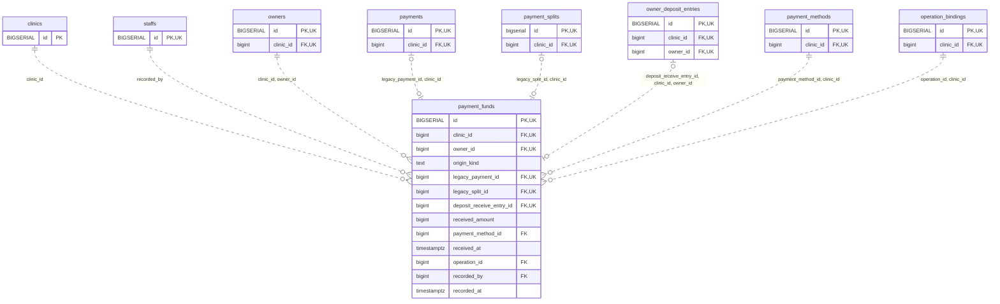

<!-- GENERATED: scripts/tools/generate-erd-detail.py; do not edit -->
# `payment_funds`

[詳細ERD一覧](index.md) · [概要ERD](../erd.md)

このページは、マイグレーションをファイル名順に静的解析した最終定義です。稼働DBの状態は未確認です。

## カラム

型・DEFAULTはDDLの宣言表記です。`bigserial` は採番宣言であり、DBカタログ上の型名ではありません。

| カラム | 型（DDL） | NULL | DEFAULT（DDL） | キー構成列 | 定義元 |
|:---|:---|:---|:---|:---|:---|
| `id` | `BIGSERIAL` | NOT NULL | — | PK, UK | [001_init.sql:9579](../../../backend/migrations/001_init.sql#L9579) |
| `clinic_id` | `bigint` | NOT NULL | — | FK, UK | [001_init.sql:9580](../../../backend/migrations/001_init.sql#L9580) |
| `owner_id` | `bigint` | NOT NULL | — | FK, UK | [001_init.sql:9581](../../../backend/migrations/001_init.sql#L9581) |
| `origin_kind` | `text` | NOT NULL | — | — | [001_init.sql:9582](../../../backend/migrations/001_init.sql#L9582) |
| `legacy_payment_id` | `bigint` | NULL | — | FK, UK | [001_init.sql:9583](../../../backend/migrations/001_init.sql#L9583) |
| `legacy_split_id` | `bigint` | NULL | — | FK, UK | [001_init.sql:9584](../../../backend/migrations/001_init.sql#L9584) |
| `deposit_receive_entry_id` | `bigint` | NULL | — | FK, UK | [001_init.sql:9585](../../../backend/migrations/001_init.sql#L9585) |
| `received_amount` | `bigint` | NOT NULL | — | — | [001_init.sql:9586](../../../backend/migrations/001_init.sql#L9586) |
| `payment_method_id` | `bigint` | NOT NULL | — | FK | [001_init.sql:9587](../../../backend/migrations/001_init.sql#L9587) |
| `received_at` | `timestamptz` | NOT NULL | — | — | [001_init.sql:9588](../../../backend/migrations/001_init.sql#L9588) |
| `operation_id` | `bigint` | NOT NULL | — | FK | [001_init.sql:9589](../../../backend/migrations/001_init.sql#L9589) |
| `recorded_by` | `bigint` | NOT NULL | — | FK | [001_init.sql:9590](../../../backend/migrations/001_init.sql#L9590) |
| `recorded_at` | `timestamptz` | NOT NULL | `clock_timestamp()` | — | [001_init.sql:9591](../../../backend/migrations/001_init.sql#L9591) |

PK/FK/UKはキーの構成列を示します。複合キーの各列が単独で一意という意味ではありません。部分uniqueは下記indexの述語を参照してください。

## ERD

このテーブルの全カラムと、すべての参照先を表示します。参照先はFKの対象列だけを表示し、全カラムは各テーブルのページに置きます。

親側の任意参照はFK列のNULL可否、子側の最大1件は無条件のPK/UNIQUEから導出します。部分uniqueによる条件付きの最大件数は図に反映せず、index一覧に記録します。実線はFK全列が子のPKに含まれる識別関係、破線はそれ以外です。

## 外部キー（全件）

| 制約 | 子の列（順序あり） | 参照先 | 親の列（順序あり） | 削除時の動作 | 定義元 |
|:---|:---|:---|:---|:---|:---|
| `payment_funds_clinic_id_fkey` | `clinic_id` | [clinics](clinics.md) | `id` | `ON DELETE RESTRICT` | [001_init.sql:9580](../../../backend/migrations/001_init.sql#L9580) |
| `payment_funds_recorded_by_fkey` | `recorded_by` | [staffs](staffs.md) | `id` | `ON DELETE RESTRICT` | [001_init.sql:9590](../../../backend/migrations/001_init.sql#L9590) |
| `payment_funds_clinic_id_owner_id_fkey` | `clinic_id, owner_id` | [owners](owners.md) | `clinic_id, id` | `ON DELETE RESTRICT` | [001_init.sql:9600](../../../backend/migrations/001_init.sql#L9600) |
| `payment_funds_legacy_payment_id_clinic_id_fkey` | `legacy_payment_id, clinic_id` | [payments](payments.md) | `id, clinic_id` | `ON DELETE RESTRICT` | [001_init.sql:9601](../../../backend/migrations/001_init.sql#L9601) |
| `payment_funds_legacy_split_id_clinic_id_fkey` | `legacy_split_id, clinic_id` | [payment_splits](payment_splits.md) | `id, clinic_id` | `ON DELETE RESTRICT` | [001_init.sql:9602](../../../backend/migrations/001_init.sql#L9602) |
| `payment_funds_deposit_receive_entry_id_clinic_id_owner_id_fkey` | `deposit_receive_entry_id, clinic_id, owner_id` | [owner_deposit_entries](owner_deposit_entries.md) | `id, clinic_id, owner_id` | `ON DELETE RESTRICT` | [001_init.sql:9603](../../../backend/migrations/001_init.sql#L9603) |
| `payment_funds_payment_method_id_clinic_id_fkey` | `payment_method_id, clinic_id` | [payment_methods](payment_methods.md) | `id, clinic_id` | `ON DELETE RESTRICT` | [001_init.sql:9604](../../../backend/migrations/001_init.sql#L9604) |
| `payment_funds_operation_id_clinic_id_fkey` | `operation_id, clinic_id` | [operation_bindings](operation_bindings.md) | `id, clinic_id` | `ON DELETE RESTRICT` | [001_init.sql:9605](../../../backend/migrations/001_init.sql#L9605) |

正確なON UPDATE・MATCH・DEFERRABLE等を含む制約DDL:

- `payment_funds_clinic_id_fkey`: `REFERENCES clinics(id) ON DELETE RESTRICT`
- `payment_funds_recorded_by_fkey`: `REFERENCES staffs(id) ON DELETE RESTRICT`
- `payment_funds_clinic_id_owner_id_fkey`: `FOREIGN KEY (clinic_id,owner_id) REFERENCES owners(clinic_id,id) ON DELETE RESTRICT`
- `payment_funds_legacy_payment_id_clinic_id_fkey`: `FOREIGN KEY (legacy_payment_id,clinic_id) REFERENCES payments(id,clinic_id) ON DELETE RESTRICT`
- `payment_funds_legacy_split_id_clinic_id_fkey`: `FOREIGN KEY (legacy_split_id,clinic_id) REFERENCES payment_splits(id,clinic_id) ON DELETE RESTRICT`
- `payment_funds_deposit_receive_entry_id_clinic_id_owner_id_fkey`: `FOREIGN KEY (deposit_receive_entry_id,clinic_id,owner_id) REFERENCES owner_deposit_entries(id,clinic_id,owner_id) ON DELETE RESTRICT`
- `payment_funds_payment_method_id_clinic_id_fkey`: `FOREIGN KEY (payment_method_id,clinic_id) REFERENCES payment_methods(id,clinic_id) ON DELETE RESTRICT`
- `payment_funds_operation_id_clinic_id_fkey`: `FOREIGN KEY (operation_id,clinic_id) REFERENCES operation_bindings(id,clinic_id) ON DELETE RESTRICT`

## その他の制約

| 制約 | 種別 | DDL | 定義元 |
|:---|:---|:---|:---|
| `payment_funds_pkey` | primary | `PRIMARY KEY` | [001_init.sql:9579](../../../backend/migrations/001_init.sql#L9579) |
| `payment_funds_origin_kind_check` | check | `CHECK (origin_kind IN ('direct','legacy_payment','legacy_split','deposit'))` | [001_init.sql:9582](../../../backend/migrations/001_init.sql#L9582) |
| `payment_funds_received_amount_check` | check | `CHECK (received_amount > 0)` | [001_init.sql:9586](../../../backend/migrations/001_init.sql#L9586) |
| `payment_funds_id_clinic_id_owner_id_key` | unique | `UNIQUE (id,clinic_id,owner_id)` | [001_init.sql:9592](../../../backend/migrations/001_init.sql#L9592) |
| `payment_funds_clinic_id_legacy_payment_id_key` | unique | `UNIQUE (clinic_id,legacy_payment_id)` | [001_init.sql:9593](../../../backend/migrations/001_init.sql#L9593) |
| `payment_funds_clinic_id_legacy_split_id_key` | unique | `UNIQUE (clinic_id,legacy_split_id)` | [001_init.sql:9594](../../../backend/migrations/001_init.sql#L9594) |
| `payment_funds_clinic_id_deposit_receive_entry_id_key` | unique | `UNIQUE (clinic_id,deposit_receive_entry_id)` | [001_init.sql:9595](../../../backend/migrations/001_init.sql#L9595) |
| `payment_funds_check` | check | `CHECK ((origin_kind='direct' AND num_nonnulls(legacy_payment_id,legacy_split_id,deposit_receive_entry_id)=0)       OR (origin_kind='legacy_payment' AND legacy_payment_id IS NOT NULL AND num_nonnulls(legacy_split_id,deposit_receive_entry_id)=0)       OR (origin_kind='legacy_split' AND legacy_split_id IS NOT NULL AND num_nonnulls(legacy_payment_id,deposit_receive_entry_id)=0)       OR (origin_kind='deposit' AND deposit_receive_entry_id IS NOT NULL AND num_nonnulls(legacy_payment_id,legacy_split_id)=0))` | [001_init.sql:9596](../../../backend/migrations/001_init.sql#L9596) |
| `uq_payment_funds_id_clinic` | unique | `CONSTRAINT uq_payment_funds_id_clinic UNIQUE(id,clinic_id)` | [001_init.sql:9817](../../../backend/migrations/001_init.sql#L9817) |

## インデックス

明示的なCREATE INDEXなし。PK/UNIQUEに付随する暗黙のindexは制約欄を参照してください。
