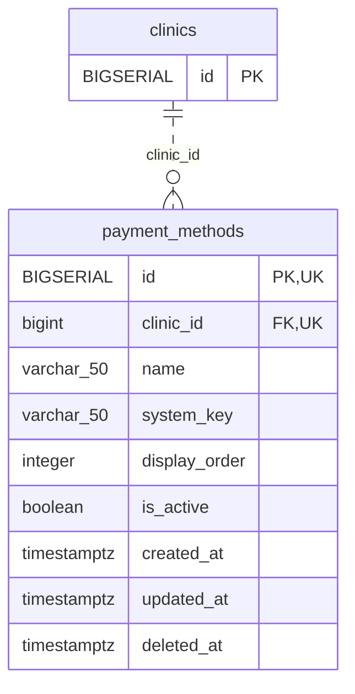

<!-- GENERATED: scripts/tools/generate-erd-detail.py; do not edit -->
# `payment_methods`

[詳細ERD一覧](index.md) · [概要ERD](../erd.md)

このページは、マイグレーションをファイル名順に静的解析した最終定義です。稼働DBの状態は未確認です。

## カラム

型・DEFAULTはDDLの宣言表記です。`bigserial` は採番宣言であり、DBカタログ上の型名ではありません。

| カラム | 型（DDL） | NULL | DEFAULT（DDL） | キー構成列 | 定義元 |
|:---|:---|:---|:---|:---|:---|
| `id` | `BIGSERIAL` | NOT NULL | — | PK, UK | [001_init.sql:1964](../../../backend/migrations/001_init.sql#L1964) |
| `clinic_id` | `bigint` | NOT NULL | — | FK, UK | [001_init.sql:1965](../../../backend/migrations/001_init.sql#L1965) |
| `name` | `varchar(50)` | NOT NULL | — | — | [001_init.sql:1966](../../../backend/migrations/001_init.sql#L1966) |
| `system_key` | `varchar(50)` | NULL | — | — | [001_init.sql:1968](../../../backend/migrations/001_init.sql#L1968) |
| `display_order` | `integer` | NOT NULL | `0` | — | [001_init.sql:1969](../../../backend/migrations/001_init.sql#L1969) |
| `is_active` | `boolean` | NOT NULL | `true` | — | [001_init.sql:1970](../../../backend/migrations/001_init.sql#L1970) |
| `created_at` | `timestamptz` | NOT NULL | `now()` | — | [001_init.sql:1971](../../../backend/migrations/001_init.sql#L1971) |
| `updated_at` | `timestamptz` | NOT NULL | `now()` | — | [001_init.sql:1972](../../../backend/migrations/001_init.sql#L1972) |
| `deleted_at` | `timestamptz` | NULL | — | — | [001_init.sql:1973](../../../backend/migrations/001_init.sql#L1973) |

PK/FK/UKはキーの構成列を示します。複合キーの各列が単独で一意という意味ではありません。部分uniqueは下記indexの述語を参照してください。

## ERD

このテーブルの全カラムと、すべての参照先を表示します。参照先はFKの対象列だけを表示し、全カラムは各テーブルのページに置きます。

親側の任意参照はFK列のNULL可否、子側の最大1件は無条件のPK/UNIQUEから導出します。部分uniqueによる条件付きの最大件数は図に反映せず、index一覧に記録します。実線はFK全列が子のPKに含まれる識別関係、破線はそれ以外です。

## 外部キー（全件）

| 制約 | 子の列（順序あり） | 参照先 | 親の列（順序あり） | 削除時の動作 | 定義元 |
|:---|:---|:---|:---|:---|:---|
| `payment_methods_clinic_id_fkey` | `clinic_id` | [clinics](clinics.md) | `id` | `ON DELETE CASCADE` | [001_init.sql:1965](../../../backend/migrations/001_init.sql#L1965) |

正確なON UPDATE・MATCH・DEFERRABLE等を含む制約DDL:

- `payment_methods_clinic_id_fkey`: `REFERENCES clinics(id) ON DELETE CASCADE`

## その他の制約

| 制約 | 種別 | DDL | 定義元 |
|:---|:---|:---|:---|
| `payment_methods_pkey` | primary | `PRIMARY KEY` | [001_init.sql:1964](../../../backend/migrations/001_init.sql#L1964) |
| `uq_payment_methods_id_clinic` | unique | `CONSTRAINT uq_payment_methods_id_clinic UNIQUE (id, clinic_id)` | [001_init.sql:4018](../../../backend/migrations/001_init.sql#L4018) |

## インデックス

| 名前 | UNIQUE | 述語 | DDL | 定義元 |
|:---|:---|:---|:---|:---|
| `idx_payment_methods_clinic_name` | YES | `deleted_at IS NULL` | `CREATE UNIQUE INDEX idx_payment_methods_clinic_name ON payment_methods(clinic_id, name) WHERE deleted_at IS NULL` | [001_init.sql:1976](../../../backend/migrations/001_init.sql#L1976) |
| `idx_payment_methods_clinic_order` | NO | `deleted_at IS NULL` | `CREATE INDEX idx_payment_methods_clinic_order ON payment_methods(clinic_id, display_order) WHERE deleted_at IS NULL` | [001_init.sql:1977](../../../backend/migrations/001_init.sql#L1977) |
| `idx_payment_methods_clinic_system_key` | YES | `system_key IS NOT NULL AND deleted_at IS NULL` | `CREATE UNIQUE INDEX idx_payment_methods_clinic_system_key     ON payment_methods (clinic_id, system_key)     WHERE system_key IS NOT NULL AND deleted_at IS NULL` | [001_init.sql:1978](../../../backend/migrations/001_init.sql#L1978) |
