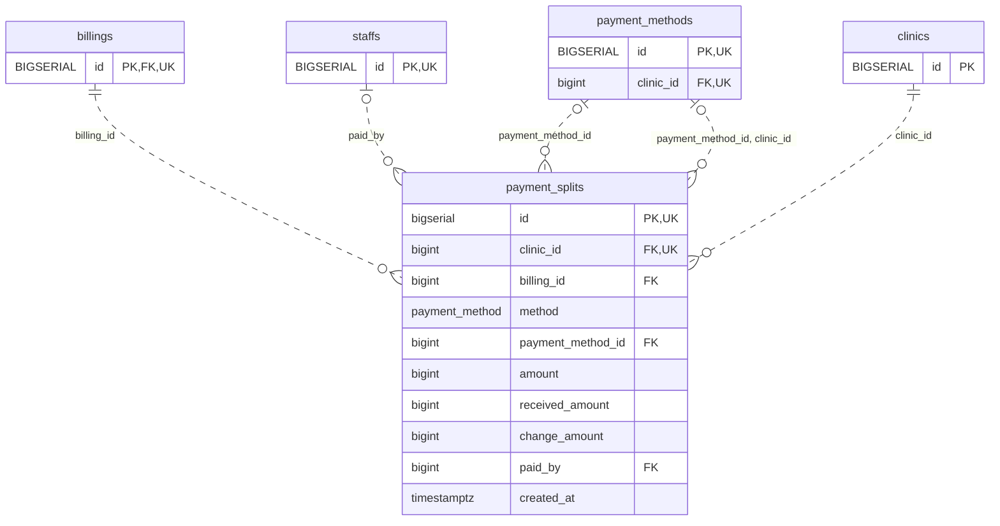

<!-- GENERATED: scripts/tools/generate-erd-detail.py; do not edit -->
# `payment_splits`

[詳細ERD一覧](index.md) · [概要ERD](../erd.md)

このページは、マイグレーションをファイル名順に静的解析した最終定義です。稼働DBの状態は未確認です。

## カラム

型・DEFAULTはDDLの宣言表記です。`bigserial` は採番宣言であり、DBカタログ上の型名ではありません。

| カラム | 型（DDL） | NULL | DEFAULT（DDL） | キー構成列 | 定義元 |
|:---|:---|:---|:---|:---|:---|
| `id` | `bigserial` | NOT NULL | — | PK, UK | [001_init.sql:1998](../../../backend/migrations/001_init.sql#L1998) |
| `clinic_id` | `bigint` | NOT NULL | — | FK, UK | [001_init.sql:1999](../../../backend/migrations/001_init.sql#L1999) |
| `billing_id` | `bigint` | NOT NULL | — | FK | [001_init.sql:2000](../../../backend/migrations/001_init.sql#L2000) |
| `method` | `payment_method` | NOT NULL | — | — | [001_init.sql:2001](../../../backend/migrations/001_init.sql#L2001) |
| `payment_method_id` | `bigint` | NULL | — | FK | [001_init.sql:2002](../../../backend/migrations/001_init.sql#L2002) |
| `amount` | `bigint` | NOT NULL | `0` | — | [001_init.sql:2003](../../../backend/migrations/001_init.sql#L2003) |
| `received_amount` | `bigint` | NOT NULL | `0` | — | [001_init.sql:2004](../../../backend/migrations/001_init.sql#L2004) |
| `change_amount` | `bigint` | NOT NULL | `0` | — | [001_init.sql:2005](../../../backend/migrations/001_init.sql#L2005) |
| `paid_by` | `bigint` | NULL | — | FK | [001_init.sql:2006](../../../backend/migrations/001_init.sql#L2006) |
| `created_at` | `timestamptz` | NOT NULL | `now()` | — | [001_init.sql:2007](../../../backend/migrations/001_init.sql#L2007) |

PK/FK/UKはキーの構成列を示します。複合キーの各列が単独で一意という意味ではありません。部分uniqueは下記indexの述語を参照してください。

## ERD

このテーブルの全カラムと、すべての参照先を表示します。参照先はFKの対象列だけを表示し、全カラムは各テーブルのページに置きます。

親側の任意参照はFK列のNULL可否、子側の最大1件は無条件のPK/UNIQUEから導出します。部分uniqueによる条件付きの最大件数は図に反映せず、index一覧に記録します。実線はFK全列が子のPKに含まれる識別関係、破線はそれ以外です。

## 外部キー（全件）

| 制約 | 子の列（順序あり） | 参照先 | 親の列（順序あり） | 削除時の動作 | 定義元 |
|:---|:---|:---|:---|:---|:---|
| `payment_splits_billing_id_fkey` | `billing_id` | [billings](billings.md) | `id` | `ON DELETE RESTRICT` | [001_init.sql:2000](../../../backend/migrations/001_init.sql#L2000) |
| `payment_splits_payment_method_id_fkey` | `payment_method_id` | [payment_methods](payment_methods.md) | `id` | `ON DELETE NO ACTION` | [001_init.sql:2002](../../../backend/migrations/001_init.sql#L2002) |
| `payment_splits_paid_by_fkey` | `paid_by` | [staffs](staffs.md) | `id` | `ON DELETE NO ACTION` | [001_init.sql:2006](../../../backend/migrations/001_init.sql#L2006) |
| `fk_payment_splits_clinic_id` | `clinic_id` | [clinics](clinics.md) | `id` | `ON DELETE RESTRICT` | [001_init.sql:2008](../../../backend/migrations/001_init.sql#L2008) |
| `fk_payment_splits_payment_method_clinic` | `payment_method_id, clinic_id` | [payment_methods](payment_methods.md) | `id, clinic_id` | `ON DELETE RESTRICT` | [001_init.sql:4025](../../../backend/migrations/001_init.sql#L4025) |

正確なON UPDATE・MATCH・DEFERRABLE等を含む制約DDL:

- `payment_splits_billing_id_fkey`: `REFERENCES billings(id) ON DELETE RESTRICT`
- `payment_splits_payment_method_id_fkey`: `REFERENCES payment_methods(id)`
- `payment_splits_paid_by_fkey`: `REFERENCES staffs(id)`
- `fk_payment_splits_clinic_id`: `CONSTRAINT fk_payment_splits_clinic_id     FOREIGN KEY (clinic_id)     REFERENCES clinics (id)     ON DELETE RESTRICT`
- `fk_payment_splits_payment_method_clinic`: `CONSTRAINT fk_payment_splits_payment_method_clinic     FOREIGN KEY (payment_method_id, clinic_id)     REFERENCES payment_methods (id, clinic_id)     ON DELETE RESTRICT`

## その他の制約

| 制約 | 種別 | DDL | 定義元 |
|:---|:---|:---|:---|
| `payment_splits_pkey` | primary | `PRIMARY KEY` | [001_init.sql:1998](../../../backend/migrations/001_init.sql#L1998) |
| `uq_payment_splits_id_clinic` | unique | `CONSTRAINT uq_payment_splits_id_clinic UNIQUE(id,clinic_id)` | [001_init.sql:9576](../../../backend/migrations/001_init.sql#L9576) |

## インデックス

| 名前 | UNIQUE | 述語 | DDL | 定義元 |
|:---|:---|:---|:---|:---|
| `idx_payment_splits_clinic_billing` | NO | — | `CREATE INDEX idx_payment_splits_clinic_billing ON payment_splits(clinic_id, billing_id)` | [001_init.sql:2014](../../../backend/migrations/001_init.sql#L2014) |
| `idx_payment_splits_billing_id` | NO | — | `CREATE INDEX IF NOT EXISTS idx_payment_splits_billing_id     ON payment_splits (billing_id)` | [001_init.sql:3904](../../../backend/migrations/001_init.sql#L3904) |
