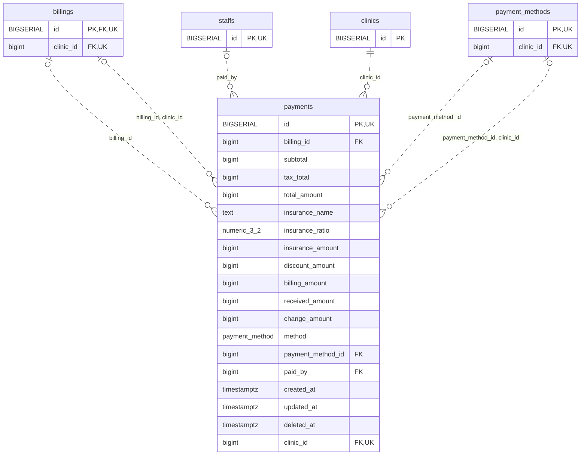

<!-- GENERATED: scripts/tools/generate-erd-detail.py; do not edit -->
# `payments`

[詳細ERD一覧](index.md) · [概要ERD](../erd.md)

このページは、マイグレーションをファイル名順に静的解析した最終定義です。稼働DBの状態は未確認です。

## カラム

型・DEFAULTはDDLの宣言表記です。`bigserial` は採番宣言であり、DBカタログ上の型名ではありません。

| カラム | 型（DDL） | NULL | DEFAULT（DDL） | キー構成列 | 定義元 |
|:---|:---|:---|:---|:---|:---|
| `id` | `BIGSERIAL` | NOT NULL | — | PK, UK | [001_init.sql:1974](../../../backend/migrations/001_init.sql#L1974) |
| `billing_id` | `bigint` | NULL | — | FK | [001_init.sql:9574](../../../backend/migrations/001_init.sql#L9574) |
| `subtotal` | `bigint` | NOT NULL | `0` | — | [001_init.sql:1976](../../../backend/migrations/001_init.sql#L1976) |
| `tax_total` | `bigint` | NOT NULL | `0` | — | [001_init.sql:1977](../../../backend/migrations/001_init.sql#L1977) |
| `total_amount` | `bigint` | NOT NULL | `0` | — | [001_init.sql:1978](../../../backend/migrations/001_init.sql#L1978) |
| `insurance_name` | `text` | NOT NULL | `''` | — | [001_init.sql:1979](../../../backend/migrations/001_init.sql#L1979) |
| `insurance_ratio` | `numeric(3,2)` | NULL | `0` | — | [001_init.sql:1980](../../../backend/migrations/001_init.sql#L1980) |
| `insurance_amount` | `bigint` | NULL | `0` | — | [001_init.sql:1981](../../../backend/migrations/001_init.sql#L1981) |
| `discount_amount` | `bigint` | NULL | `0` | — | [001_init.sql:1982](../../../backend/migrations/001_init.sql#L1982) |
| `billing_amount` | `bigint` | NOT NULL | `0` | — | [001_init.sql:1983](../../../backend/migrations/001_init.sql#L1983) |
| `received_amount` | `bigint` | NULL | `0` | — | [001_init.sql:1984](../../../backend/migrations/001_init.sql#L1984) |
| `change_amount` | `bigint` | NULL | `0` | — | [001_init.sql:1985](../../../backend/migrations/001_init.sql#L1985) |
| `method` | `payment_method` | NULL | `'cash'` | — | [001_init.sql:1986](../../../backend/migrations/001_init.sql#L1986) |
| `payment_method_id` | `bigint` | NULL | — | FK | [001_init.sql:1987](../../../backend/migrations/001_init.sql#L1987) |
| `paid_by` | `bigint` | NULL | — | FK | [001_init.sql:1988](../../../backend/migrations/001_init.sql#L1988) |
| `created_at` | `timestamptz` | NOT NULL | `now()` | — | [001_init.sql:1989](../../../backend/migrations/001_init.sql#L1989) |
| `updated_at` | `timestamptz` | NOT NULL | `now()` | — | [001_init.sql:1990](../../../backend/migrations/001_init.sql#L1990) |
| `deleted_at` | `timestamptz` | NULL | — | — | [001_init.sql:1991](../../../backend/migrations/001_init.sql#L1991) |
| `clinic_id` | `bigint` | NOT NULL | — | FK, UK | [001_init.sql:4233](../../../backend/migrations/001_init.sql#L4233) |

PK/FK/UKはキーの構成列を示します。複合キーの各列が単独で一意という意味ではありません。部分uniqueは下記indexの述語を参照してください。

## ERD

このテーブルの全カラムと、すべての参照先を表示します。参照先はFKの対象列だけを表示し、全カラムは各テーブルのページに置きます。

親側の任意参照はFK列のNULL可否、子側の最大1件は無条件のPK/UNIQUEから導出します。部分uniqueによる条件付きの最大件数は図に反映せず、index一覧に記録します。実線はFK全列が子のPKに含まれる識別関係、破線はそれ以外です。

## 外部キー（全件）

| 制約 | 子の列（順序あり） | 参照先 | 親の列（順序あり） | 削除時の動作 | 定義元 |
|:---|:---|:---|:---|:---|:---|
| `payments_billing_id_fkey` | `billing_id` | [billings](billings.md) | `id` | `ON DELETE CASCADE` | [001_init.sql:1975](../../../backend/migrations/001_init.sql#L1975) |
| `payments_payment_method_id_fkey` | `payment_method_id` | [payment_methods](payment_methods.md) | `id` | `ON DELETE NO ACTION` | [001_init.sql:1987](../../../backend/migrations/001_init.sql#L1987) |
| `payments_paid_by_fkey` | `paid_by` | [staffs](staffs.md) | `id` | `ON DELETE NO ACTION` | [001_init.sql:1988](../../../backend/migrations/001_init.sql#L1988) |
| `fk_payments_clinic_id` | `clinic_id` | [clinics](clinics.md) | `id` | `ON DELETE RESTRICT` | [001_init.sql:4236](../../../backend/migrations/001_init.sql#L4236) |
| `fk_payments_billing_clinic` | `billing_id, clinic_id` | [billings](billings.md) | `id, clinic_id` | `ON DELETE RESTRICT` | [001_init.sql:4243](../../../backend/migrations/001_init.sql#L4243) |
| `fk_payments_payment_method_clinic` | `payment_method_id, clinic_id` | [payment_methods](payment_methods.md) | `id, clinic_id` | `ON DELETE RESTRICT` | [001_init.sql:4251](../../../backend/migrations/001_init.sql#L4251) |

正確なON UPDATE・MATCH・DEFERRABLE等を含む制約DDL:

- `payments_billing_id_fkey`: `REFERENCES billings(id) ON DELETE CASCADE`
- `payments_payment_method_id_fkey`: `REFERENCES payment_methods(id)`
- `payments_paid_by_fkey`: `REFERENCES staffs(id)`
- `fk_payments_clinic_id`: `CONSTRAINT fk_payments_clinic_id     FOREIGN KEY (clinic_id)     REFERENCES clinics (id)     ON DELETE RESTRICT`
- `fk_payments_billing_clinic`: `CONSTRAINT fk_payments_billing_clinic     FOREIGN KEY (billing_id, clinic_id)     REFERENCES billings (id, clinic_id)     ON DELETE RESTRICT`
- `fk_payments_payment_method_clinic`: `CONSTRAINT fk_payments_payment_method_clinic     FOREIGN KEY (payment_method_id, clinic_id)     REFERENCES payment_methods (id, clinic_id)     ON DELETE RESTRICT`

## その他の制約

| 制約 | 種別 | DDL | 定義元 |
|:---|:---|:---|:---|
| `payments_pkey` | primary | `PRIMARY KEY` | [001_init.sql:1974](../../../backend/migrations/001_init.sql#L1974) |
| `uq_payments_id_clinic` | unique | `CONSTRAINT uq_payments_id_clinic UNIQUE(id,clinic_id)` | [001_init.sql:9575](../../../backend/migrations/001_init.sql#L9575) |

## インデックス

| 名前 | UNIQUE | 述語 | DDL | 定義元 |
|:---|:---|:---|:---|:---|
| `idx_payments_staff` | NO | — | `CREATE INDEX idx_payments_staff ON payments(paid_by)` | [001_init.sql:2322](../../../backend/migrations/001_init.sql#L2322) |
| `idx_payments_clinic_id` | NO | — | `CREATE INDEX idx_payments_clinic_id ON payments (clinic_id)` | [001_init.sql:4256](../../../backend/migrations/001_init.sql#L4256) |
