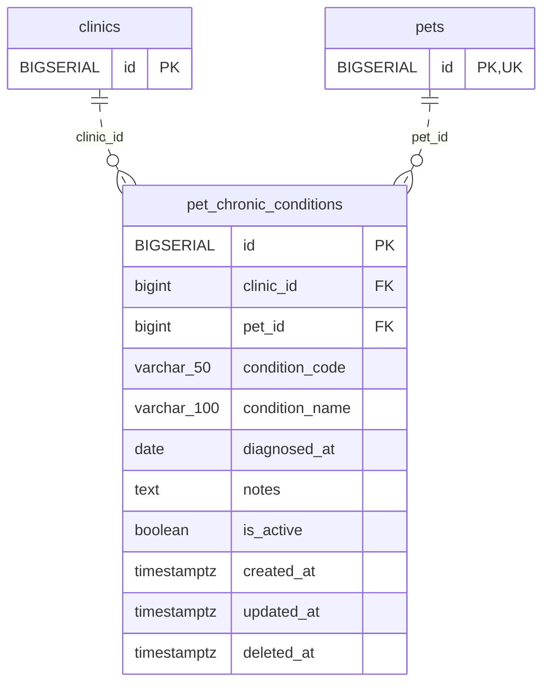

<!-- GENERATED: scripts/tools/generate-erd-detail.py; do not edit -->
# `pet_chronic_conditions`

[詳細ERD一覧](index.md) · [概要ERD](../erd.md)

このページは、マイグレーションをファイル名順に静的解析した最終定義です。稼働DBの状態は未確認です。

## カラム

型・DEFAULTはDDLの宣言表記です。`bigserial` は採番宣言であり、DBカタログ上の型名ではありません。

| カラム | 型（DDL） | NULL | DEFAULT（DDL） | キー構成列 | 定義元 |
|:---|:---|:---|:---|:---|:---|
| `id` | `BIGSERIAL` | NOT NULL | — | PK | [001_init.sql:1177](../../../backend/migrations/001_init.sql#L1177) |
| `clinic_id` | `bigint` | NOT NULL | — | FK | [001_init.sql:1178](../../../backend/migrations/001_init.sql#L1178) |
| `pet_id` | `bigint` | NOT NULL | — | FK | [001_init.sql:1179](../../../backend/migrations/001_init.sql#L1179) |
| `condition_code` | `varchar(50)` | NOT NULL | — | — | [001_init.sql:1180](../../../backend/migrations/001_init.sql#L1180) |
| `condition_name` | `varchar(100)` | NOT NULL | — | — | [001_init.sql:1181](../../../backend/migrations/001_init.sql#L1181) |
| `diagnosed_at` | `date` | NOT NULL | — | — | [001_init.sql:1182](../../../backend/migrations/001_init.sql#L1182) |
| `notes` | `text` | NULL | — | — | [001_init.sql:1183](../../../backend/migrations/001_init.sql#L1183) |
| `is_active` | `boolean` | NOT NULL | `true` | — | [001_init.sql:1184](../../../backend/migrations/001_init.sql#L1184) |
| `created_at` | `timestamptz` | NOT NULL | `now()` | — | [001_init.sql:1185](../../../backend/migrations/001_init.sql#L1185) |
| `updated_at` | `timestamptz` | NOT NULL | `now()` | — | [001_init.sql:1186](../../../backend/migrations/001_init.sql#L1186) |
| `deleted_at` | `timestamptz` | NULL | — | — | [001_init.sql:1187](../../../backend/migrations/001_init.sql#L1187) |

PK/FK/UKはキーの構成列を示します。複合キーの各列が単独で一意という意味ではありません。部分uniqueは下記indexの述語を参照してください。

## ERD

このテーブルの全カラムと、すべての参照先を表示します。参照先はFKの対象列だけを表示し、全カラムは各テーブルのページに置きます。

親側の任意参照はFK列のNULL可否、子側の最大1件は無条件のPK/UNIQUEから導出します。部分uniqueによる条件付きの最大件数は図に反映せず、index一覧に記録します。実線はFK全列が子のPKに含まれる識別関係、破線はそれ以外です。

## 外部キー（全件）

| 制約 | 子の列（順序あり） | 参照先 | 親の列（順序あり） | 削除時の動作 | 定義元 |
|:---|:---|:---|:---|:---|:---|
| `pet_chronic_conditions_clinic_id_fkey` | `clinic_id` | [clinics](clinics.md) | `id` | `ON DELETE NO ACTION` | [001_init.sql:1178](../../../backend/migrations/001_init.sql#L1178) |
| `pet_chronic_conditions_pet_id_fkey` | `pet_id` | [pets](pets.md) | `id` | `ON DELETE NO ACTION` | [001_init.sql:1179](../../../backend/migrations/001_init.sql#L1179) |

正確なON UPDATE・MATCH・DEFERRABLE等を含む制約DDL:

- `pet_chronic_conditions_clinic_id_fkey`: `REFERENCES clinics(id)`
- `pet_chronic_conditions_pet_id_fkey`: `REFERENCES pets(id)`

## その他の制約

| 制約 | 種別 | DDL | 定義元 |
|:---|:---|:---|:---|
| `pet_chronic_conditions_pkey` | primary | `PRIMARY KEY` | [001_init.sql:1177](../../../backend/migrations/001_init.sql#L1177) |

## インデックス

| 名前 | UNIQUE | 述語 | DDL | 定義元 |
|:---|:---|:---|:---|:---|
| `idx_pet_chronic_conditions_clinic_pet` | NO | `deleted_at IS NULL` | `CREATE INDEX idx_pet_chronic_conditions_clinic_pet     ON pet_chronic_conditions (clinic_id, pet_id)     WHERE deleted_at IS NULL` | [001_init.sql:1190](../../../backend/migrations/001_init.sql#L1190) |
