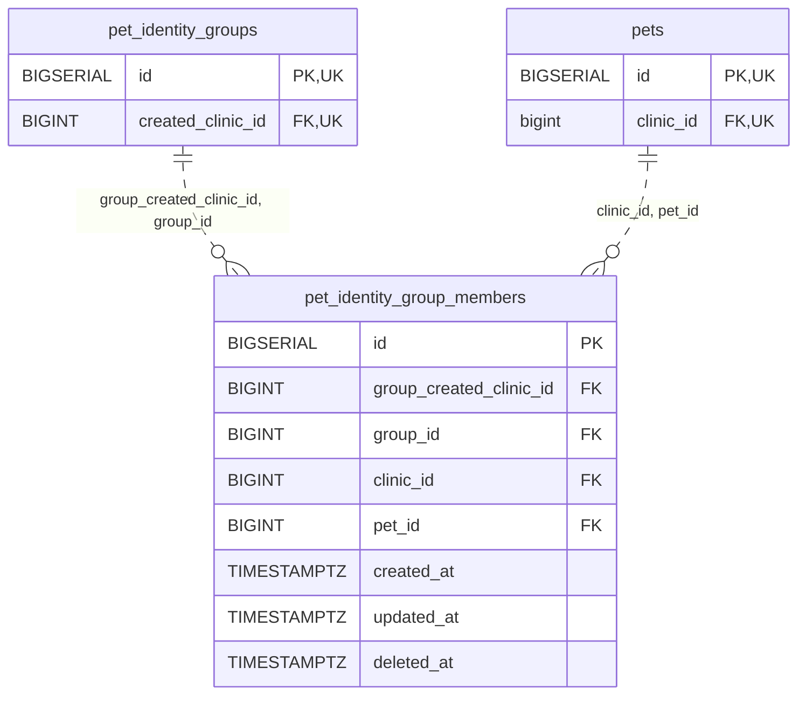

<!-- GENERATED: scripts/tools/generate-erd-detail.py; do not edit -->
# `pet_identity_group_members`

[詳細ERD一覧](index.md) · [概要ERD](../erd.md)

このページは、マイグレーションをファイル名順に静的解析した最終定義です。稼働DBの状態は未確認です。

## カラム

型・DEFAULTはDDLの宣言表記です。`bigserial` は採番宣言であり、DBカタログ上の型名ではありません。

| カラム | 型（DDL） | NULL | DEFAULT（DDL） | キー構成列 | 定義元 |
|:---|:---|:---|:---|:---|:---|
| `id` | `BIGSERIAL` | NOT NULL | — | PK | [001_init.sql:4662](../../../backend/migrations/001_init.sql#L4662) |
| `group_created_clinic_id` | `BIGINT` | NOT NULL | — | FK | [001_init.sql:4663](../../../backend/migrations/001_init.sql#L4663) |
| `group_id` | `BIGINT` | NOT NULL | — | FK | [001_init.sql:4664](../../../backend/migrations/001_init.sql#L4664) |
| `clinic_id` | `BIGINT` | NOT NULL | — | FK | [001_init.sql:4665](../../../backend/migrations/001_init.sql#L4665) |
| `pet_id` | `BIGINT` | NOT NULL | — | FK | [001_init.sql:4666](../../../backend/migrations/001_init.sql#L4666) |
| `created_at` | `TIMESTAMPTZ` | NOT NULL | `now()` | — | [001_init.sql:4667](../../../backend/migrations/001_init.sql#L4667) |
| `updated_at` | `TIMESTAMPTZ` | NOT NULL | `now()` | — | [001_init.sql:4668](../../../backend/migrations/001_init.sql#L4668) |
| `deleted_at` | `TIMESTAMPTZ` | NULL | — | — | [001_init.sql:4669](../../../backend/migrations/001_init.sql#L4669) |

PK/FK/UKはキーの構成列を示します。複合キーの各列が単独で一意という意味ではありません。部分uniqueは下記indexの述語を参照してください。

## ERD

このテーブルの全カラムと、すべての参照先を表示します。参照先はFKの対象列だけを表示し、全カラムは各テーブルのページに置きます。

親側の任意参照はFK列のNULL可否、子側の最大1件は無条件のPK/UNIQUEから導出します。部分uniqueによる条件付きの最大件数は図に反映せず、index一覧に記録します。実線はFK全列が子のPKに含まれる識別関係、破線はそれ以外です。

## 外部キー（全件）

| 制約 | 子の列（順序あり） | 参照先 | 親の列（順序あり） | 削除時の動作 | 定義元 |
|:---|:---|:---|:---|:---|:---|
| `pet_identity_group_members_group_created_clinic_id_group_i_fkey` | `group_created_clinic_id, group_id` | [pet_identity_groups](pet_identity_groups.md) | `created_clinic_id, id` | `ON DELETE RESTRICT` | [001_init.sql:4670](../../../backend/migrations/001_init.sql#L4670) |
| `pet_identity_group_members_clinic_id_pet_id_fkey` | `clinic_id, pet_id` | [pets](pets.md) | `clinic_id, id` | `ON DELETE RESTRICT` | [001_init.sql:4672](../../../backend/migrations/001_init.sql#L4672) |

正確なON UPDATE・MATCH・DEFERRABLE等を含む制約DDL:

- `pet_identity_group_members_group_created_clinic_id_group_i_fkey`: `FOREIGN KEY (group_created_clinic_id, group_id)         REFERENCES pet_identity_groups(created_clinic_id, id) ON DELETE RESTRICT`
- `pet_identity_group_members_clinic_id_pet_id_fkey`: `FOREIGN KEY (clinic_id, pet_id)         REFERENCES pets(clinic_id, id) ON DELETE RESTRICT`

## その他の制約

| 制約 | 種別 | DDL | 定義元 |
|:---|:---|:---|:---|
| `pet_identity_group_members_pkey` | primary | `PRIMARY KEY` | [001_init.sql:4662](../../../backend/migrations/001_init.sql#L4662) |

## インデックス

| 名前 | UNIQUE | 述語 | DDL | 定義元 |
|:---|:---|:---|:---|:---|
| `uq_pet_identity_active_member` | YES | `deleted_at IS NULL` | `CREATE UNIQUE INDEX uq_pet_identity_active_member     ON pet_identity_group_members(clinic_id, pet_id)     WHERE deleted_at IS NULL` | [001_init.sql:4676](../../../backend/migrations/001_init.sql#L4676) |
| `uq_pet_identity_active_group_member` | YES | `deleted_at IS NULL` | `CREATE UNIQUE INDEX uq_pet_identity_active_group_member     ON pet_identity_group_members(group_id, clinic_id, pet_id)     WHERE deleted_at IS NULL` | [001_init.sql:4680](../../../backend/migrations/001_init.sql#L4680) |
| `idx_pet_identity_group_members_group` | NO | `deleted_at IS NULL` | `CREATE INDEX idx_pet_identity_group_members_group     ON pet_identity_group_members(group_id)     WHERE deleted_at IS NULL` | [001_init.sql:4684](../../../backend/migrations/001_init.sql#L4684) |
