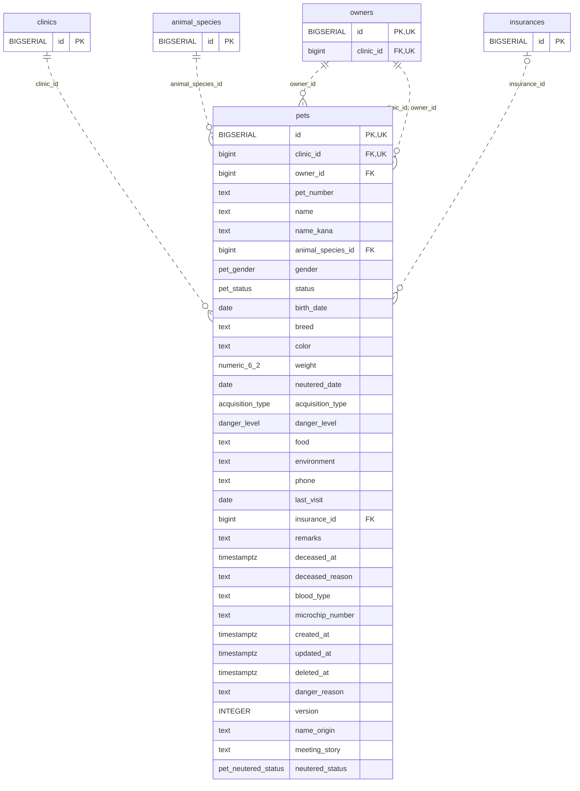

<!-- GENERATED: scripts/tools/generate-erd-detail.py; do not edit -->
# `pets`

[詳細ERD一覧](index.md) · [概要ERD](../erd.md)

このページは、マイグレーションをファイル名順に静的解析した最終定義です。稼働DBの状態は未確認です。

## カラム

型・DEFAULTはDDLの宣言表記です。`bigserial` は採番宣言であり、DBカタログ上の型名ではありません。

| カラム | 型（DDL） | NULL | DEFAULT（DDL） | キー構成列 | 定義元 |
|:---|:---|:---|:---|:---|:---|
| `id` | `BIGSERIAL` | NOT NULL | — | PK, UK | [001_init.sql:1119](../../../backend/migrations/001_init.sql#L1119) |
| `clinic_id` | `bigint` | NOT NULL | — | FK, UK | [001_init.sql:1120](../../../backend/migrations/001_init.sql#L1120) |
| `owner_id` | `bigint` | NOT NULL | — | FK | [001_init.sql:1121](../../../backend/migrations/001_init.sql#L1121) |
| `pet_number` | `text` | NOT NULL | `''` | — | [001_init.sql:1122](../../../backend/migrations/001_init.sql#L1122) |
| `name` | `text` | NOT NULL | — | — | [001_init.sql:1123](../../../backend/migrations/001_init.sql#L1123) |
| `name_kana` | `text` | NOT NULL | `''` | — | [001_init.sql:1124](../../../backend/migrations/001_init.sql#L1124) |
| `animal_species_id` | `bigint` | NOT NULL | — | FK | [001_init.sql:1125](../../../backend/migrations/001_init.sql#L1125) |
| `gender` | `pet_gender` | NOT NULL | `'unknown'` | — | [001_init.sql:1126](../../../backend/migrations/001_init.sql#L1126) |
| `status` | `pet_status` | NOT NULL | `'alive'` | — | [001_init.sql:1127](../../../backend/migrations/001_init.sql#L1127) |
| `birth_date` | `date` | NULL | — | — | [001_init.sql:1128](../../../backend/migrations/001_init.sql#L1128) |
| `breed` | `text` | NOT NULL | `''` | — | [001_init.sql:1129](../../../backend/migrations/001_init.sql#L1129) |
| `color` | `text` | NOT NULL | `''` | — | [001_init.sql:1130](../../../backend/migrations/001_init.sql#L1130) |
| `weight` | `numeric(6,2)` | NULL | — | — | [001_init.sql:1131](../../../backend/migrations/001_init.sql#L1131) |
| `neutered_date` | `date` | NULL | — | — | [001_init.sql:1132](../../../backend/migrations/001_init.sql#L1132) |
| `acquisition_type` | `acquisition_type` | NULL | — | — | [001_init.sql:1133](../../../backend/migrations/001_init.sql#L1133) |
| `danger_level` | `danger_level` | NOT NULL | `'low'` | — | [001_init.sql:1134](../../../backend/migrations/001_init.sql#L1134) |
| `food` | `text` | NOT NULL | `''` | — | [001_init.sql:1135](../../../backend/migrations/001_init.sql#L1135) |
| `environment` | `text` | NOT NULL | `''` | — | [001_init.sql:1136](../../../backend/migrations/001_init.sql#L1136) |
| `phone` | `text` | NOT NULL | `''` | — | [001_init.sql:1137](../../../backend/migrations/001_init.sql#L1137) |
| `last_visit` | `date` | NULL | — | — | [001_init.sql:1138](../../../backend/migrations/001_init.sql#L1138) |
| `insurance_id` | `bigint` | NULL | — | FK | [001_init.sql:1139](../../../backend/migrations/001_init.sql#L1139) |
| `remarks` | `text` | NOT NULL | `''` | — | [001_init.sql:1140](../../../backend/migrations/001_init.sql#L1140) |
| `deceased_at` | `timestamptz` | NULL | — | — | [001_init.sql:1142](../../../backend/migrations/001_init.sql#L1142) |
| `deceased_reason` | `text` | NULL | — | — | [001_init.sql:1143](../../../backend/migrations/001_init.sql#L1143) |
| `blood_type` | `text` | NULL | — | — | [001_init.sql:1145](../../../backend/migrations/001_init.sql#L1145) |
| `microchip_number` | `text` | NULL | — | — | [001_init.sql:1146](../../../backend/migrations/001_init.sql#L1146) |
| `created_at` | `timestamptz` | NOT NULL | `now()` | — | [001_init.sql:1147](../../../backend/migrations/001_init.sql#L1147) |
| `updated_at` | `timestamptz` | NOT NULL | `now()` | — | [001_init.sql:1148](../../../backend/migrations/001_init.sql#L1148) |
| `deleted_at` | `timestamptz` | NULL | — | — | [001_init.sql:1149](../../../backend/migrations/001_init.sql#L1149) |
| `danger_reason` | `text` | NULL | — | — | [001_init.sql:4035](../../../backend/migrations/001_init.sql#L4035) |
| `version` | `INTEGER` | NOT NULL | `1` | — | [001_init.sql:4153](../../../backend/migrations/001_init.sql#L4153) |
| `name_origin` | `text` | NULL | — | — | [001_init.sql:6602](../../../backend/migrations/001_init.sql#L6602) |
| `meeting_story` | `text` | NULL | — | — | [001_init.sql:6603](../../../backend/migrations/001_init.sql#L6603) |
| `neutered_status` | `pet_neutered_status` | NOT NULL | `'unknown'` | — | [001_init.sql:6816](../../../backend/migrations/001_init.sql#L6816) |

PK/FK/UKはキーの構成列を示します。複合キーの各列が単独で一意という意味ではありません。部分uniqueは下記indexの述語を参照してください。

## ERD

このテーブルの全カラムと、すべての参照先を表示します。参照先はFKの対象列だけを表示し、全カラムは各テーブルのページに置きます。

親側の任意参照はFK列のNULL可否、子側の最大1件は無条件のPK/UNIQUEから導出します。部分uniqueによる条件付きの最大件数は図に反映せず、index一覧に記録します。実線はFK全列が子のPKに含まれる識別関係、破線はそれ以外です。

## 外部キー（全件）

| 制約 | 子の列（順序あり） | 参照先 | 親の列（順序あり） | 削除時の動作 | 定義元 |
|:---|:---|:---|:---|:---|:---|
| `pets_clinic_id_fkey` | `clinic_id` | [clinics](clinics.md) | `id` | `ON DELETE RESTRICT` | [001_init.sql:1120](../../../backend/migrations/001_init.sql#L1120) |
| `pets_owner_id_fkey` | `owner_id` | [owners](owners.md) | `id` | `ON DELETE RESTRICT` | [001_init.sql:1121](../../../backend/migrations/001_init.sql#L1121) |
| `pets_animal_species_id_fkey` | `animal_species_id` | [animal_species](animal_species.md) | `id` | `ON DELETE RESTRICT` | [001_init.sql:1125](../../../backend/migrations/001_init.sql#L1125) |
| `pets_insurance_id_fkey` | `insurance_id` | [insurances](insurances.md) | `id` | `ON DELETE SET NULL` | [001_init.sql:1139](../../../backend/migrations/001_init.sql#L1139) |
| `fk_pets_clinic_owner` | `clinic_id, owner_id` | [owners](owners.md) | `clinic_id, id` | `ON DELETE RESTRICT` | [001_init.sql:4284](../../../backend/migrations/001_init.sql#L4284) |

正確なON UPDATE・MATCH・DEFERRABLE等を含む制約DDL:

- `pets_clinic_id_fkey`: `REFERENCES clinics(id) ON DELETE RESTRICT`
- `pets_owner_id_fkey`: `REFERENCES owners(id) ON DELETE RESTRICT`
- `pets_animal_species_id_fkey`: `REFERENCES animal_species(id) ON DELETE RESTRICT`
- `pets_insurance_id_fkey`: `REFERENCES insurances(id) ON DELETE SET NULL`
- `fk_pets_clinic_owner`: `CONSTRAINT fk_pets_clinic_owner     FOREIGN KEY (clinic_id, owner_id)     REFERENCES owners (clinic_id, id)     ON DELETE RESTRICT`

## その他の制約

| 制約 | 種別 | DDL | 定義元 |
|:---|:---|:---|:---|
| `pets_pkey` | primary | `PRIMARY KEY` | [001_init.sql:1119](../../../backend/migrations/001_init.sql#L1119) |
| `pets_name_kana_check` | check | `CHECK (name_kana !~ '[ァ-ヶ]')` | [001_init.sql:1124](../../../backend/migrations/001_init.sql#L1124) |
| `uq_pets_clinic_id_id` | unique | `CONSTRAINT uq_pets_clinic_id_id     UNIQUE (clinic_id, id)` | [001_init.sql:4098](../../../backend/migrations/001_init.sql#L4098) |

## インデックス

| 名前 | UNIQUE | 述語 | DDL | 定義元 |
|:---|:---|:---|:---|:---|
| `idx_pets_deceased` | NO | `deceased_at IS NOT NULL` | `CREATE INDEX idx_pets_deceased ON pets (clinic_id, deceased_at)     WHERE deceased_at IS NOT NULL` | [001_init.sql:1153](../../../backend/migrations/001_init.sql#L1153) |
| `idx_pets_clinic_id` | NO | — | `CREATE INDEX idx_pets_clinic_id ON pets(clinic_id)` | [001_init.sql:2247](../../../backend/migrations/001_init.sql#L2247) |
| `idx_pets_name_trgm` | NO | `deleted_at IS NULL` | `CREATE INDEX idx_pets_name_trgm ON pets USING gin (name gin_trgm_ops) WHERE deleted_at IS NULL` | [001_init.sql:2345](../../../backend/migrations/001_init.sql#L2345) |
| `idx_pets_owner_id` | NO | `deleted_at IS NULL` | `CREATE INDEX idx_pets_owner_id   ON pets(owner_id)   WHERE deleted_at IS NULL` | [001_init.sql:2395](../../../backend/migrations/001_init.sql#L2395) |
| `idx_pets_clinic_owner_living` | NO | `deleted_at IS NULL` | `CREATE INDEX idx_pets_clinic_owner_living   ON pets(clinic_id, owner_id, deceased_at)   WHERE deleted_at IS NULL` | [001_init.sql:2400](../../../backend/migrations/001_init.sql#L2400) |
| `idx_pets_animal_species_id` | NO | — | `CREATE INDEX idx_pets_animal_species_id ON pets(animal_species_id)` | [001_init.sql:2437](../../../backend/migrations/001_init.sql#L2437) |
| `idx_pets_insurance_id` | NO | `insurance_id IS NOT NULL` | `CREATE INDEX idx_pets_insurance_id ON pets(insurance_id) WHERE insurance_id IS NOT NULL` | [001_init.sql:2438](../../../backend/migrations/001_init.sql#L2438) |
| `idx_pets_name_fold_trgm` | NO | — | `CREATE INDEX idx_pets_name_fold_trgm   ON pets USING gin ((translate(name, 'ァアィイゥウェエォオカガキギクグケゲコゴサザシジスズセゼソゾタダチヂッツヅテデトドナニヌネノハバパヒビピフブプヘベペホボポマミムメモャヤュユョヨラリルレロヮワヰヱヲンヴヵヶ　', 'ぁあぃいぅうぇえぉおかがきぎくぐけげこごさざしじすずせぜそぞただちぢっつづてでとどなにぬねのはばぱひびぴふぶぷへべぺほぼぽまみむめもゃやゅゆょよらりるれろゎわゐゑをんゔゕゖ ')) gin_trgm_ops)` | [001_init.sql:6696](../../../backend/migrations/001_init.sql#L6696) |
| `idx_pets_name_kana_fold_trgm` | NO | — | `CREATE INDEX idx_pets_name_kana_fold_trgm   ON pets USING gin ((translate(name_kana, 'ァアィイゥウェエォオカガキギクグケゲコゴサザシジスズセゼソゾタダチヂッツヅテデトドナニヌネノハバパヒビピフブプヘベペホボポマミムメモャヤュユョヨラリルレロヮワヰヱヲンヴヵヶ　', 'ぁあぃいぅうぇえぉおかがきぎくぐけげこごさざしじすずせぜそぞただちぢっつづてでとどなにぬねのはばぱひびぴふぶぷへべぺほぼぽまみむめもゃやゅゆょよらりるれろゎわゐゑをんゔゕゖ ')) gin_trgm_ops)` | [001_init.sql:6699](../../../backend/migrations/001_init.sql#L6699) |
| `idx_pets_pet_number_trgm` | NO | — | `CREATE INDEX idx_pets_pet_number_trgm   ON pets USING gin (pet_number gin_trgm_ops)` | [001_init.sql:6702](../../../backend/migrations/001_init.sql#L6702) |
