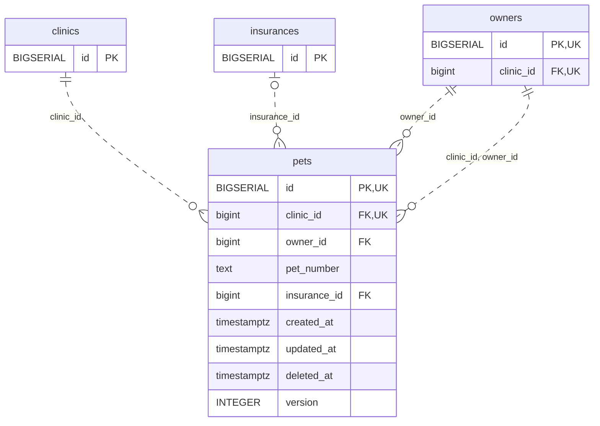

<!-- GENERATED: scripts/tools/generate-erd-detail.py; do not edit -->
# `pets`

[詳細ERD一覧](index.md) · [概要ERD](../erd.md)

このページは、マイグレーションをファイル名順に静的解析した最終定義です。稼働DBの状態は未確認です。

## カラム

型・DEFAULTはDDLの宣言表記です。`bigserial` は採番宣言であり、DBカタログ上の型名ではありません。

| カラム | 型（DDL） | NULL | DEFAULT（DDL） | キー構成列 | 定義元 |
|:---|:---|:---|:---|:---|:---|
| `id` | `BIGSERIAL` | NOT NULL | — | PK, UK | [001_init.sql:1131](../../../backend/migrations/001_init.sql#L1131) |
| `clinic_id` | `bigint` | NOT NULL | — | FK, UK | [001_init.sql:1132](../../../backend/migrations/001_init.sql#L1132) |
| `owner_id` | `bigint` | NOT NULL | — | FK | [001_init.sql:1133](../../../backend/migrations/001_init.sql#L1133) |
| `pet_number` | `text` | NOT NULL | `''` | — | [001_init.sql:1134](../../../backend/migrations/001_init.sql#L1134) |
| `insurance_id` | `bigint` | NULL | — | FK | [001_init.sql:1151](../../../backend/migrations/001_init.sql#L1151) |
| `created_at` | `timestamptz` | NOT NULL | `now()` | — | [001_init.sql:1159](../../../backend/migrations/001_init.sql#L1159) |
| `updated_at` | `timestamptz` | NOT NULL | `now()` | — | [001_init.sql:1160](../../../backend/migrations/001_init.sql#L1160) |
| `deleted_at` | `timestamptz` | NULL | — | — | [001_init.sql:1161](../../../backend/migrations/001_init.sql#L1161) |
| `version` | `INTEGER` | NOT NULL | `1` | — | [001_init.sql:4165](../../../backend/migrations/001_init.sql#L4165) |

PK/FK/UKはキーの構成列を示します。複合キーの各列が単独で一意という意味ではありません。部分uniqueは下記indexの述語を参照してください。

## ERD

このテーブルの全カラムと、すべての参照先を表示します。参照先はFKの対象列だけを表示し、全カラムは各テーブルのページに置きます。

親側の任意参照はFK列のNULL可否、子側の最大1件は無条件のPK/UNIQUEから導出します。部分uniqueによる条件付きの最大件数は図に反映せず、index一覧に記録します。実線はFK全列が子のPKに含まれる識別関係、破線はそれ以外です。

## 外部キー（全件）

| 制約 | 子の列（順序あり） | 参照先 | 親の列（順序あり） | 削除時の動作 | 定義元 |
|:---|:---|:---|:---|:---|:---|
| `pets_clinic_id_fkey` | `clinic_id` | [clinics](clinics.md) | `id` | `ON DELETE RESTRICT` | [001_init.sql:1132](../../../backend/migrations/001_init.sql#L1132) |
| `pets_owner_id_fkey` | `owner_id` | [owners](owners.md) | `id` | `ON DELETE RESTRICT` | [001_init.sql:1133](../../../backend/migrations/001_init.sql#L1133) |
| `pets_insurance_id_fkey` | `insurance_id` | [insurances](insurances.md) | `id` | `ON DELETE SET NULL` | [001_init.sql:1151](../../../backend/migrations/001_init.sql#L1151) |
| `fk_pets_clinic_owner` | `clinic_id, owner_id` | [owners](owners.md) | `clinic_id, id` | `ON DELETE RESTRICT` | [001_init.sql:4296](../../../backend/migrations/001_init.sql#L4296) |

正確なON UPDATE・MATCH・DEFERRABLE等を含む制約DDL:

- `pets_clinic_id_fkey`: `REFERENCES clinics(id) ON DELETE RESTRICT`
- `pets_owner_id_fkey`: `REFERENCES owners(id) ON DELETE RESTRICT`
- `pets_insurance_id_fkey`: `REFERENCES insurances(id) ON DELETE SET NULL`
- `fk_pets_clinic_owner`: `CONSTRAINT fk_pets_clinic_owner     FOREIGN KEY (clinic_id, owner_id)     REFERENCES owners (clinic_id, id)     ON DELETE RESTRICT`

## その他の制約

| 制約 | 種別 | DDL | 定義元 |
|:---|:---|:---|:---|
| `pets_pkey` | primary | `PRIMARY KEY` | [001_init.sql:1131](../../../backend/migrations/001_init.sql#L1131) |
| `uq_pets_clinic_id_id` | unique | `CONSTRAINT uq_pets_clinic_id_id     UNIQUE (clinic_id, id)` | [001_init.sql:4110](../../../backend/migrations/001_init.sql#L4110) |

## インデックス

| 名前 | UNIQUE | 述語 | DDL | 定義元 |
|:---|:---|:---|:---|:---|
| `idx_pets_clinic_id` | NO | — | `CREATE INDEX idx_pets_clinic_id ON pets(clinic_id)` | [001_init.sql:2259](../../../backend/migrations/001_init.sql#L2259) |
| `idx_pets_owner_id` | NO | `deleted_at IS NULL` | `CREATE INDEX idx_pets_owner_id   ON pets(owner_id)   WHERE deleted_at IS NULL` | [001_init.sql:2407](../../../backend/migrations/001_init.sql#L2407) |
| `idx_pets_insurance_id` | NO | `insurance_id IS NOT NULL` | `CREATE INDEX idx_pets_insurance_id ON pets(insurance_id) WHERE insurance_id IS NOT NULL` | [001_init.sql:2450](../../../backend/migrations/001_init.sql#L2450) |
| `idx_pets_pet_number_trgm` | NO | — | `CREATE INDEX idx_pets_pet_number_trgm   ON pets USING gin (pet_number gin_trgm_ops)` | [001_init.sql:6714](../../../backend/migrations/001_init.sql#L6714) |
