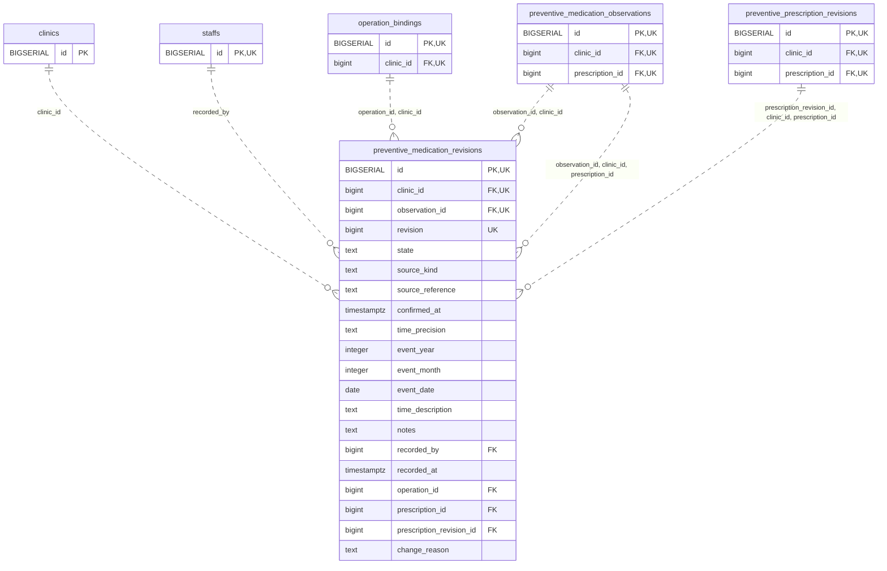

<!-- GENERATED: scripts/tools/generate-erd-detail.py; do not edit -->
# `preventive_medication_revisions`

[詳細ERD一覧](index.md) · [概要ERD](../erd.md)

このページは、マイグレーションをファイル名順に静的解析した最終定義です。稼働DBの状態は未確認です。

## カラム

型・DEFAULTはDDLの宣言表記です。`bigserial` は採番宣言であり、DBカタログ上の型名ではありません。

| カラム | 型（DDL） | NULL | DEFAULT（DDL） | キー構成列 | 定義元 |
|:---|:---|:---|:---|:---|:---|
| `id` | `BIGSERIAL` | NOT NULL | — | PK, UK | [001_init.sql:9229](../../../backend/migrations/001_init.sql#L9229) |
| `clinic_id` | `bigint` | NOT NULL | — | FK, UK | [001_init.sql:9230](../../../backend/migrations/001_init.sql#L9230) |
| `observation_id` | `bigint` | NOT NULL | — | FK, UK | [001_init.sql:9231](../../../backend/migrations/001_init.sql#L9231) |
| `revision` | `bigint` | NOT NULL | — | UK | [001_init.sql:9232](../../../backend/migrations/001_init.sql#L9232) |
| `state` | `text` | NOT NULL | — | — | [001_init.sql:9233](../../../backend/migrations/001_init.sql#L9233) |
| `source_kind` | `text` | NOT NULL | — | — | [001_init.sql:9234](../../../backend/migrations/001_init.sql#L9234) |
| `source_reference` | `text` | NULL | — | — | [001_init.sql:9235](../../../backend/migrations/001_init.sql#L9235) |
| `confirmed_at` | `timestamptz` | NULL | — | — | [001_init.sql:9236](../../../backend/migrations/001_init.sql#L9236) |
| `time_precision` | `text` | NULL | — | — | [001_init.sql:9237](../../../backend/migrations/001_init.sql#L9237) |
| `event_year` | `integer` | NULL | — | — | [001_init.sql:9238](../../../backend/migrations/001_init.sql#L9238) |
| `event_month` | `integer` | NULL | — | — | [001_init.sql:9239](../../../backend/migrations/001_init.sql#L9239) |
| `event_date` | `date` | NULL | — | — | [001_init.sql:9240](../../../backend/migrations/001_init.sql#L9240) |
| `time_description` | `text` | NULL | — | — | [001_init.sql:9241](../../../backend/migrations/001_init.sql#L9241) |
| `notes` | `text` | NULL | — | — | [001_init.sql:9242](../../../backend/migrations/001_init.sql#L9242) |
| `recorded_by` | `bigint` | NOT NULL | — | FK | [001_init.sql:9243](../../../backend/migrations/001_init.sql#L9243) |
| `recorded_at` | `timestamptz` | NOT NULL | `clock_timestamp()` | — | [001_init.sql:9244](../../../backend/migrations/001_init.sql#L9244) |
| `operation_id` | `bigint` | NOT NULL | — | FK | [001_init.sql:9245](../../../backend/migrations/001_init.sql#L9245) |
| `prescription_id` | `bigint` | NOT NULL | — | FK | [001_init.sql:10105](../../../backend/migrations/001_init.sql#L10105) |
| `prescription_revision_id` | `bigint` | NOT NULL | — | FK | [001_init.sql:10106](../../../backend/migrations/001_init.sql#L10106) |
| `change_reason` | `text` | NULL | — | — | [001_init.sql:10840](../../../backend/migrations/001_init.sql#L10840) |

PK/FK/UKはキーの構成列を示します。複合キーの各列が単独で一意という意味ではありません。部分uniqueは下記indexの述語を参照してください。

## ERD

このテーブルの全カラムと、すべての参照先を表示します。参照先はFKの対象列だけを表示し、全カラムは各テーブルのページに置きます。

親側の任意参照はFK列のNULL可否、子側の最大1件は無条件のPK/UNIQUEから導出します。部分uniqueによる条件付きの最大件数は図に反映せず、index一覧に記録します。実線はFK全列が子のPKに含まれる識別関係、破線はそれ以外です。

## 外部キー（全件）

| 制約 | 子の列（順序あり） | 参照先 | 親の列（順序あり） | 削除時の動作 | 定義元 |
|:---|:---|:---|:---|:---|:---|
| `preventive_medication_revisions_clinic_id_fkey` | `clinic_id` | [clinics](clinics.md) | `id` | `ON DELETE RESTRICT` | [001_init.sql:9230](../../../backend/migrations/001_init.sql#L9230) |
| `preventive_medication_revisions_recorded_by_fkey` | `recorded_by` | [staffs](staffs.md) | `id` | `ON DELETE RESTRICT` | [001_init.sql:9243](../../../backend/migrations/001_init.sql#L9243) |
| `preventive_medication_revisions_observation_id_clinic_id_fkey` | `observation_id, clinic_id` | [preventive_medication_observations](preventive_medication_observations.md) | `id, clinic_id` | `ON DELETE RESTRICT` | [001_init.sql:9249](../../../backend/migrations/001_init.sql#L9249) |
| `preventive_medication_revisions_operation_id_clinic_id_fkey` | `operation_id, clinic_id` | [operation_bindings](operation_bindings.md) | `id, clinic_id` | `ON DELETE RESTRICT` | [001_init.sql:9250](../../../backend/migrations/001_init.sql#L9250) |
| `fk_medication_observation_parent` | `observation_id, clinic_id, prescription_id` | [preventive_medication_observations](preventive_medication_observations.md) | `id, clinic_id, prescription_id` | `ON DELETE RESTRICT` | [001_init.sql:10107](../../../backend/migrations/001_init.sql#L10107) |
| `fk_medication_prescription_version` | `prescription_revision_id, clinic_id, prescription_id` | [preventive_prescription_revisions](preventive_prescription_revisions.md) | `id, clinic_id, prescription_id` | `ON DELETE RESTRICT` | [001_init.sql:10109](../../../backend/migrations/001_init.sql#L10109) |

正確なON UPDATE・MATCH・DEFERRABLE等を含む制約DDL:

- `preventive_medication_revisions_clinic_id_fkey`: `REFERENCES clinics(id) ON DELETE RESTRICT`
- `preventive_medication_revisions_recorded_by_fkey`: `REFERENCES staffs(id) ON DELETE RESTRICT`
- `preventive_medication_revisions_observation_id_clinic_id_fkey`: `FOREIGN KEY (observation_id,clinic_id) REFERENCES preventive_medication_observations(id,clinic_id) ON DELETE RESTRICT`
- `preventive_medication_revisions_operation_id_clinic_id_fkey`: `FOREIGN KEY (operation_id,clinic_id) REFERENCES operation_bindings(id,clinic_id) ON DELETE RESTRICT`
- `fk_medication_observation_parent`: `CONSTRAINT fk_medication_observation_parent  FOREIGN KEY(observation_id,clinic_id,prescription_id) REFERENCES preventive_medication_observations(id,clinic_id,prescription_id) ON DELETE RESTRICT`
- `fk_medication_prescription_version`: `CONSTRAINT fk_medication_prescription_version  FOREIGN KEY(prescription_revision_id,clinic_id,prescription_id) REFERENCES preventive_prescription_revisions(id,clinic_id,prescription_id) ON DELETE RESTRICT`

## その他の制約

| 制約 | 種別 | DDL | 定義元 |
|:---|:---|:---|:---|
| `preventive_medication_revisions_pkey` | primary | `PRIMARY KEY` | [001_init.sql:9229](../../../backend/migrations/001_init.sql#L9229) |
| `preventive_medication_revisions_revision_check` | check | `CHECK (revision > 0)` | [001_init.sql:9232](../../../backend/migrations/001_init.sql#L9232) |
| `preventive_medication_revisions_state_check` | check | `CHECK (state IN ('planned','taken','not_taken','unknown'))` | [001_init.sql:9233](../../../backend/migrations/001_init.sql#L9233) |
| `preventive_medication_revisions_source_kind_check` | check | `CHECK (source_kind IN ('performed_record','owner_report','legacy_unknown','other'))` | [001_init.sql:9234](../../../backend/migrations/001_init.sql#L9234) |
| `preventive_medication_revisions_id_clinic_id_key` | unique | `UNIQUE (id,clinic_id)` | [001_init.sql:9246](../../../backend/migrations/001_init.sql#L9246) |
| `preventive_medication_revisio_clinic_id_observation_id_revi_key` | unique | `UNIQUE (clinic_id,observation_id,revision)` | [001_init.sql:9247](../../../backend/migrations/001_init.sql#L9247) |
| `preventive_medication_revisions_check` | check | `CHECK (app_private.valid_partial_clinical_date(time_precision,event_year,event_month,event_date,time_description) IS TRUE)` | [001_init.sql:9248](../../../backend/migrations/001_init.sql#L9248) |

## インデックス

| 名前 | UNIQUE | 述語 | DDL | 定義元 |
|:---|:---|:---|:---|:---|
| `idx_preventive_medication_period` | NO | — | `CREATE INDEX idx_preventive_medication_period ON preventive_medication_revisions(clinic_id,event_year,event_month)` | [001_init.sql:9253](../../../backend/migrations/001_init.sql#L9253) |
