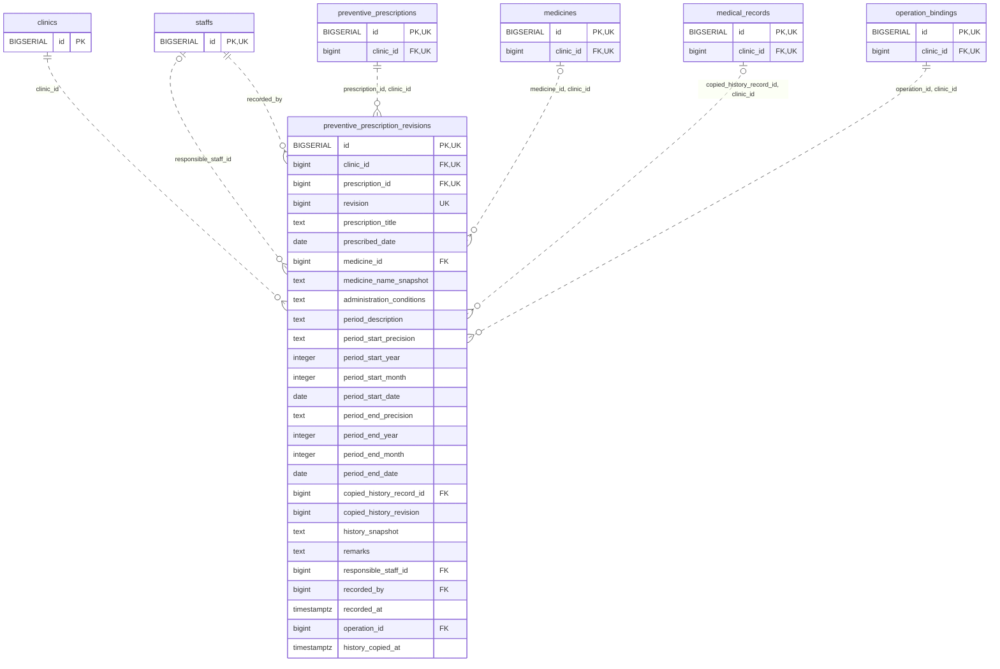

<!-- GENERATED: scripts/tools/generate-erd-detail.py; do not edit -->
# `preventive_prescription_revisions`

[詳細ERD一覧](index.md) · [概要ERD](../erd.md)

このページは、マイグレーションをファイル名順に静的解析した最終定義です。稼働DBの状態は未確認です。

## カラム

型・DEFAULTはDDLの宣言表記です。`bigserial` は採番宣言であり、DBカタログ上の型名ではありません。

| カラム | 型（DDL） | NULL | DEFAULT（DDL） | キー構成列 | 定義元 |
|:---|:---|:---|:---|:---|:---|
| `id` | `BIGSERIAL` | NOT NULL | — | PK, UK | [001_init.sql:9187](../../../backend/migrations/001_init.sql#L9187) |
| `clinic_id` | `bigint` | NOT NULL | — | FK, UK | [001_init.sql:9188](../../../backend/migrations/001_init.sql#L9188) |
| `prescription_id` | `bigint` | NOT NULL | — | FK, UK | [001_init.sql:9189](../../../backend/migrations/001_init.sql#L9189) |
| `revision` | `bigint` | NOT NULL | — | UK | [001_init.sql:9190](../../../backend/migrations/001_init.sql#L9190) |
| `prescription_title` | `text` | NULL | — | — | [001_init.sql:9191](../../../backend/migrations/001_init.sql#L9191) |
| `prescribed_date` | `date` | NULL | — | — | [001_init.sql:9192](../../../backend/migrations/001_init.sql#L9192) |
| `medicine_id` | `bigint` | NULL | — | FK | [001_init.sql:9193](../../../backend/migrations/001_init.sql#L9193) |
| `medicine_name_snapshot` | `text` | NULL | — | — | [001_init.sql:9194](../../../backend/migrations/001_init.sql#L9194) |
| `administration_conditions` | `text` | NULL | — | — | [001_init.sql:9195](../../../backend/migrations/001_init.sql#L9195) |
| `period_description` | `text` | NULL | — | — | [001_init.sql:9196](../../../backend/migrations/001_init.sql#L9196) |
| `period_start_precision` | `text` | NULL | — | — | [001_init.sql:9197](../../../backend/migrations/001_init.sql#L9197) |
| `period_start_year` | `integer` | NULL | — | — | [001_init.sql:9198](../../../backend/migrations/001_init.sql#L9198) |
| `period_start_month` | `integer` | NULL | — | — | [001_init.sql:9199](../../../backend/migrations/001_init.sql#L9199) |
| `period_start_date` | `date` | NULL | — | — | [001_init.sql:9200](../../../backend/migrations/001_init.sql#L9200) |
| `period_end_precision` | `text` | NULL | — | — | [001_init.sql:9201](../../../backend/migrations/001_init.sql#L9201) |
| `period_end_year` | `integer` | NULL | — | — | [001_init.sql:9202](../../../backend/migrations/001_init.sql#L9202) |
| `period_end_month` | `integer` | NULL | — | — | [001_init.sql:9203](../../../backend/migrations/001_init.sql#L9203) |
| `period_end_date` | `date` | NULL | — | — | [001_init.sql:9204](../../../backend/migrations/001_init.sql#L9204) |
| `copied_history_record_id` | `bigint` | NULL | — | FK | [001_init.sql:9205](../../../backend/migrations/001_init.sql#L9205) |
| `copied_history_revision` | `bigint` | NULL | — | — | [001_init.sql:9206](../../../backend/migrations/001_init.sql#L9206) |
| `history_snapshot` | `text` | NULL | — | — | [001_init.sql:9207](../../../backend/migrations/001_init.sql#L9207) |
| `remarks` | `text` | NULL | — | — | [001_init.sql:9208](../../../backend/migrations/001_init.sql#L9208) |
| `responsible_staff_id` | `bigint` | NULL | — | FK | [001_init.sql:9209](../../../backend/migrations/001_init.sql#L9209) |
| `recorded_by` | `bigint` | NOT NULL | — | FK | [001_init.sql:9210](../../../backend/migrations/001_init.sql#L9210) |
| `recorded_at` | `timestamptz` | NOT NULL | `clock_timestamp()` | — | [001_init.sql:9211](../../../backend/migrations/001_init.sql#L9211) |
| `operation_id` | `bigint` | NOT NULL | — | FK | [001_init.sql:9212](../../../backend/migrations/001_init.sql#L9212) |
| `history_copied_at` | `timestamptz` | NULL | — | — | [001_init.sql:10843](../../../backend/migrations/001_init.sql#L10843) |

PK/FK/UKはキーの構成列を示します。複合キーの各列が単独で一意という意味ではありません。部分uniqueは下記indexの述語を参照してください。

## ERD

このテーブルの全カラムと、すべての参照先を表示します。参照先はFKの対象列だけを表示し、全カラムは各テーブルのページに置きます。

親側の任意参照はFK列のNULL可否、子側の最大1件は無条件のPK/UNIQUEから導出します。部分uniqueによる条件付きの最大件数は図に反映せず、index一覧に記録します。実線はFK全列が子のPKに含まれる識別関係、破線はそれ以外です。

## 外部キー（全件）

| 制約 | 子の列（順序あり） | 参照先 | 親の列（順序あり） | 削除時の動作 | 定義元 |
|:---|:---|:---|:---|:---|:---|
| `preventive_prescription_revisions_clinic_id_fkey` | `clinic_id` | [clinics](clinics.md) | `id` | `ON DELETE RESTRICT` | [001_init.sql:9188](../../../backend/migrations/001_init.sql#L9188) |
| `preventive_prescription_revisions_responsible_staff_id_fkey` | `responsible_staff_id` | [staffs](staffs.md) | `id` | `ON DELETE RESTRICT` | [001_init.sql:9209](../../../backend/migrations/001_init.sql#L9209) |
| `preventive_prescription_revisions_recorded_by_fkey` | `recorded_by` | [staffs](staffs.md) | `id` | `ON DELETE RESTRICT` | [001_init.sql:9210](../../../backend/migrations/001_init.sql#L9210) |
| `preventive_prescription_revision_prescription_id_clinic_id_fkey` | `prescription_id, clinic_id` | [preventive_prescriptions](preventive_prescriptions.md) | `id, clinic_id` | `ON DELETE RESTRICT` | [001_init.sql:9217](../../../backend/migrations/001_init.sql#L9217) |
| `preventive_prescription_revisions_medicine_id_clinic_id_fkey` | `medicine_id, clinic_id` | [medicines](medicines.md) | `id, clinic_id` | `ON DELETE RESTRICT` | [001_init.sql:9218](../../../backend/migrations/001_init.sql#L9218) |
| `preventive_prescription_revis_copied_history_record_id_cli_fkey` | `copied_history_record_id, clinic_id` | [medical_records](medical_records.md) | `id, clinic_id` | `ON DELETE RESTRICT` | [001_init.sql:9219](../../../backend/migrations/001_init.sql#L9219) |
| `preventive_prescription_revisions_operation_id_clinic_id_fkey` | `operation_id, clinic_id` | [operation_bindings](operation_bindings.md) | `id, clinic_id` | `ON DELETE RESTRICT` | [001_init.sql:9220](../../../backend/migrations/001_init.sql#L9220) |

正確なON UPDATE・MATCH・DEFERRABLE等を含む制約DDL:

- `preventive_prescription_revisions_clinic_id_fkey`: `REFERENCES clinics(id) ON DELETE RESTRICT`
- `preventive_prescription_revisions_responsible_staff_id_fkey`: `REFERENCES staffs(id) ON DELETE RESTRICT`
- `preventive_prescription_revisions_recorded_by_fkey`: `REFERENCES staffs(id) ON DELETE RESTRICT`
- `preventive_prescription_revision_prescription_id_clinic_id_fkey`: `FOREIGN KEY (prescription_id,clinic_id) REFERENCES preventive_prescriptions(id,clinic_id) ON DELETE RESTRICT`
- `preventive_prescription_revisions_medicine_id_clinic_id_fkey`: `FOREIGN KEY (medicine_id,clinic_id) REFERENCES medicines(id,clinic_id) ON DELETE RESTRICT`
- `preventive_prescription_revis_copied_history_record_id_cli_fkey`: `FOREIGN KEY (copied_history_record_id,clinic_id) REFERENCES medical_records(id,clinic_id) ON DELETE RESTRICT`
- `preventive_prescription_revisions_operation_id_clinic_id_fkey`: `FOREIGN KEY (operation_id,clinic_id) REFERENCES operation_bindings(id,clinic_id) ON DELETE RESTRICT`

## その他の制約

| 制約 | 種別 | DDL | 定義元 |
|:---|:---|:---|:---|
| `preventive_prescription_revisions_pkey` | primary | `PRIMARY KEY` | [001_init.sql:9187](../../../backend/migrations/001_init.sql#L9187) |
| `preventive_prescription_revisions_revision_check` | check | `CHECK (revision > 0)` | [001_init.sql:9190](../../../backend/migrations/001_init.sql#L9190) |
| `preventive_prescription_revisions_copied_history_revision_check` | check | `CHECK (copied_history_revision > 0)` | [001_init.sql:9206](../../../backend/migrations/001_init.sql#L9206) |
| `preventive_prescription_revisions_id_clinic_id_key` | unique | `UNIQUE (id,clinic_id)` | [001_init.sql:9213](../../../backend/migrations/001_init.sql#L9213) |
| `preventive_prescription_revis_clinic_id_prescription_id_rev_key` | unique | `UNIQUE (clinic_id,prescription_id,revision)` | [001_init.sql:9214](../../../backend/migrations/001_init.sql#L9214) |
| `preventive_prescription_revisions_check` | check | `CHECK (app_private.valid_partial_clinical_date(period_start_precision,period_start_year,period_start_month,period_start_date,period_description) IS TRUE)` | [001_init.sql:9215](../../../backend/migrations/001_init.sql#L9215) |
| `preventive_prescription_revisions_check1` | check | `CHECK (app_private.valid_partial_clinical_date(period_end_precision,period_end_year,period_end_month,period_end_date,period_description) IS TRUE)` | [001_init.sql:9216](../../../backend/migrations/001_init.sql#L9216) |
| `uq_preventive_prescription_version_parent` | unique | `CONSTRAINT uq_preventive_prescription_version_parent UNIQUE(id,clinic_id,prescription_id)` | [001_init.sql:10106](../../../backend/migrations/001_init.sql#L10106) |

## インデックス

明示的なCREATE INDEXなし。PK/UNIQUEに付随する暗黙のindexは制約欄を参照してください。
