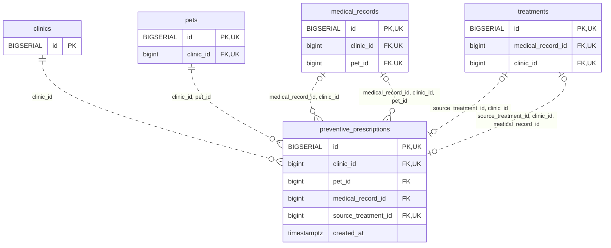

<!-- GENERATED: scripts/tools/generate-erd-detail.py; do not edit -->
# `preventive_prescriptions`

[詳細ERD一覧](index.md) · [概要ERD](../erd.md)

このページは、マイグレーションをファイル名順に静的解析した最終定義です。稼働DBの状態は未確認です。

## カラム

型・DEFAULTはDDLの宣言表記です。`bigserial` は採番宣言であり、DBカタログ上の型名ではありません。

| カラム | 型（DDL） | NULL | DEFAULT（DDL） | キー構成列 | 定義元 |
|:---|:---|:---|:---|:---|:---|
| `id` | `BIGSERIAL` | NOT NULL | — | PK, UK | [001_init.sql:9160](../../../backend/migrations/001_init.sql#L9160) |
| `clinic_id` | `bigint` | NOT NULL | — | FK, UK | [001_init.sql:9161](../../../backend/migrations/001_init.sql#L9161) |
| `pet_id` | `bigint` | NOT NULL | — | FK | [001_init.sql:9162](../../../backend/migrations/001_init.sql#L9162) |
| `medical_record_id` | `bigint` | NULL | — | FK | [001_init.sql:9163](../../../backend/migrations/001_init.sql#L9163) |
| `source_treatment_id` | `bigint` | NULL | — | FK, UK | [001_init.sql:9164](../../../backend/migrations/001_init.sql#L9164) |
| `created_at` | `timestamptz` | NOT NULL | `clock_timestamp()` | — | [001_init.sql:9165](../../../backend/migrations/001_init.sql#L9165) |

PK/FK/UKはキーの構成列を示します。複合キーの各列が単独で一意という意味ではありません。部分uniqueは下記indexの述語を参照してください。

## ERD

このテーブルの全カラムと、すべての参照先を表示します。参照先はFKの対象列だけを表示し、全カラムは各テーブルのページに置きます。

親側の任意参照はFK列のNULL可否、子側の最大1件は無条件のPK/UNIQUEから導出します。部分uniqueによる条件付きの最大件数は図に反映せず、index一覧に記録します。実線はFK全列が子のPKに含まれる識別関係、破線はそれ以外です。

## 外部キー（全件）

| 制約 | 子の列（順序あり） | 参照先 | 親の列（順序あり） | 削除時の動作 | 定義元 |
|:---|:---|:---|:---|:---|:---|
| `preventive_prescriptions_clinic_id_fkey` | `clinic_id` | [clinics](clinics.md) | `id` | `ON DELETE RESTRICT` | [001_init.sql:9161](../../../backend/migrations/001_init.sql#L9161) |
| `preventive_prescriptions_clinic_id_pet_id_fkey` | `clinic_id, pet_id` | [pets](pets.md) | `clinic_id, id` | `ON DELETE RESTRICT` | [001_init.sql:9168](../../../backend/migrations/001_init.sql#L9168) |
| `preventive_prescriptions_medical_record_id_clinic_id_fkey` | `medical_record_id, clinic_id` | [medical_records](medical_records.md) | `id, clinic_id` | `ON DELETE RESTRICT` | [001_init.sql:9169](../../../backend/migrations/001_init.sql#L9169) |
| `preventive_prescriptions_source_treatment_id_clinic_id_fkey` | `source_treatment_id, clinic_id` | [treatments](treatments.md) | `id, clinic_id` | `ON DELETE RESTRICT` | [001_init.sql:9170](../../../backend/migrations/001_init.sql#L9170) |
| `fk_preventive_record_patient` | `medical_record_id, clinic_id, pet_id` | [medical_records](medical_records.md) | `id, clinic_id, pet_id` | `ON DELETE RESTRICT` | [001_init.sql:10100](../../../backend/migrations/001_init.sql#L10100) |
| `fk_prescription_source_record` | `source_treatment_id, clinic_id, medical_record_id` | [treatments](treatments.md) | `id, clinic_id, medical_record_id` | `ON DELETE RESTRICT` | [001_init.sql:10104](../../../backend/migrations/001_init.sql#L10104) |

正確なON UPDATE・MATCH・DEFERRABLE等を含む制約DDL:

- `preventive_prescriptions_clinic_id_fkey`: `REFERENCES clinics(id) ON DELETE RESTRICT`
- `preventive_prescriptions_clinic_id_pet_id_fkey`: `FOREIGN KEY (clinic_id,pet_id) REFERENCES pets(clinic_id,id) ON DELETE RESTRICT`
- `preventive_prescriptions_medical_record_id_clinic_id_fkey`: `FOREIGN KEY (medical_record_id,clinic_id) REFERENCES medical_records(id,clinic_id) ON DELETE RESTRICT`
- `preventive_prescriptions_source_treatment_id_clinic_id_fkey`: `FOREIGN KEY (source_treatment_id,clinic_id) REFERENCES treatments(id,clinic_id) ON DELETE RESTRICT`
- `fk_preventive_record_patient`: `CONSTRAINT fk_preventive_record_patient  FOREIGN KEY(medical_record_id,clinic_id,pet_id) REFERENCES medical_records(id,clinic_id,pet_id) ON DELETE RESTRICT`
- `fk_prescription_source_record`: `CONSTRAINT fk_prescription_source_record  FOREIGN KEY(source_treatment_id,clinic_id,medical_record_id) REFERENCES treatments(id,clinic_id,medical_record_id) ON DELETE RESTRICT`

## その他の制約

| 制約 | 種別 | DDL | 定義元 |
|:---|:---|:---|:---|
| `preventive_prescriptions_pkey` | primary | `PRIMARY KEY` | [001_init.sql:9160](../../../backend/migrations/001_init.sql#L9160) |
| `preventive_prescriptions_id_clinic_id_key` | unique | `UNIQUE (id,clinic_id)` | [001_init.sql:9166](../../../backend/migrations/001_init.sql#L9166) |
| `preventive_prescriptions_clinic_id_source_treatment_id_key` | unique | `UNIQUE (clinic_id,source_treatment_id)` | [001_init.sql:9167](../../../backend/migrations/001_init.sql#L9167) |
| `ck_prescription_source_record` | check | `CONSTRAINT ck_prescription_source_record CHECK(source_treatment_id IS NULL OR medical_record_id IS NOT NULL)` | [001_init.sql:10103](../../../backend/migrations/001_init.sql#L10103) |

## インデックス

明示的なCREATE INDEXなし。PK/UNIQUEに付随する暗黙のindexは制約欄を参照してください。
