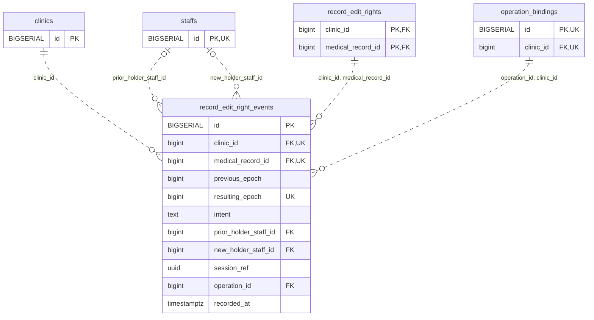

<!-- GENERATED: scripts/tools/generate-erd-detail.py; do not edit -->
# `record_edit_right_events`

[詳細ERD一覧](index.md) · [概要ERD](../erd.md)

このページは、マイグレーションをファイル名順に静的解析した最終定義です。稼働DBの状態は未確認です。

## カラム

型・DEFAULTはDDLの宣言表記です。`bigserial` は採番宣言であり、DBカタログ上の型名ではありません。

| カラム | 型（DDL） | NULL | DEFAULT（DDL） | キー構成列 | 定義元 |
|:---|:---|:---|:---|:---|:---|
| `id` | `BIGSERIAL` | NOT NULL | — | PK | [001_init.sql:9016](../../../backend/migrations/001_init.sql#L9016) |
| `clinic_id` | `bigint` | NOT NULL | — | FK, UK | [001_init.sql:9017](../../../backend/migrations/001_init.sql#L9017) |
| `medical_record_id` | `bigint` | NOT NULL | — | FK, UK | [001_init.sql:9018](../../../backend/migrations/001_init.sql#L9018) |
| `previous_epoch` | `bigint` | NOT NULL | — | — | [001_init.sql:9019](../../../backend/migrations/001_init.sql#L9019) |
| `resulting_epoch` | `bigint` | NOT NULL | — | UK | [001_init.sql:9020](../../../backend/migrations/001_init.sql#L9020) |
| `intent` | `text` | NOT NULL | — | — | [001_init.sql:9021](../../../backend/migrations/001_init.sql#L9021) |
| `prior_holder_staff_id` | `bigint` | NULL | — | FK | [001_init.sql:9022](../../../backend/migrations/001_init.sql#L9022) |
| `new_holder_staff_id` | `bigint` | NULL | — | FK | [001_init.sql:9023](../../../backend/migrations/001_init.sql#L9023) |
| `session_ref` | `uuid` | NULL | — | — | [001_init.sql:9024](../../../backend/migrations/001_init.sql#L9024) |
| `operation_id` | `bigint` | NOT NULL | — | FK | [001_init.sql:9025](../../../backend/migrations/001_init.sql#L9025) |
| `recorded_at` | `timestamptz` | NOT NULL | `clock_timestamp()` | — | [001_init.sql:9026](../../../backend/migrations/001_init.sql#L9026) |

PK/FK/UKはキーの構成列を示します。複合キーの各列が単独で一意という意味ではありません。部分uniqueは下記indexの述語を参照してください。

## ERD

このテーブルの全カラムと、すべての参照先を表示します。参照先はFKの対象列だけを表示し、全カラムは各テーブルのページに置きます。

親側の任意参照はFK列のNULL可否、子側の最大1件は無条件のPK/UNIQUEから導出します。部分uniqueによる条件付きの最大件数は図に反映せず、index一覧に記録します。実線はFK全列が子のPKに含まれる識別関係、破線はそれ以外です。

## 外部キー（全件）

| 制約 | 子の列（順序あり） | 参照先 | 親の列（順序あり） | 削除時の動作 | 定義元 |
|:---|:---|:---|:---|:---|:---|
| `record_edit_right_events_clinic_id_fkey` | `clinic_id` | [clinics](clinics.md) | `id` | `ON DELETE RESTRICT` | [001_init.sql:9017](../../../backend/migrations/001_init.sql#L9017) |
| `record_edit_right_events_prior_holder_staff_id_fkey` | `prior_holder_staff_id` | [staffs](staffs.md) | `id` | `ON DELETE RESTRICT` | [001_init.sql:9022](../../../backend/migrations/001_init.sql#L9022) |
| `record_edit_right_events_new_holder_staff_id_fkey` | `new_holder_staff_id` | [staffs](staffs.md) | `id` | `ON DELETE RESTRICT` | [001_init.sql:9023](../../../backend/migrations/001_init.sql#L9023) |
| `record_edit_right_events_clinic_id_medical_record_id_fkey` | `clinic_id, medical_record_id` | [record_edit_rights](record_edit_rights.md) | `clinic_id, medical_record_id` | `ON DELETE RESTRICT` | [001_init.sql:9028](../../../backend/migrations/001_init.sql#L9028) |
| `record_edit_right_events_operation_id_clinic_id_fkey` | `operation_id, clinic_id` | [operation_bindings](operation_bindings.md) | `id, clinic_id` | `ON DELETE RESTRICT` | [001_init.sql:9029](../../../backend/migrations/001_init.sql#L9029) |

正確なON UPDATE・MATCH・DEFERRABLE等を含む制約DDL:

- `record_edit_right_events_clinic_id_fkey`: `REFERENCES clinics(id) ON DELETE RESTRICT`
- `record_edit_right_events_prior_holder_staff_id_fkey`: `REFERENCES staffs(id) ON DELETE RESTRICT`
- `record_edit_right_events_new_holder_staff_id_fkey`: `REFERENCES staffs(id) ON DELETE RESTRICT`
- `record_edit_right_events_clinic_id_medical_record_id_fkey`: `FOREIGN KEY (clinic_id,medical_record_id) REFERENCES record_edit_rights(clinic_id,medical_record_id) ON DELETE RESTRICT`
- `record_edit_right_events_operation_id_clinic_id_fkey`: `FOREIGN KEY (operation_id,clinic_id) REFERENCES operation_bindings(id,clinic_id) ON DELETE RESTRICT`

## その他の制約

| 制約 | 種別 | DDL | 定義元 |
|:---|:---|:---|:---|
| `record_edit_right_events_pkey` | primary | `PRIMARY KEY` | [001_init.sql:9016](../../../backend/migrations/001_init.sql#L9016) |
| `record_edit_right_events_previous_epoch_check` | check | `CHECK (previous_epoch > 0)` | [001_init.sql:9019](../../../backend/migrations/001_init.sql#L9019) |
| `record_edit_right_events_check` | check | `CHECK (resulting_epoch > previous_epoch)` | [001_init.sql:9020](../../../backend/migrations/001_init.sql#L9020) |
| `record_edit_right_events_intent_check` | check | `CHECK (intent IN ('acquire','release','force_acquire','disconnect'))` | [001_init.sql:9021](../../../backend/migrations/001_init.sql#L9021) |
| `record_edit_right_events_clinic_id_medical_record_id_result_key` | unique | `UNIQUE (clinic_id,medical_record_id,resulting_epoch)` | [001_init.sql:9027](../../../backend/migrations/001_init.sql#L9027) |

## インデックス

明示的なCREATE INDEXなし。PK/UNIQUEに付随する暗黙のindexは制約欄を参照してください。
