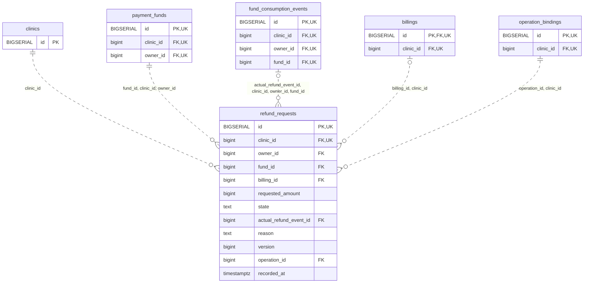

<!-- GENERATED: scripts/tools/generate-erd-detail.py; do not edit -->
# `refund_requests`

[詳細ERD一覧](index.md) · [概要ERD](../erd.md)

このページは、マイグレーションをファイル名順に静的解析した最終定義です。稼働DBの状態は未確認です。

## カラム

型・DEFAULTはDDLの宣言表記です。`bigserial` は採番宣言であり、DBカタログ上の型名ではありません。

| カラム | 型（DDL） | NULL | DEFAULT（DDL） | キー構成列 | 定義元 |
|:---|:---|:---|:---|:---|:---|
| `id` | `BIGSERIAL` | NOT NULL | — | PK, UK | [001_init.sql:9657](../../../backend/migrations/001_init.sql#L9657) |
| `clinic_id` | `bigint` | NOT NULL | — | FK, UK | [001_init.sql:9658](../../../backend/migrations/001_init.sql#L9658) |
| `owner_id` | `bigint` | NOT NULL | — | FK | [001_init.sql:9659](../../../backend/migrations/001_init.sql#L9659) |
| `fund_id` | `bigint` | NOT NULL | — | FK | [001_init.sql:9660](../../../backend/migrations/001_init.sql#L9660) |
| `billing_id` | `bigint` | NULL | — | FK | [001_init.sql:9661](../../../backend/migrations/001_init.sql#L9661) |
| `requested_amount` | `bigint` | NOT NULL | — | — | [001_init.sql:9662](../../../backend/migrations/001_init.sql#L9662) |
| `state` | `text` | NOT NULL | — | — | [001_init.sql:9663](../../../backend/migrations/001_init.sql#L9663) |
| `actual_refund_event_id` | `bigint` | NULL | — | FK | [001_init.sql:9664](../../../backend/migrations/001_init.sql#L9664) |
| `reason` | `text` | NOT NULL | — | — | [001_init.sql:9665](../../../backend/migrations/001_init.sql#L9665) |
| `version` | `bigint` | NOT NULL | `1` | — | [001_init.sql:9666](../../../backend/migrations/001_init.sql#L9666) |
| `operation_id` | `bigint` | NOT NULL | — | FK | [001_init.sql:9667](../../../backend/migrations/001_init.sql#L9667) |
| `recorded_at` | `timestamptz` | NOT NULL | `clock_timestamp()` | — | [001_init.sql:9668](../../../backend/migrations/001_init.sql#L9668) |

PK/FK/UKはキーの構成列を示します。複合キーの各列が単独で一意という意味ではありません。部分uniqueは下記indexの述語を参照してください。

## ERD

このテーブルの全カラムと、すべての参照先を表示します。参照先はFKの対象列だけを表示し、全カラムは各テーブルのページに置きます。

親側の任意参照はFK列のNULL可否、子側の最大1件は無条件のPK/UNIQUEから導出します。部分uniqueによる条件付きの最大件数は図に反映せず、index一覧に記録します。実線はFK全列が子のPKに含まれる識別関係、破線はそれ以外です。

## 外部キー（全件）

| 制約 | 子の列（順序あり） | 参照先 | 親の列（順序あり） | 削除時の動作 | 定義元 |
|:---|:---|:---|:---|:---|:---|
| `refund_requests_clinic_id_fkey` | `clinic_id` | [clinics](clinics.md) | `id` | `ON DELETE RESTRICT` | [001_init.sql:9658](../../../backend/migrations/001_init.sql#L9658) |
| `refund_requests_fund_id_clinic_id_owner_id_fkey` | `fund_id, clinic_id, owner_id` | [payment_funds](payment_funds.md) | `id, clinic_id, owner_id` | `ON DELETE RESTRICT` | [001_init.sql:9671](../../../backend/migrations/001_init.sql#L9671) |
| `refund_requests_actual_refund_event_id_clinic_id_owner_id__fkey` | `actual_refund_event_id, clinic_id, owner_id, fund_id` | [fund_consumption_events](fund_consumption_events.md) | `id, clinic_id, owner_id, fund_id` | `ON DELETE RESTRICT` | [001_init.sql:9672](../../../backend/migrations/001_init.sql#L9672) |
| `refund_requests_billing_id_clinic_id_fkey` | `billing_id, clinic_id` | [billings](billings.md) | `id, clinic_id` | `ON DELETE RESTRICT` | [001_init.sql:9673](../../../backend/migrations/001_init.sql#L9673) |
| `refund_requests_operation_id_clinic_id_fkey` | `operation_id, clinic_id` | [operation_bindings](operation_bindings.md) | `id, clinic_id` | `ON DELETE RESTRICT` | [001_init.sql:9674](../../../backend/migrations/001_init.sql#L9674) |

正確なON UPDATE・MATCH・DEFERRABLE等を含む制約DDL:

- `refund_requests_clinic_id_fkey`: `REFERENCES clinics(id) ON DELETE RESTRICT`
- `refund_requests_fund_id_clinic_id_owner_id_fkey`: `FOREIGN KEY (fund_id,clinic_id,owner_id) REFERENCES payment_funds(id,clinic_id,owner_id) ON DELETE RESTRICT`
- `refund_requests_actual_refund_event_id_clinic_id_owner_id__fkey`: `FOREIGN KEY (actual_refund_event_id,clinic_id,owner_id,fund_id) REFERENCES fund_consumption_events(id,clinic_id,owner_id,fund_id) ON DELETE RESTRICT`
- `refund_requests_billing_id_clinic_id_fkey`: `FOREIGN KEY (billing_id,clinic_id) REFERENCES billings(id,clinic_id) ON DELETE RESTRICT`
- `refund_requests_operation_id_clinic_id_fkey`: `FOREIGN KEY (operation_id,clinic_id) REFERENCES operation_bindings(id,clinic_id) ON DELETE RESTRICT`

## その他の制約

| 制約 | 種別 | DDL | 定義元 |
|:---|:---|:---|:---|
| `refund_requests_pkey` | primary | `PRIMARY KEY` | [001_init.sql:9657](../../../backend/migrations/001_init.sql#L9657) |
| `refund_requests_requested_amount_check` | check | `CHECK (requested_amount > 0)` | [001_init.sql:9662](../../../backend/migrations/001_init.sql#L9662) |
| `refund_requests_state_check` | check | `CHECK (state IN ('pending','performed','cancelled'))` | [001_init.sql:9663](../../../backend/migrations/001_init.sql#L9663) |
| `refund_requests_reason_check` | check | `CHECK (btrim(reason)<>'')` | [001_init.sql:9665](../../../backend/migrations/001_init.sql#L9665) |
| `refund_requests_version_check` | check | `CHECK (version > 0)` | [001_init.sql:9666](../../../backend/migrations/001_init.sql#L9666) |
| `refund_requests_check` | check | `CHECK ((state='performed' AND actual_refund_event_id IS NOT NULL) OR (state IN ('pending','cancelled') AND actual_refund_event_id IS NULL))` | [001_init.sql:9669](../../../backend/migrations/001_init.sql#L9669) |
| `refund_requests_id_clinic_id_key` | unique | `UNIQUE (id,clinic_id)` | [001_init.sql:9670](../../../backend/migrations/001_init.sql#L9670) |

## インデックス

明示的なCREATE INDEXなし。PK/UNIQUEに付随する暗黙のindexは制約欄を参照してください。
