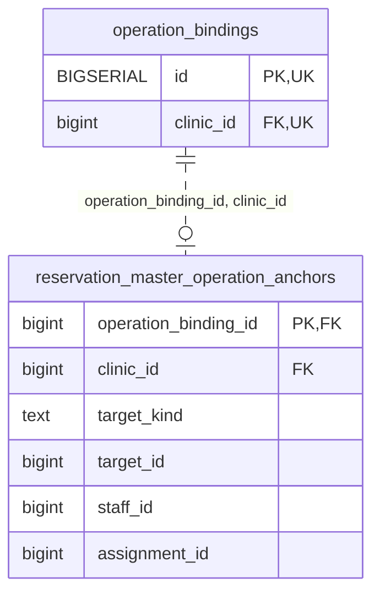

<!-- GENERATED: scripts/tools/generate-erd-detail.py; do not edit -->
# `reservation_master_operation_anchors`

[詳細ERD一覧](index.md) · [概要ERD](../erd.md)

このページは、マイグレーションをファイル名順に静的解析した最終定義です。稼働DBの状態は未確認です。

## カラム

型・DEFAULTはDDLの宣言表記です。`bigserial` は採番宣言であり、DBカタログ上の型名ではありません。

| カラム | 型（DDL） | NULL | DEFAULT（DDL） | キー構成列 | 定義元 |
|:---|:---|:---|:---|:---|:---|
| `operation_binding_id` | `bigint` | NOT NULL | — | PK, FK | [010_line_staff_start_policy_and_reservation_anchor.sql:86](../../../backend/migrations/010_line_staff_start_policy_and_reservation_anchor.sql#L86) |
| `clinic_id` | `bigint` | NOT NULL | — | FK | [010_line_staff_start_policy_and_reservation_anchor.sql:87](../../../backend/migrations/010_line_staff_start_policy_and_reservation_anchor.sql#L87) |
| `target_kind` | `text` | NOT NULL | — | — | [010_line_staff_start_policy_and_reservation_anchor.sql:88](../../../backend/migrations/010_line_staff_start_policy_and_reservation_anchor.sql#L88) |
| `target_id` | `bigint` | NULL | — | — | [010_line_staff_start_policy_and_reservation_anchor.sql:89](../../../backend/migrations/010_line_staff_start_policy_and_reservation_anchor.sql#L89) |
| `staff_id` | `bigint` | NULL | — | — | [010_line_staff_start_policy_and_reservation_anchor.sql:90](../../../backend/migrations/010_line_staff_start_policy_and_reservation_anchor.sql#L90) |
| `assignment_id` | `bigint` | NULL | — | — | [010_line_staff_start_policy_and_reservation_anchor.sql:91](../../../backend/migrations/010_line_staff_start_policy_and_reservation_anchor.sql#L91) |

PK/FK/UKはキーの構成列を示します。複合キーの各列が単独で一意という意味ではありません。部分uniqueは下記indexの述語を参照してください。

## ERD

このテーブルの全カラムと、すべての参照先を表示します。参照先はFKの対象列だけを表示し、全カラムは各テーブルのページに置きます。

親側の任意参照はFK列のNULL可否、子側の最大1件は無条件のPK/UNIQUEから導出します。部分uniqueによる条件付きの最大件数は図に反映せず、index一覧に記録します。実線はFK全列が子のPKに含まれる識別関係、破線はそれ以外です。

## 外部キー（全件）

| 制約 | 子の列（順序あり） | 参照先 | 親の列（順序あり） | 削除時の動作 | 定義元 |
|:---|:---|:---|:---|:---|:---|
| `reservation_master_operation__operation_binding_id_clinic__fkey` | `operation_binding_id, clinic_id` | [operation_bindings](operation_bindings.md) | `id, clinic_id` | `ON DELETE RESTRICT` | [010_line_staff_start_policy_and_reservation_anchor.sql:92](../../../backend/migrations/010_line_staff_start_policy_and_reservation_anchor.sql#L92) |

正確なON UPDATE・MATCH・DEFERRABLE等を含む制約DDL:

- `reservation_master_operation__operation_binding_id_clinic__fkey`: `FOREIGN KEY (operation_binding_id, clinic_id) REFERENCES operation_bindings (id, clinic_id) ON DELETE RESTRICT`

## その他の制約

| 制約 | 種別 | DDL | 定義元 |
|:---|:---|:---|:---|
| `reservation_master_operation_anchors_pkey` | primary | `PRIMARY KEY` | [010_line_staff_start_policy_and_reservation_anchor.sql:86](../../../backend/migrations/010_line_staff_start_policy_and_reservation_anchor.sql#L86) |
| `reservation_master_operation_anchors_operation_binding_id_check` | check | `CHECK (operation_binding_id > 0)` | [010_line_staff_start_policy_and_reservation_anchor.sql:86](../../../backend/migrations/010_line_staff_start_policy_and_reservation_anchor.sql#L86) |
| `reservation_master_operation_anchors_clinic_id_check` | check | `CHECK (clinic_id > 0)` | [010_line_staff_start_policy_and_reservation_anchor.sql:87](../../../backend/migrations/010_line_staff_start_policy_and_reservation_anchor.sql#L87) |
| `reservation_master_operation_anchors_target_kind_check` | check | `CHECK (target_kind IN ('type', 'group', 'line_start_policy'))` | [010_line_staff_start_policy_and_reservation_anchor.sql:88](../../../backend/migrations/010_line_staff_start_policy_and_reservation_anchor.sql#L88) |
| `reservation_master_operation_anchors_target_id_check` | check | `CHECK (target_id IS NULL OR target_id > 0)` | [010_line_staff_start_policy_and_reservation_anchor.sql:89](../../../backend/migrations/010_line_staff_start_policy_and_reservation_anchor.sql#L89) |
| `reservation_master_operation_anchors_staff_id_check` | check | `CHECK (staff_id IS NULL OR staff_id > 0)` | [010_line_staff_start_policy_and_reservation_anchor.sql:90](../../../backend/migrations/010_line_staff_start_policy_and_reservation_anchor.sql#L90) |
| `reservation_master_operation_anchors_assignment_id_check` | check | `CHECK (assignment_id IS NULL OR assignment_id > 0)` | [010_line_staff_start_policy_and_reservation_anchor.sql:91](../../../backend/migrations/010_line_staff_start_policy_and_reservation_anchor.sql#L91) |
| `reservation_master_operation_anchors_check` | check | `CHECK (         (target_kind IN ('type', 'group') AND staff_id IS NULL AND assignment_id IS NULL)         OR (target_kind = 'line_start_policy' AND target_id IS NOT NULL AND staff_id IS NOT NULL AND assignment_id IS NOT NULL)     )` | [010_line_staff_start_policy_and_reservation_anchor.sql:93](../../../backend/migrations/010_line_staff_start_policy_and_reservation_anchor.sql#L93) |

## インデックス

明示的なCREATE INDEXなし。PK/UNIQUEに付随する暗黙のindexは制約欄を参照してください。
