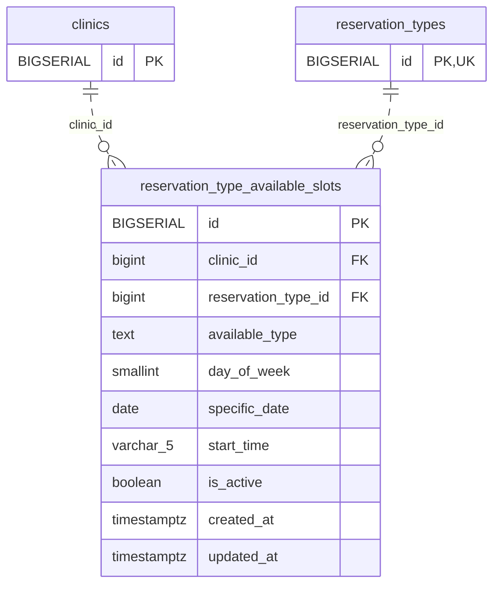

<!-- GENERATED: scripts/tools/generate-erd-detail.py; do not edit -->
# `reservation_type_available_slots`

[詳細ERD一覧](index.md) · [概要ERD](../erd.md)

このページは、マイグレーションをファイル名順に静的解析した最終定義です。稼働DBの状態は未確認です。

## カラム

型・DEFAULTはDDLの宣言表記です。`bigserial` は採番宣言であり、DBカタログ上の型名ではありません。

| カラム | 型（DDL） | NULL | DEFAULT（DDL） | キー構成列 | 定義元 |
|:---|:---|:---|:---|:---|:---|
| `id` | `BIGSERIAL` | NOT NULL | — | PK | [001_init.sql:881](../../../backend/migrations/001_init.sql#L881) |
| `clinic_id` | `bigint` | NOT NULL | — | FK | [001_init.sql:882](../../../backend/migrations/001_init.sql#L882) |
| `reservation_type_id` | `bigint` | NOT NULL | — | FK | [001_init.sql:883](../../../backend/migrations/001_init.sql#L883) |
| `available_type` | `text` | NOT NULL | — | — | [001_init.sql:884](../../../backend/migrations/001_init.sql#L884) |
| `day_of_week` | `smallint` | NULL | — | — | [001_init.sql:885](../../../backend/migrations/001_init.sql#L885) |
| `specific_date` | `date` | NULL | — | — | [001_init.sql:886](../../../backend/migrations/001_init.sql#L886) |
| `start_time` | `varchar(5)` | NOT NULL | — | — | [001_init.sql:887](../../../backend/migrations/001_init.sql#L887) |
| `is_active` | `boolean` | NOT NULL | `true` | — | [001_init.sql:888](../../../backend/migrations/001_init.sql#L888) |
| `created_at` | `timestamptz` | NOT NULL | `now()` | — | [001_init.sql:889](../../../backend/migrations/001_init.sql#L889) |
| `updated_at` | `timestamptz` | NOT NULL | `now()` | — | [001_init.sql:890](../../../backend/migrations/001_init.sql#L890) |

PK/FK/UKはキーの構成列を示します。複合キーの各列が単独で一意という意味ではありません。部分uniqueは下記indexの述語を参照してください。

## ERD

このテーブルの全カラムと、すべての参照先を表示します。参照先はFKの対象列だけを表示し、全カラムは各テーブルのページに置きます。

親側の任意参照はFK列のNULL可否、子側の最大1件は無条件のPK/UNIQUEから導出します。部分uniqueによる条件付きの最大件数は図に反映せず、index一覧に記録します。実線はFK全列が子のPKに含まれる識別関係、破線はそれ以外です。

## 外部キー（全件）

| 制約 | 子の列（順序あり） | 参照先 | 親の列（順序あり） | 削除時の動作 | 定義元 |
|:---|:---|:---|:---|:---|:---|
| `reservation_type_available_slots_clinic_id_fkey` | `clinic_id` | [clinics](clinics.md) | `id` | `ON DELETE RESTRICT` | [001_init.sql:882](../../../backend/migrations/001_init.sql#L882) |
| `reservation_type_available_slots_reservation_type_id_fkey` | `reservation_type_id` | [reservation_types](reservation_types.md) | `id` | `ON DELETE CASCADE` | [001_init.sql:883](../../../backend/migrations/001_init.sql#L883) |

正確なON UPDATE・MATCH・DEFERRABLE等を含む制約DDL:

- `reservation_type_available_slots_clinic_id_fkey`: `REFERENCES clinics(id) ON DELETE RESTRICT`
- `reservation_type_available_slots_reservation_type_id_fkey`: `REFERENCES reservation_types(id) ON DELETE CASCADE`

## その他の制約

| 制約 | 種別 | DDL | 定義元 |
|:---|:---|:---|:---|
| `reservation_type_available_slots_pkey` | primary | `PRIMARY KEY` | [001_init.sql:881](../../../backend/migrations/001_init.sql#L881) |
| `reservation_type_available_slots_available_type_check` | check | `CHECK (available_type IN ('weekly', 'specific'))` | [001_init.sql:884](../../../backend/migrations/001_init.sql#L884) |
| `reservation_type_available_slots_day_of_week_check` | check | `CHECK (day_of_week >= 0 AND day_of_week <= 6)` | [001_init.sql:885](../../../backend/migrations/001_init.sql#L885) |
| `reservation_type_available_slots_start_time_check` | check | `CHECK (start_time ~ '^[0-2][0-9]:[0-5][0-9]$')` | [001_init.sql:887](../../../backend/migrations/001_init.sql#L887) |

## インデックス

| 名前 | UNIQUE | 述語 | DDL | 定義元 |
|:---|:---|:---|:---|:---|
| `idx_rtype_available_slot_clinic_type` | NO | — | `CREATE INDEX idx_rtype_available_slot_clinic_type ON reservation_type_available_slots(clinic_id, reservation_type_id)` | [001_init.sql:893](../../../backend/migrations/001_init.sql#L893) |
| `idx_rtype_available_slot_weekly_unique` | YES | `available_type = 'weekly'` | `CREATE UNIQUE INDEX idx_rtype_available_slot_weekly_unique   ON reservation_type_available_slots(reservation_type_id, day_of_week, start_time) WHERE available_type = 'weekly'` | [001_init.sql:894](../../../backend/migrations/001_init.sql#L894) |
| `idx_rtype_available_slot_specific_unique` | YES | `available_type = 'specific'` | `CREATE UNIQUE INDEX idx_rtype_available_slot_specific_unique ON reservation_type_available_slots(reservation_type_id, specific_date, start_time) WHERE available_type = 'specific'` | [001_init.sql:895](../../../backend/migrations/001_init.sql#L895) |
