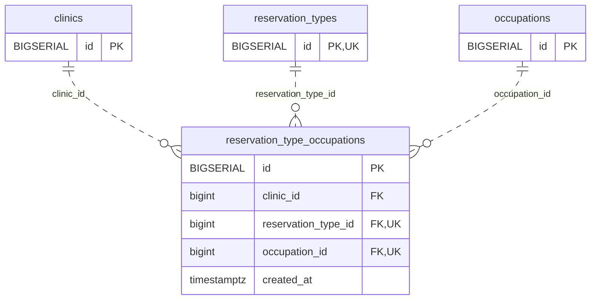

<!-- GENERATED: scripts/tools/generate-erd-detail.py; do not edit -->
# `reservation_type_occupations`

[詳細ERD一覧](index.md) · [概要ERD](../erd.md)

このページは、マイグレーションをファイル名順に静的解析した最終定義です。稼働DBの状態は未確認です。

## カラム

型・DEFAULTはDDLの宣言表記です。`bigserial` は採番宣言であり、DBカタログ上の型名ではありません。

| カラム | 型（DDL） | NULL | DEFAULT（DDL） | キー構成列 | 定義元 |
|:---|:---|:---|:---|:---|:---|
| `id` | `BIGSERIAL` | NOT NULL | — | PK | [001_init.sql:2790](../../../backend/migrations/001_init.sql#L2790) |
| `clinic_id` | `bigint` | NOT NULL | — | FK | [001_init.sql:2791](../../../backend/migrations/001_init.sql#L2791) |
| `reservation_type_id` | `bigint` | NOT NULL | — | FK, UK | [001_init.sql:2792](../../../backend/migrations/001_init.sql#L2792) |
| `occupation_id` | `bigint` | NOT NULL | — | FK, UK | [001_init.sql:2793](../../../backend/migrations/001_init.sql#L2793) |
| `created_at` | `timestamptz` | NOT NULL | `now()` | — | [001_init.sql:2794](../../../backend/migrations/001_init.sql#L2794) |

PK/FK/UKはキーの構成列を示します。複合キーの各列が単独で一意という意味ではありません。部分uniqueは下記indexの述語を参照してください。

## ERD

このテーブルの全カラムと、すべての参照先を表示します。参照先はFKの対象列だけを表示し、全カラムは各テーブルのページに置きます。

親側の任意参照はFK列のNULL可否、子側の最大1件は無条件のPK/UNIQUEから導出します。部分uniqueによる条件付きの最大件数は図に反映せず、index一覧に記録します。実線はFK全列が子のPKに含まれる識別関係、破線はそれ以外です。

## 外部キー（全件）

| 制約 | 子の列（順序あり） | 参照先 | 親の列（順序あり） | 削除時の動作 | 定義元 |
|:---|:---|:---|:---|:---|:---|
| `reservation_type_occupations_clinic_id_fkey` | `clinic_id` | [clinics](clinics.md) | `id` | `ON DELETE NO ACTION` | [001_init.sql:2791](../../../backend/migrations/001_init.sql#L2791) |
| `reservation_type_occupations_reservation_type_id_fkey` | `reservation_type_id` | [reservation_types](reservation_types.md) | `id` | `ON DELETE CASCADE` | [001_init.sql:2792](../../../backend/migrations/001_init.sql#L2792) |
| `reservation_type_occupations_occupation_id_fkey` | `occupation_id` | [occupations](occupations.md) | `id` | `ON DELETE CASCADE` | [001_init.sql:2793](../../../backend/migrations/001_init.sql#L2793) |

正確なON UPDATE・MATCH・DEFERRABLE等を含む制約DDL:

- `reservation_type_occupations_clinic_id_fkey`: `REFERENCES clinics(id)`
- `reservation_type_occupations_reservation_type_id_fkey`: `REFERENCES reservation_types(id) ON DELETE CASCADE`
- `reservation_type_occupations_occupation_id_fkey`: `REFERENCES occupations(id) ON DELETE CASCADE`

## その他の制約

| 制約 | 種別 | DDL | 定義元 |
|:---|:---|:---|:---|
| `reservation_type_occupations_pkey` | primary | `PRIMARY KEY` | [001_init.sql:2790](../../../backend/migrations/001_init.sql#L2790) |
| `reservation_type_occupations_reservation_type_id_occupation_key` | unique | `UNIQUE (reservation_type_id, occupation_id)` | [001_init.sql:2795](../../../backend/migrations/001_init.sql#L2795) |

## インデックス

| 名前 | UNIQUE | 述語 | DDL | 定義元 |
|:---|:---|:---|:---|:---|
| `idx_rtype_occupation_clinic` | NO | — | `CREATE INDEX idx_rtype_occupation_clinic     ON reservation_type_occupations(clinic_id, reservation_type_id)` | [001_init.sql:2799](../../../backend/migrations/001_init.sql#L2799) |
| `idx_rtype_occupation_occupation` | NO | — | `CREATE INDEX idx_rtype_occupation_occupation     ON reservation_type_occupations(occupation_id)` | [001_init.sql:2801](../../../backend/migrations/001_init.sql#L2801) |
