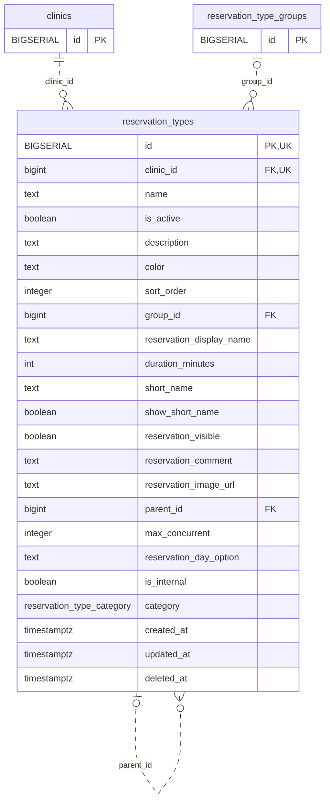

<!-- GENERATED: scripts/tools/generate-erd-detail.py; do not edit -->
# `reservation_types`

[詳細ERD一覧](index.md) · [概要ERD](../erd.md)

このページは、マイグレーションをファイル名順に静的解析した最終定義です。稼働DBの状態は未確認です。

## カラム

型・DEFAULTはDDLの宣言表記です。`bigserial` は採番宣言であり、DBカタログ上の型名ではありません。

| カラム | 型（DDL） | NULL | DEFAULT（DDL） | キー構成列 | 定義元 |
|:---|:---|:---|:---|:---|:---|
| `id` | `BIGSERIAL` | NOT NULL | — | PK, UK | [001_init.sql:828](../../../backend/migrations/001_init.sql#L828) |
| `clinic_id` | `bigint` | NOT NULL | — | FK, UK | [001_init.sql:829](../../../backend/migrations/001_init.sql#L829) |
| `name` | `text` | NOT NULL | — | — | [001_init.sql:830](../../../backend/migrations/001_init.sql#L830) |
| `is_active` | `boolean` | NOT NULL | `true` | — | [001_init.sql:831](../../../backend/migrations/001_init.sql#L831) |
| `description` | `text` | NOT NULL | `''` | — | [001_init.sql:832](../../../backend/migrations/001_init.sql#L832) |
| `color` | `text` | NOT NULL | `'#3B82F6'` | — | [001_init.sql:833](../../../backend/migrations/001_init.sql#L833) |
| `sort_order` | `integer` | NULL | `0` | — | [001_init.sql:834](../../../backend/migrations/001_init.sql#L834) |
| `group_id` | `bigint` | NULL | — | FK | [001_init.sql:835](../../../backend/migrations/001_init.sql#L835) |
| `reservation_display_name` | `text` | NOT NULL | `''` | — | [001_init.sql:836](../../../backend/migrations/001_init.sql#L836) |
| `duration_minutes` | `int` | NOT NULL | `15` | — | [001_init.sql:837](../../../backend/migrations/001_init.sql#L837) |
| `short_name` | `text` | NOT NULL | `''` | — | [001_init.sql:838](../../../backend/migrations/001_init.sql#L838) |
| `show_short_name` | `boolean` | NOT NULL | `false` | — | [001_init.sql:839](../../../backend/migrations/001_init.sql#L839) |
| `reservation_visible` | `boolean` | NOT NULL | `true` | — | [001_init.sql:840](../../../backend/migrations/001_init.sql#L840) |
| `reservation_comment` | `text` | NOT NULL | `''` | — | [001_init.sql:841](../../../backend/migrations/001_init.sql#L841) |
| `reservation_image_url` | `text` | NOT NULL | `''` | — | [001_init.sql:842](../../../backend/migrations/001_init.sql#L842) |
| `parent_id` | `bigint` | NULL | — | FK | [001_init.sql:843](../../../backend/migrations/001_init.sql#L843) |
| `max_concurrent` | `integer` | NULL | — | — | [001_init.sql:844](../../../backend/migrations/001_init.sql#L844) |
| `reservation_day_option` | `text` | NOT NULL | `'none'` | — | [001_init.sql:845](../../../backend/migrations/001_init.sql#L845) |
| `is_internal` | `boolean` | NOT NULL | `false` | — | [001_init.sql:846](../../../backend/migrations/001_init.sql#L846) |
| `category` | `reservation_type_category` | NOT NULL | `'general'` | — | [001_init.sql:847](../../../backend/migrations/001_init.sql#L847) |
| `created_at` | `timestamptz` | NOT NULL | `now()` | — | [001_init.sql:848](../../../backend/migrations/001_init.sql#L848) |
| `updated_at` | `timestamptz` | NOT NULL | `now()` | — | [001_init.sql:849](../../../backend/migrations/001_init.sql#L849) |
| `deleted_at` | `timestamptz` | NULL | — | — | [001_init.sql:850](../../../backend/migrations/001_init.sql#L850) |

PK/FK/UKはキーの構成列を示します。複合キーの各列が単独で一意という意味ではありません。部分uniqueは下記indexの述語を参照してください。

## ERD

このテーブルの全カラムと、すべての参照先を表示します。参照先はFKの対象列だけを表示し、全カラムは各テーブルのページに置きます。

親側の任意参照はFK列のNULL可否、子側の最大1件は無条件のPK/UNIQUEから導出します。部分uniqueによる条件付きの最大件数は図に反映せず、index一覧に記録します。実線はFK全列が子のPKに含まれる識別関係、破線はそれ以外です。

## 外部キー（全件）

| 制約 | 子の列（順序あり） | 参照先 | 親の列（順序あり） | 削除時の動作 | 定義元 |
|:---|:---|:---|:---|:---|:---|
| `reservation_types_clinic_id_fkey` | `clinic_id` | [clinics](clinics.md) | `id` | `ON DELETE RESTRICT` | [001_init.sql:829](../../../backend/migrations/001_init.sql#L829) |
| `reservation_types_group_id_fkey` | `group_id` | [reservation_type_groups](reservation_type_groups.md) | `id` | `ON DELETE SET NULL` | [001_init.sql:835](../../../backend/migrations/001_init.sql#L835) |
| `reservation_types_parent_id_fkey` | `parent_id` | [reservation_types](reservation_types.md) | `id` | `ON DELETE RESTRICT` | [001_init.sql:843](../../../backend/migrations/001_init.sql#L843) |

正確なON UPDATE・MATCH・DEFERRABLE等を含む制約DDL:

- `reservation_types_clinic_id_fkey`: `REFERENCES clinics(id) ON DELETE RESTRICT`
- `reservation_types_group_id_fkey`: `REFERENCES reservation_type_groups(id) ON DELETE SET NULL`
- `reservation_types_parent_id_fkey`: `REFERENCES reservation_types(id) ON DELETE RESTRICT`

## その他の制約

| 制約 | 種別 | DDL | 定義元 |
|:---|:---|:---|:---|
| `reservation_types_pkey` | primary | `PRIMARY KEY` | [001_init.sql:828](../../../backend/migrations/001_init.sql#L828) |
| `reservation_types_max_concurrent_check` | check | `CHECK (max_concurrent > 0)` | [001_init.sql:844](../../../backend/migrations/001_init.sql#L844) |
| `uq_reservation_types_id_clinic` | unique | `CONSTRAINT uq_reservation_types_id_clinic UNIQUE (id, clinic_id)` | [001_init.sql:863](../../../backend/migrations/001_init.sql#L863) |

## インデックス

| 名前 | UNIQUE | 述語 | DDL | 定義元 |
|:---|:---|:---|:---|:---|
| `idx_reservation_types_group_id` | NO | — | `CREATE INDEX idx_reservation_types_group_id ON reservation_types(group_id)` | [001_init.sql:853](../../../backend/migrations/001_init.sql#L853) |
| `idx_reservation_types_parent` | NO | `parent_id IS NOT NULL AND deleted_at IS NULL` | `CREATE INDEX idx_reservation_types_parent   ON reservation_types(parent_id)   WHERE parent_id IS NOT NULL AND deleted_at IS NULL` | [001_init.sql:858](../../../backend/migrations/001_init.sql#L858) |
| `idx_reservation_types_clinic_id` | NO | — | `CREATE INDEX idx_reservation_types_clinic_id ON reservation_types(clinic_id)` | [001_init.sql:2228](../../../backend/migrations/001_init.sql#L2228) |
| `idx_reservation_types_clinic_sort` | NO | `deleted_at IS NULL` | `CREATE INDEX idx_reservation_types_clinic_sort ON reservation_types(clinic_id, sort_order)       WHERE deleted_at IS NULL` | [001_init.sql:2274](../../../backend/migrations/001_init.sql#L2274) |
| `idx_reservation_types_clinic_name` | YES | `deleted_at IS NULL` | `CREATE UNIQUE INDEX idx_reservation_types_clinic_name ON reservation_types(clinic_id, name) WHERE deleted_at IS NULL` | [001_init.sql:2464](../../../backend/migrations/001_init.sql#L2464) |
| `idx_reservation_types_active` | NO | `deleted_at IS NULL` | `CREATE INDEX idx_reservation_types_active ON reservation_types(id) WHERE deleted_at IS NULL` | [001_init.sql:2484](../../../backend/migrations/001_init.sql#L2484) |
