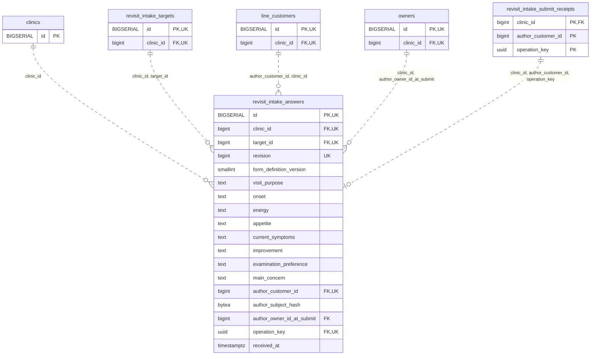

<!-- GENERATED: scripts/tools/generate-erd-detail.py; do not edit -->
# `revisit_intake_answers`

[詳細ERD一覧](index.md) · [概要ERD](../erd.md)

このページは、マイグレーションをファイル名順に静的解析した最終定義です。稼働DBの状態は未確認です。

## カラム

型・DEFAULTはDDLの宣言表記です。`bigserial` は採番宣言であり、DBカタログ上の型名ではありません。

| カラム | 型（DDL） | NULL | DEFAULT（DDL） | キー構成列 | 定義元 |
|:---|:---|:---|:---|:---|:---|
| `id` | `BIGSERIAL` | NOT NULL | — | PK, UK | [001_init.sql:7635](../../../backend/migrations/001_init.sql#L7635) |
| `clinic_id` | `bigint` | NOT NULL | — | FK, UK | [001_init.sql:7636](../../../backend/migrations/001_init.sql#L7636) |
| `target_id` | `bigint` | NOT NULL | — | FK, UK | [001_init.sql:7637](../../../backend/migrations/001_init.sql#L7637) |
| `revision` | `bigint` | NOT NULL | — | UK | [001_init.sql:7638](../../../backend/migrations/001_init.sql#L7638) |
| `form_definition_version` | `smallint` | NOT NULL | — | — | [001_init.sql:7639](../../../backend/migrations/001_init.sql#L7639) |
| `visit_purpose` | `text` | NOT NULL | — | — | [001_init.sql:7640](../../../backend/migrations/001_init.sql#L7640) |
| `onset` | `text` | NULL | — | — | [001_init.sql:7641](../../../backend/migrations/001_init.sql#L7641) |
| `energy` | `text` | NULL | — | — | [001_init.sql:7642](../../../backend/migrations/001_init.sql#L7642) |
| `appetite` | `text` | NULL | — | — | [001_init.sql:7643](../../../backend/migrations/001_init.sql#L7643) |
| `current_symptoms` | `text` | NULL | — | — | [001_init.sql:7644](../../../backend/migrations/001_init.sql#L7644) |
| `improvement` | `text` | NULL | — | — | [001_init.sql:7645](../../../backend/migrations/001_init.sql#L7645) |
| `examination_preference` | `text` | NULL | — | — | [001_init.sql:7647](../../../backend/migrations/001_init.sql#L7647) |
| `main_concern` | `text` | NULL | — | — | [001_init.sql:7649](../../../backend/migrations/001_init.sql#L7649) |
| `author_customer_id` | `bigint` | NOT NULL | — | FK, UK | [001_init.sql:7650](../../../backend/migrations/001_init.sql#L7650) |
| `author_subject_hash` | `bytea` | NOT NULL | — | — | [001_init.sql:7651](../../../backend/migrations/001_init.sql#L7651) |
| `author_owner_id_at_submit` | `bigint` | NOT NULL | — | FK | [001_init.sql:7652](../../../backend/migrations/001_init.sql#L7652) |
| `operation_key` | `uuid` | NOT NULL | — | FK, UK | [001_init.sql:7653](../../../backend/migrations/001_init.sql#L7653) |
| `received_at` | `timestamptz` | NOT NULL | `clock_timestamp()` | — | [001_init.sql:7654](../../../backend/migrations/001_init.sql#L7654) |

PK/FK/UKはキーの構成列を示します。複合キーの各列が単独で一意という意味ではありません。部分uniqueは下記indexの述語を参照してください。

## ERD

このテーブルの全カラムと、すべての参照先を表示します。参照先はFKの対象列だけを表示し、全カラムは各テーブルのページに置きます。

親側の任意参照はFK列のNULL可否、子側の最大1件は無条件のPK/UNIQUEから導出します。部分uniqueによる条件付きの最大件数は図に反映せず、index一覧に記録します。実線はFK全列が子のPKに含まれる識別関係、破線はそれ以外です。

## 外部キー（全件）

| 制約 | 子の列（順序あり） | 参照先 | 親の列（順序あり） | 削除時の動作 | 定義元 |
|:---|:---|:---|:---|:---|:---|
| `revisit_intake_answers_clinic_id_fkey` | `clinic_id` | [clinics](clinics.md) | `id` | `ON DELETE RESTRICT` | [001_init.sql:7636](../../../backend/migrations/001_init.sql#L7636) |
| `revisit_intake_answers_clinic_id_target_id_fkey` | `clinic_id, target_id` | [revisit_intake_targets](revisit_intake_targets.md) | `clinic_id, id` | `ON DELETE RESTRICT` | [001_init.sql:7658](../../../backend/migrations/001_init.sql#L7658) |
| `revisit_intake_answers_author_customer_id_clinic_id_fkey` | `author_customer_id, clinic_id` | [line_customers](line_customers.md) | `id, clinic_id` | `ON DELETE RESTRICT` | [001_init.sql:7660](../../../backend/migrations/001_init.sql#L7660) |
| `revisit_intake_answers_clinic_id_author_owner_id_at_submit_fkey` | `clinic_id, author_owner_id_at_submit` | [owners](owners.md) | `clinic_id, id` | `ON DELETE RESTRICT` | [001_init.sql:7662](../../../backend/migrations/001_init.sql#L7662) |
| `revisit_intake_answers_clinic_id_author_customer_id_operat_fkey` | `clinic_id, author_customer_id, operation_key` | [revisit_intake_submit_receipts](revisit_intake_submit_receipts.md) | `clinic_id, author_customer_id, operation_key` | `ON DELETE RESTRICT` | [001_init.sql:7664](../../../backend/migrations/001_init.sql#L7664) |

正確なON UPDATE・MATCH・DEFERRABLE等を含む制約DDL:

- `revisit_intake_answers_clinic_id_fkey`: `REFERENCES clinics(id) ON DELETE RESTRICT`
- `revisit_intake_answers_clinic_id_target_id_fkey`: `FOREIGN KEY (clinic_id, target_id)         REFERENCES revisit_intake_targets(clinic_id, id) ON DELETE RESTRICT`
- `revisit_intake_answers_author_customer_id_clinic_id_fkey`: `FOREIGN KEY (author_customer_id, clinic_id)         REFERENCES line_customers(id, clinic_id) ON DELETE RESTRICT`
- `revisit_intake_answers_clinic_id_author_owner_id_at_submit_fkey`: `FOREIGN KEY (clinic_id, author_owner_id_at_submit)         REFERENCES owners(clinic_id, id) ON DELETE RESTRICT`
- `revisit_intake_answers_clinic_id_author_customer_id_operat_fkey`: `FOREIGN KEY (clinic_id, author_customer_id, operation_key)         REFERENCES revisit_intake_submit_receipts(clinic_id, author_customer_id, operation_key)         ON DELETE RESTRICT`

## その他の制約

| 制約 | 種別 | DDL | 定義元 |
|:---|:---|:---|:---|
| `revisit_intake_answers_pkey` | primary | `PRIMARY KEY` | [001_init.sql:7635](../../../backend/migrations/001_init.sql#L7635) |
| `revisit_intake_answers_revision_check` | check | `CHECK (revision > 0)` | [001_init.sql:7638](../../../backend/migrations/001_init.sql#L7638) |
| `revisit_intake_answers_form_definition_version_check` | check | `CHECK (form_definition_version = 1)` | [001_init.sql:7639](../../../backend/migrations/001_init.sql#L7639) |
| `revisit_intake_answers_visit_purpose_check` | check | `CHECK (btrim(visit_purpose) <> '')` | [001_init.sql:7640](../../../backend/migrations/001_init.sql#L7640) |
| `revisit_intake_answers_energy_check` | check | `CHECK (energy IN ('usual', 'slightly_reduced', 'markedly_reduced'))` | [001_init.sql:7642](../../../backend/migrations/001_init.sql#L7642) |
| `revisit_intake_answers_appetite_check` | check | `CHECK (appetite IN ('usual', 'slightly_reduced', 'markedly_reduced'))` | [001_init.sql:7643](../../../backend/migrations/001_init.sql#L7643) |
| `revisit_intake_answers_improvement_check` | check | `CHECK (improvement IN         ('improved', 'slightly_improved', 'unchanged', 'worse', 'new_symptoms'))` | [001_init.sql:7645](../../../backend/migrations/001_init.sql#L7645) |
| `revisit_intake_answers_examination_preference_check` | check | `CHECK (examination_preference IN         ('consultation_only', 'medication_only', 'examination', 'decide_with_vet'))` | [001_init.sql:7647](../../../backend/migrations/001_init.sql#L7647) |
| `revisit_intake_answers_author_subject_hash_check` | check | `CHECK (octet_length(author_subject_hash) = 32)` | [001_init.sql:7651](../../../backend/migrations/001_init.sql#L7651) |
| `revisit_intake_answers_clinic_id_id_key` | unique | `UNIQUE (clinic_id, id)` | [001_init.sql:7655](../../../backend/migrations/001_init.sql#L7655) |
| `revisit_intake_answers_clinic_id_target_id_revision_key` | unique | `UNIQUE (clinic_id, target_id, revision)` | [001_init.sql:7656](../../../backend/migrations/001_init.sql#L7656) |
| `revisit_intake_answers_clinic_id_author_customer_id_operati_key` | unique | `UNIQUE (clinic_id, author_customer_id, operation_key)` | [001_init.sql:7657](../../../backend/migrations/001_init.sql#L7657) |

## インデックス

| 名前 | UNIQUE | 述語 | DDL | 定義元 |
|:---|:---|:---|:---|:---|
| `idx_revisit_answers_clinic_author` | NO | — | `CREATE INDEX idx_revisit_answers_clinic_author     ON revisit_intake_answers(clinic_id, author_customer_id, received_at, id)` | [001_init.sql:7676](../../../backend/migrations/001_init.sql#L7676) |
