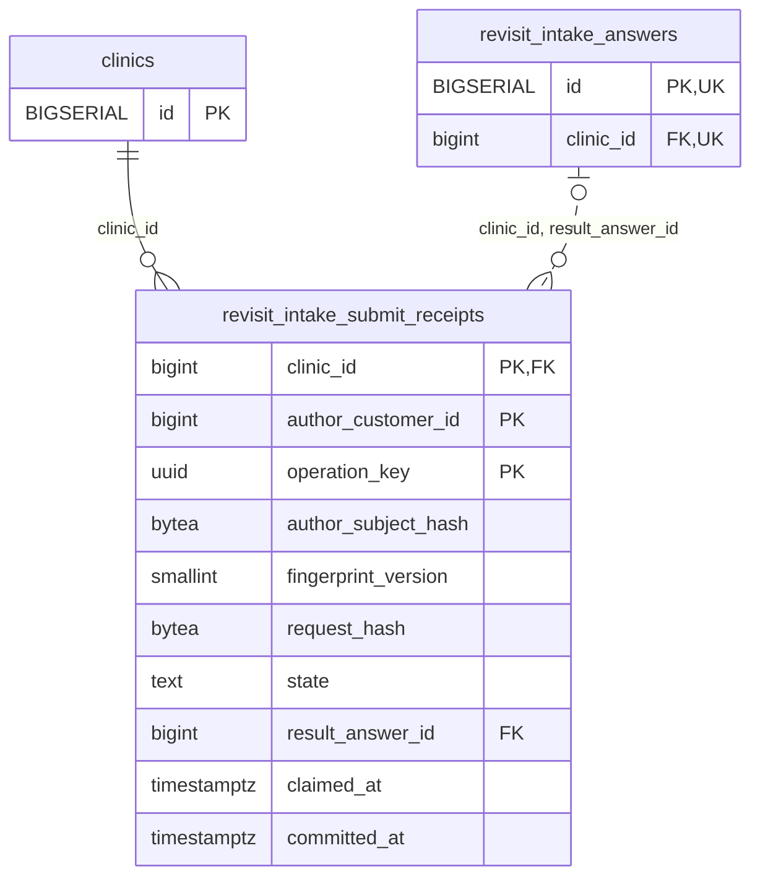

<!-- GENERATED: scripts/tools/generate-erd-detail.py; do not edit -->
# `revisit_intake_submit_receipts`

[詳細ERD一覧](index.md) · [概要ERD](../erd.md)

このページは、マイグレーションをファイル名順に静的解析した最終定義です。稼働DBの状態は未確認です。

## カラム

型・DEFAULTはDDLの宣言表記です。`bigserial` は採番宣言であり、DBカタログ上の型名ではありません。

| カラム | 型（DDL） | NULL | DEFAULT（DDL） | キー構成列 | 定義元 |
|:---|:---|:---|:---|:---|:---|
| `clinic_id` | `bigint` | NOT NULL | — | PK, FK | [001_init.sql:7640](../../../backend/migrations/001_init.sql#L7640) |
| `author_customer_id` | `bigint` | NOT NULL | — | PK | [001_init.sql:7641](../../../backend/migrations/001_init.sql#L7641) |
| `operation_key` | `uuid` | NOT NULL | — | PK | [001_init.sql:7642](../../../backend/migrations/001_init.sql#L7642) |
| `author_subject_hash` | `bytea` | NOT NULL | — | — | [001_init.sql:7643](../../../backend/migrations/001_init.sql#L7643) |
| `fingerprint_version` | `smallint` | NOT NULL | `1` | — | [001_init.sql:7644](../../../backend/migrations/001_init.sql#L7644) |
| `request_hash` | `bytea` | NOT NULL | — | — | [001_init.sql:7645](../../../backend/migrations/001_init.sql#L7645) |
| `state` | `text` | NOT NULL | `'claimed'` | — | [001_init.sql:7646](../../../backend/migrations/001_init.sql#L7646) |
| `result_answer_id` | `bigint` | NULL | — | FK | [001_init.sql:7647](../../../backend/migrations/001_init.sql#L7647) |
| `claimed_at` | `timestamptz` | NOT NULL | `clock_timestamp()` | — | [001_init.sql:7648](../../../backend/migrations/001_init.sql#L7648) |
| `committed_at` | `timestamptz` | NULL | — | — | [001_init.sql:7649](../../../backend/migrations/001_init.sql#L7649) |

PK/FK/UKはキーの構成列を示します。複合キーの各列が単独で一意という意味ではありません。部分uniqueは下記indexの述語を参照してください。

## ERD

このテーブルの全カラムと、すべての参照先を表示します。参照先はFKの対象列だけを表示し、全カラムは各テーブルのページに置きます。

親側の任意参照はFK列のNULL可否、子側の最大1件は無条件のPK/UNIQUEから導出します。部分uniqueによる条件付きの最大件数は図に反映せず、index一覧に記録します。実線はFK全列が子のPKに含まれる識別関係、破線はそれ以外です。

## 外部キー（全件）

| 制約 | 子の列（順序あり） | 参照先 | 親の列（順序あり） | 削除時の動作 | 定義元 |
|:---|:---|:---|:---|:---|:---|
| `revisit_intake_submit_receipts_clinic_id_fkey` | `clinic_id` | [clinics](clinics.md) | `id` | `ON DELETE RESTRICT` | [001_init.sql:7640](../../../backend/migrations/001_init.sql#L7640) |
| `fk_revisit_receipt_answer` | `clinic_id, result_answer_id` | [revisit_intake_answers](revisit_intake_answers.md) | `clinic_id, id` | `ON DELETE RESTRICT` | [001_init.sql:7692](../../../backend/migrations/001_init.sql#L7692) |

正確なON UPDATE・MATCH・DEFERRABLE等を含む制約DDL:

- `revisit_intake_submit_receipts_clinic_id_fkey`: `REFERENCES clinics(id) ON DELETE RESTRICT`
- `fk_revisit_receipt_answer`: `CONSTRAINT fk_revisit_receipt_answer     FOREIGN KEY (clinic_id, result_answer_id)     REFERENCES revisit_intake_answers(clinic_id, id) ON DELETE RESTRICT`

## その他の制約

| 制約 | 種別 | DDL | 定義元 |
|:---|:---|:---|:---|
| `revisit_intake_submit_receipts_author_customer_id_check` | check | `CHECK (author_customer_id > 0)` | [001_init.sql:7641](../../../backend/migrations/001_init.sql#L7641) |
| `revisit_intake_submit_receipts_author_subject_hash_check` | check | `CHECK (octet_length(author_subject_hash) = 32)` | [001_init.sql:7643](../../../backend/migrations/001_init.sql#L7643) |
| `revisit_intake_submit_receipts_fingerprint_version_check` | check | `CHECK (fingerprint_version = 1)` | [001_init.sql:7644](../../../backend/migrations/001_init.sql#L7644) |
| `revisit_intake_submit_receipts_request_hash_check` | check | `CHECK (octet_length(request_hash) = 32)` | [001_init.sql:7645](../../../backend/migrations/001_init.sql#L7645) |
| `revisit_intake_submit_receipts_state_check` | check | `CHECK (state IN ('claimed', 'succeeded'))` | [001_init.sql:7646](../../../backend/migrations/001_init.sql#L7646) |
| `revisit_intake_submit_receipts_pkey` | primary | `PRIMARY KEY (clinic_id, author_customer_id, operation_key)` | [001_init.sql:7650](../../../backend/migrations/001_init.sql#L7650) |
| `revisit_intake_submit_receipts_check` | check | `CHECK ((state = 'claimed' AND result_answer_id IS NULL AND committed_at IS NULL)         OR (state = 'succeeded' AND result_answer_id IS NOT NULL AND committed_at IS NOT NULL))` | [001_init.sql:7651](../../../backend/migrations/001_init.sql#L7651) |
| `revisit_intake_submit_receipts_check1` | check | `CHECK (committed_at IS NULL OR committed_at >= claimed_at)` | [001_init.sql:7653](../../../backend/migrations/001_init.sql#L7653) |

## インデックス

明示的なCREATE INDEXなし。PK/UNIQUEに付随する暗黙のindexは制約欄を参照してください。
