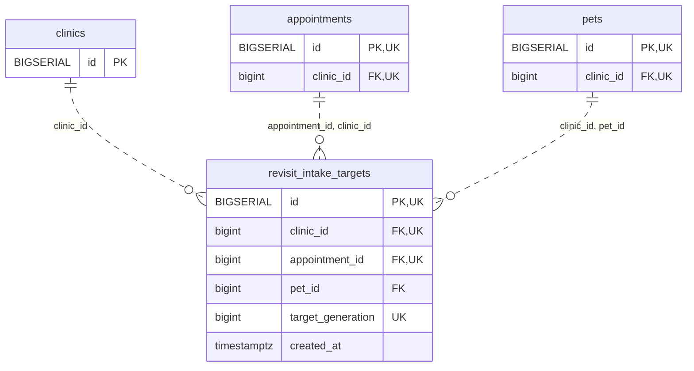

<!-- GENERATED: scripts/tools/generate-erd-detail.py; do not edit -->
# `revisit_intake_targets`

[詳細ERD一覧](index.md) · [概要ERD](../erd.md)

このページは、マイグレーションをファイル名順に静的解析した最終定義です。稼働DBの状態は未確認です。

## カラム

型・DEFAULTはDDLの宣言表記です。`bigserial` は採番宣言であり、DBカタログ上の型名ではありません。

| カラム | 型（DDL） | NULL | DEFAULT（DDL） | キー構成列 | 定義元 |
|:---|:---|:---|:---|:---|:---|
| `id` | `BIGSERIAL` | NOT NULL | — | PK, UK | [001_init.sql:7636](../../../backend/migrations/001_init.sql#L7636) |
| `clinic_id` | `bigint` | NOT NULL | — | FK, UK | [001_init.sql:7637](../../../backend/migrations/001_init.sql#L7637) |
| `appointment_id` | `bigint` | NOT NULL | — | FK, UK | [001_init.sql:7638](../../../backend/migrations/001_init.sql#L7638) |
| `pet_id` | `bigint` | NOT NULL | — | FK | [001_init.sql:7639](../../../backend/migrations/001_init.sql#L7639) |
| `target_generation` | `bigint` | NOT NULL | — | UK | [001_init.sql:7640](../../../backend/migrations/001_init.sql#L7640) |
| `created_at` | `timestamptz` | NOT NULL | `clock_timestamp()` | — | [001_init.sql:7641](../../../backend/migrations/001_init.sql#L7641) |

PK/FK/UKはキーの構成列を示します。複合キーの各列が単独で一意という意味ではありません。部分uniqueは下記indexの述語を参照してください。

## ERD

このテーブルの全カラムと、すべての参照先を表示します。参照先はFKの対象列だけを表示し、全カラムは各テーブルのページに置きます。

親側の任意参照はFK列のNULL可否、子側の最大1件は無条件のPK/UNIQUEから導出します。部分uniqueによる条件付きの最大件数は図に反映せず、index一覧に記録します。実線はFK全列が子のPKに含まれる識別関係、破線はそれ以外です。

## 外部キー（全件）

| 制約 | 子の列（順序あり） | 参照先 | 親の列（順序あり） | 削除時の動作 | 定義元 |
|:---|:---|:---|:---|:---|:---|
| `revisit_intake_targets_clinic_id_fkey` | `clinic_id` | [clinics](clinics.md) | `id` | `ON DELETE RESTRICT` | [001_init.sql:7637](../../../backend/migrations/001_init.sql#L7637) |
| `revisit_intake_targets_appointment_id_clinic_id_fkey` | `appointment_id, clinic_id` | [appointments](appointments.md) | `id, clinic_id` | `ON DELETE RESTRICT` | [001_init.sql:7644](../../../backend/migrations/001_init.sql#L7644) |
| `revisit_intake_targets_clinic_id_pet_id_fkey` | `clinic_id, pet_id` | [pets](pets.md) | `clinic_id, id` | `ON DELETE RESTRICT` | [001_init.sql:7646](../../../backend/migrations/001_init.sql#L7646) |

正確なON UPDATE・MATCH・DEFERRABLE等を含む制約DDL:

- `revisit_intake_targets_clinic_id_fkey`: `REFERENCES clinics(id) ON DELETE RESTRICT`
- `revisit_intake_targets_appointment_id_clinic_id_fkey`: `FOREIGN KEY (appointment_id, clinic_id)         REFERENCES appointments(id, clinic_id) ON DELETE RESTRICT`
- `revisit_intake_targets_clinic_id_pet_id_fkey`: `FOREIGN KEY (clinic_id, pet_id)         REFERENCES pets(clinic_id, id) ON DELETE RESTRICT`

## その他の制約

| 制約 | 種別 | DDL | 定義元 |
|:---|:---|:---|:---|
| `revisit_intake_targets_pkey` | primary | `PRIMARY KEY` | [001_init.sql:7636](../../../backend/migrations/001_init.sql#L7636) |
| `revisit_intake_targets_target_generation_check` | check | `CHECK (target_generation > 0)` | [001_init.sql:7640](../../../backend/migrations/001_init.sql#L7640) |
| `revisit_intake_targets_clinic_id_id_key` | unique | `UNIQUE (clinic_id, id)` | [001_init.sql:7642](../../../backend/migrations/001_init.sql#L7642) |
| `revisit_intake_targets_clinic_id_appointment_id_target_gene_key` | unique | `UNIQUE (clinic_id, appointment_id, target_generation)` | [001_init.sql:7643](../../../backend/migrations/001_init.sql#L7643) |

## インデックス

明示的なCREATE INDEXなし。PK/UNIQUEに付随する暗黙のindexは制約欄を参照してください。
