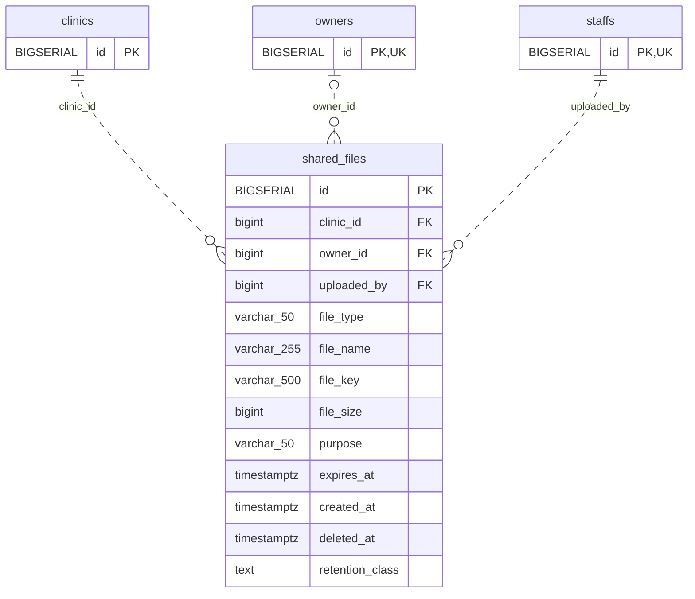

<!-- GENERATED: scripts/tools/generate-erd-detail.py; do not edit -->
# `shared_files`

[詳細ERD一覧](index.md) · [概要ERD](../erd.md)

このページは、マイグレーションをファイル名順に静的解析した最終定義です。稼働DBの状態は未確認です。

## カラム

型・DEFAULTはDDLの宣言表記です。`bigserial` は採番宣言であり、DBカタログ上の型名ではありません。

| カラム | 型（DDL） | NULL | DEFAULT（DDL） | キー構成列 | 定義元 |
|:---|:---|:---|:---|:---|:---|
| `id` | `BIGSERIAL` | NOT NULL | — | PK | [001_init.sql:1292](../../../backend/migrations/001_init.sql#L1292) |
| `clinic_id` | `bigint` | NOT NULL | — | FK | [001_init.sql:1293](../../../backend/migrations/001_init.sql#L1293) |
| `owner_id` | `bigint` | NULL | — | FK | [001_init.sql:1294](../../../backend/migrations/001_init.sql#L1294) |
| `uploaded_by` | `bigint` | NOT NULL | — | FK | [001_init.sql:1295](../../../backend/migrations/001_init.sql#L1295) |
| `file_type` | `varchar(50)` | NOT NULL | — | — | [001_init.sql:1296](../../../backend/migrations/001_init.sql#L1296) |
| `file_name` | `varchar(255)` | NOT NULL | — | — | [001_init.sql:1297](../../../backend/migrations/001_init.sql#L1297) |
| `file_key` | `varchar(500)` | NOT NULL | — | — | [001_init.sql:1298](../../../backend/migrations/001_init.sql#L1298) |
| `file_size` | `bigint` | NOT NULL | — | — | [001_init.sql:1299](../../../backend/migrations/001_init.sql#L1299) |
| `purpose` | `varchar(50)` | NOT NULL | — | — | [001_init.sql:1300](../../../backend/migrations/001_init.sql#L1300) |
| `expires_at` | `timestamptz` | NULL | — | — | [001_init.sql:1301](../../../backend/migrations/001_init.sql#L1301) |
| `created_at` | `timestamptz` | NOT NULL | `now()` | — | [001_init.sql:1302](../../../backend/migrations/001_init.sql#L1302) |
| `deleted_at` | `timestamptz` | NULL | — | — | [001_init.sql:1303](../../../backend/migrations/001_init.sql#L1303) |
| `retention_class` | `text` | NOT NULL | `'unclassified'` | — | [001_init.sql:10914](../../../backend/migrations/001_init.sql#L10914) |

PK/FK/UKはキーの構成列を示します。複合キーの各列が単独で一意という意味ではありません。部分uniqueは下記indexの述語を参照してください。

## ERD

このテーブルの全カラムと、すべての参照先を表示します。参照先はFKの対象列だけを表示し、全カラムは各テーブルのページに置きます。

親側の任意参照はFK列のNULL可否、子側の最大1件は無条件のPK/UNIQUEから導出します。部分uniqueによる条件付きの最大件数は図に反映せず、index一覧に記録します。実線はFK全列が子のPKに含まれる識別関係、破線はそれ以外です。

## 外部キー（全件）

| 制約 | 子の列（順序あり） | 参照先 | 親の列（順序あり） | 削除時の動作 | 定義元 |
|:---|:---|:---|:---|:---|:---|
| `shared_files_clinic_id_fkey` | `clinic_id` | [clinics](clinics.md) | `id` | `ON DELETE NO ACTION` | [001_init.sql:1293](../../../backend/migrations/001_init.sql#L1293) |
| `shared_files_owner_id_fkey` | `owner_id` | [owners](owners.md) | `id` | `ON DELETE NO ACTION` | [001_init.sql:1294](../../../backend/migrations/001_init.sql#L1294) |
| `shared_files_uploaded_by_fkey` | `uploaded_by` | [staffs](staffs.md) | `id` | `ON DELETE NO ACTION` | [001_init.sql:1295](../../../backend/migrations/001_init.sql#L1295) |

正確なON UPDATE・MATCH・DEFERRABLE等を含む制約DDL:

- `shared_files_clinic_id_fkey`: `REFERENCES clinics(id)`
- `shared_files_owner_id_fkey`: `REFERENCES owners(id)`
- `shared_files_uploaded_by_fkey`: `REFERENCES staffs(id)`

## その他の制約

| 制約 | 種別 | DDL | 定義元 |
|:---|:---|:---|:---|
| `shared_files_pkey` | primary | `PRIMARY KEY` | [001_init.sql:1292](../../../backend/migrations/001_init.sql#L1292) |
| `shared_files_retention_class_check` | check | `CHECK(retention_class IN('business_original','required_history','temporary','unclassified'))` | [001_init.sql:10914](../../../backend/migrations/001_init.sql#L10914) |

## インデックス

| 名前 | UNIQUE | 述語 | DDL | 定義元 |
|:---|:---|:---|:---|:---|
| `idx_shared_files_clinic_owner` | NO | — | `CREATE INDEX idx_shared_files_clinic_owner     ON shared_files (clinic_id, owner_id)` | [001_init.sql:1306](../../../backend/migrations/001_init.sql#L1306) |
| `idx_shared_files_expires_at` | NO | `deleted_at IS NULL` | `CREATE INDEX idx_shared_files_expires_at     ON shared_files (expires_at)     WHERE deleted_at IS NULL` | [001_init.sql:1309](../../../backend/migrations/001_init.sql#L1309) |
