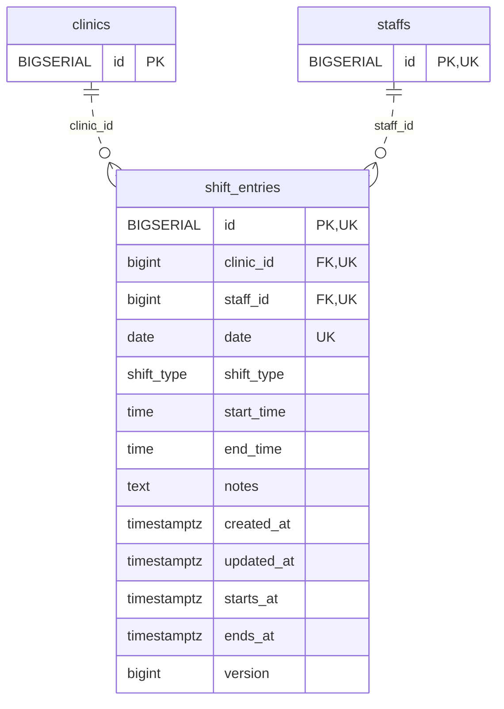

<!-- GENERATED: scripts/tools/generate-erd-detail.py; do not edit -->
# `shift_entries`

[詳細ERD一覧](index.md) · [概要ERD](../erd.md)

このページは、マイグレーションをファイル名順に静的解析した最終定義です。稼働DBの状態は未確認です。

## カラム

型・DEFAULTはDDLの宣言表記です。`bigserial` は採番宣言であり、DBカタログ上の型名ではありません。

| カラム | 型（DDL） | NULL | DEFAULT（DDL） | キー構成列 | 定義元 |
|:---|:---|:---|:---|:---|:---|
| `id` | `BIGSERIAL` | NOT NULL | — | PK, UK | [001_init.sql:2035](../../../backend/migrations/001_init.sql#L2035) |
| `clinic_id` | `bigint` | NOT NULL | — | FK, UK | [001_init.sql:2036](../../../backend/migrations/001_init.sql#L2036) |
| `staff_id` | `bigint` | NOT NULL | — | FK, UK | [001_init.sql:2037](../../../backend/migrations/001_init.sql#L2037) |
| `date` | `date` | NOT NULL | — | UK | [001_init.sql:2038](../../../backend/migrations/001_init.sql#L2038) |
| `shift_type` | `shift_type` | NOT NULL | — | — | [001_init.sql:2039](../../../backend/migrations/001_init.sql#L2039) |
| `start_time` | `time` | NULL | — | — | [001_init.sql:2040](../../../backend/migrations/001_init.sql#L2040) |
| `end_time` | `time` | NULL | — | — | [001_init.sql:2041](../../../backend/migrations/001_init.sql#L2041) |
| `notes` | `text` | NOT NULL | `''` | — | [001_init.sql:2042](../../../backend/migrations/001_init.sql#L2042) |
| `created_at` | `timestamptz` | NOT NULL | `now()` | — | [001_init.sql:2043](../../../backend/migrations/001_init.sql#L2043) |
| `updated_at` | `timestamptz` | NOT NULL | `now()` | — | [001_init.sql:2044](../../../backend/migrations/001_init.sql#L2044) |
| `starts_at` | `timestamptz` | NULL | — | — | [001_init.sql:8943](../../../backend/migrations/001_init.sql#L8943) |
| `ends_at` | `timestamptz` | NULL | — | — | [001_init.sql:8944](../../../backend/migrations/001_init.sql#L8944) |
| `version` | `bigint` | NOT NULL | `1` | — | [001_init.sql:8945](../../../backend/migrations/001_init.sql#L8945) |

PK/FK/UKはキーの構成列を示します。複合キーの各列が単独で一意という意味ではありません。部分uniqueは下記indexの述語を参照してください。

## ERD

このテーブルの全カラムと、すべての参照先を表示します。参照先はFKの対象列だけを表示し、全カラムは各テーブルのページに置きます。

親側の任意参照はFK列のNULL可否、子側の最大1件は無条件のPK/UNIQUEから導出します。部分uniqueによる条件付きの最大件数は図に反映せず、index一覧に記録します。実線はFK全列が子のPKに含まれる識別関係、破線はそれ以外です。

## 外部キー（全件）

| 制約 | 子の列（順序あり） | 参照先 | 親の列（順序あり） | 削除時の動作 | 定義元 |
|:---|:---|:---|:---|:---|:---|
| `shift_entries_clinic_id_fkey` | `clinic_id` | [clinics](clinics.md) | `id` | `ON DELETE RESTRICT` | [001_init.sql:2036](../../../backend/migrations/001_init.sql#L2036) |
| `shift_entries_staff_id_fkey` | `staff_id` | [staffs](staffs.md) | `id` | `ON DELETE RESTRICT` | [001_init.sql:2037](../../../backend/migrations/001_init.sql#L2037) |

正確なON UPDATE・MATCH・DEFERRABLE等を含む制約DDL:

- `shift_entries_clinic_id_fkey`: `REFERENCES clinics(id) ON DELETE RESTRICT`
- `shift_entries_staff_id_fkey`: `REFERENCES staffs(id) ON DELETE RESTRICT`

## その他の制約

| 制約 | 種別 | DDL | 定義元 |
|:---|:---|:---|:---|
| `shift_entries_pkey` | primary | `PRIMARY KEY` | [001_init.sql:2035](../../../backend/migrations/001_init.sql#L2035) |
| `uk_shift_staff_date` | unique | `CONSTRAINT uk_shift_staff_date UNIQUE (clinic_id, staff_id, date)` | [001_init.sql:2045](../../../backend/migrations/001_init.sql#L2045) |
| `shift_entries_version_check` | check | `CHECK (version > 0)` | [001_init.sql:8945](../../../backend/migrations/001_init.sql#L8945) |
| `uq_shift_entries_id_clinic` | unique | `CONSTRAINT uq_shift_entries_id_clinic UNIQUE(id,clinic_id)` | [001_init.sql:8946](../../../backend/migrations/001_init.sql#L8946) |
| `ck_shift_explicit_interval` | check | `CONSTRAINT ck_shift_explicit_interval CHECK ((starts_at IS NULL AND ends_at IS NULL)       OR (starts_at IS NOT NULL AND ends_at IS NOT NULL AND ends_at>starts_at))` | [001_init.sql:8947](../../../backend/migrations/001_init.sql#L8947) |
| `excl_staff_cross_clinic_work` | exclude | `CONSTRAINT excl_staff_cross_clinic_work  EXCLUDE USING gist (staff_id WITH =, tstzrange(starts_at,ends_at,'[)') WITH &&)  WHERE (starts_at IS NOT NULL AND ends_at IS NOT NULL)` | [001_init.sql:8954](../../../backend/migrations/001_init.sql#L8954) |

## インデックス

| 名前 | UNIQUE | 述語 | DDL | 定義元 |
|:---|:---|:---|:---|:---|
| `idx_shift_entries_clinic_id` | NO | — | `CREATE INDEX idx_shift_entries_clinic_id ON shift_entries(clinic_id)` | [001_init.sql:2253](../../../backend/migrations/001_init.sql#L2253) |
