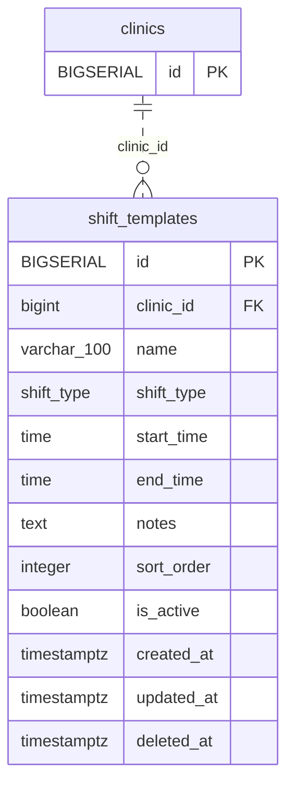

<!-- GENERATED: scripts/tools/generate-erd-detail.py; do not edit -->
# `shift_templates`

[詳細ERD一覧](index.md) · [概要ERD](../erd.md)

このページは、マイグレーションをファイル名順に静的解析した最終定義です。稼働DBの状態は未確認です。

## カラム

型・DEFAULTはDDLの宣言表記です。`bigserial` は採番宣言であり、DBカタログ上の型名ではありません。

| カラム | 型（DDL） | NULL | DEFAULT（DDL） | キー構成列 | 定義元 |
|:---|:---|:---|:---|:---|:---|
| `id` | `BIGSERIAL` | NOT NULL | — | PK | [001_init.sql:2722](../../../backend/migrations/001_init.sql#L2722) |
| `clinic_id` | `bigint` | NOT NULL | — | FK | [001_init.sql:2723](../../../backend/migrations/001_init.sql#L2723) |
| `name` | `varchar(100)` | NOT NULL | — | — | [001_init.sql:2724](../../../backend/migrations/001_init.sql#L2724) |
| `shift_type` | `shift_type` | NOT NULL | `'full'` | — | [001_init.sql:2725](../../../backend/migrations/001_init.sql#L2725) |
| `start_time` | `time` | NULL | — | — | [001_init.sql:2726](../../../backend/migrations/001_init.sql#L2726) |
| `end_time` | `time` | NULL | — | — | [001_init.sql:2727](../../../backend/migrations/001_init.sql#L2727) |
| `notes` | `text` | NOT NULL | `''` | — | [001_init.sql:2728](../../../backend/migrations/001_init.sql#L2728) |
| `sort_order` | `integer` | NOT NULL | `0` | — | [001_init.sql:2729](../../../backend/migrations/001_init.sql#L2729) |
| `is_active` | `boolean` | NOT NULL | `true` | — | [001_init.sql:2730](../../../backend/migrations/001_init.sql#L2730) |
| `created_at` | `timestamptz` | NOT NULL | `now()` | — | [001_init.sql:2731](../../../backend/migrations/001_init.sql#L2731) |
| `updated_at` | `timestamptz` | NOT NULL | `now()` | — | [001_init.sql:2732](../../../backend/migrations/001_init.sql#L2732) |
| `deleted_at` | `timestamptz` | NULL | — | — | [001_init.sql:2733](../../../backend/migrations/001_init.sql#L2733) |

PK/FK/UKはキーの構成列を示します。複合キーの各列が単独で一意という意味ではありません。部分uniqueは下記indexの述語を参照してください。

## ERD

このテーブルの全カラムと、すべての参照先を表示します。参照先はFKの対象列だけを表示し、全カラムは各テーブルのページに置きます。

親側の任意参照はFK列のNULL可否、子側の最大1件は無条件のPK/UNIQUEから導出します。部分uniqueによる条件付きの最大件数は図に反映せず、index一覧に記録します。実線はFK全列が子のPKに含まれる識別関係、破線はそれ以外です。

## 外部キー（全件）

| 制約 | 子の列（順序あり） | 参照先 | 親の列（順序あり） | 削除時の動作 | 定義元 |
|:---|:---|:---|:---|:---|:---|
| `shift_templates_clinic_id_fkey` | `clinic_id` | [clinics](clinics.md) | `id` | `ON DELETE NO ACTION` | [001_init.sql:2723](../../../backend/migrations/001_init.sql#L2723) |

正確なON UPDATE・MATCH・DEFERRABLE等を含む制約DDL:

- `shift_templates_clinic_id_fkey`: `REFERENCES clinics(id)`

## その他の制約

| 制約 | 種別 | DDL | 定義元 |
|:---|:---|:---|:---|
| `shift_templates_pkey` | primary | `PRIMARY KEY` | [001_init.sql:2722](../../../backend/migrations/001_init.sql#L2722) |

## インデックス

| 名前 | UNIQUE | 述語 | DDL | 定義元 |
|:---|:---|:---|:---|:---|
| `uk_shift_templates_clinic_name` | YES | `deleted_at IS NULL` | `CREATE UNIQUE INDEX uk_shift_templates_clinic_name ON shift_templates(clinic_id, name) WHERE deleted_at IS NULL` | [001_init.sql:2737](../../../backend/migrations/001_init.sql#L2737) |
