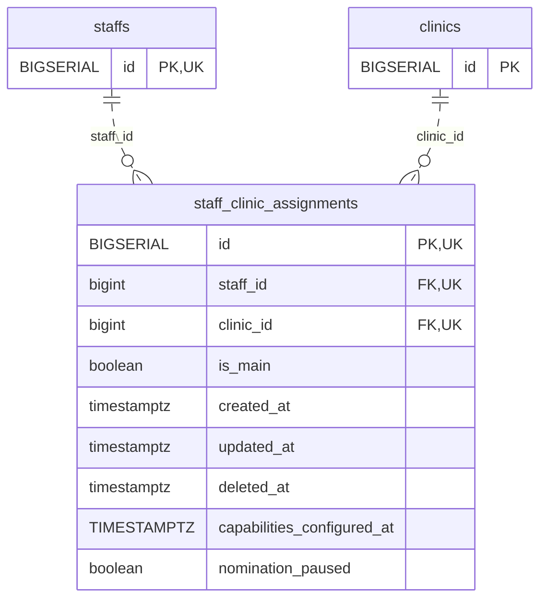

<!-- GENERATED: scripts/tools/generate-erd-detail.py; do not edit -->
# `staff_clinic_assignments`

[詳細ERD一覧](index.md) · [概要ERD](../erd.md)

このページは、マイグレーションをファイル名順に静的解析した最終定義です。稼働DBの状態は未確認です。

## カラム

型・DEFAULTはDDLの宣言表記です。`bigserial` は採番宣言であり、DBカタログ上の型名ではありません。

| カラム | 型（DDL） | NULL | DEFAULT（DDL） | キー構成列 | 定義元 |
|:---|:---|:---|:---|:---|:---|
| `id` | `BIGSERIAL` | NOT NULL | — | PK, UK | [001_init.sql:1200](../../../backend/migrations/001_init.sql#L1200) |
| `staff_id` | `bigint` | NOT NULL | — | FK, UK | [001_init.sql:1201](../../../backend/migrations/001_init.sql#L1201) |
| `clinic_id` | `bigint` | NOT NULL | — | FK, UK | [001_init.sql:1202](../../../backend/migrations/001_init.sql#L1202) |
| `is_main` | `boolean` | NOT NULL | `false` | — | [001_init.sql:1203](../../../backend/migrations/001_init.sql#L1203) |
| `created_at` | `timestamptz` | NOT NULL | `now()` | — | [001_init.sql:1204](../../../backend/migrations/001_init.sql#L1204) |
| `updated_at` | `timestamptz` | NOT NULL | `now()` | — | [001_init.sql:1205](../../../backend/migrations/001_init.sql#L1205) |
| `deleted_at` | `timestamptz` | NULL | — | — | [001_init.sql:1206](../../../backend/migrations/001_init.sql#L1206) |
| `capabilities_configured_at` | `TIMESTAMPTZ` | NULL | — | — | [001_init.sql:6964](../../../backend/migrations/001_init.sql#L6964) |
| `nomination_paused` | `boolean` | NULL | — | — | [001_init.sql:8955](../../../backend/migrations/001_init.sql#L8955) |

PK/FK/UKはキーの構成列を示します。複合キーの各列が単独で一意という意味ではありません。部分uniqueは下記indexの述語を参照してください。

## ERD

このテーブルの全カラムと、すべての参照先を表示します。参照先はFKの対象列だけを表示し、全カラムは各テーブルのページに置きます。

親側の任意参照はFK列のNULL可否、子側の最大1件は無条件のPK/UNIQUEから導出します。部分uniqueによる条件付きの最大件数は図に反映せず、index一覧に記録します。実線はFK全列が子のPKに含まれる識別関係、破線はそれ以外です。

## 外部キー（全件）

| 制約 | 子の列（順序あり） | 参照先 | 親の列（順序あり） | 削除時の動作 | 定義元 |
|:---|:---|:---|:---|:---|:---|
| `staff_clinic_assignments_staff_id_fkey` | `staff_id` | [staffs](staffs.md) | `id` | `ON DELETE CASCADE` | [001_init.sql:1201](../../../backend/migrations/001_init.sql#L1201) |
| `staff_clinic_assignments_clinic_id_fkey` | `clinic_id` | [clinics](clinics.md) | `id` | `ON DELETE CASCADE` | [001_init.sql:1202](../../../backend/migrations/001_init.sql#L1202) |

正確なON UPDATE・MATCH・DEFERRABLE等を含む制約DDL:

- `staff_clinic_assignments_staff_id_fkey`: `REFERENCES staffs(id) ON DELETE CASCADE`
- `staff_clinic_assignments_clinic_id_fkey`: `REFERENCES clinics(id) ON DELETE CASCADE`

## その他の制約

| 制約 | 種別 | DDL | 定義元 |
|:---|:---|:---|:---|
| `staff_clinic_assignments_pkey` | primary | `PRIMARY KEY` | [001_init.sql:1200](../../../backend/migrations/001_init.sql#L1200) |
| `uk_staff_clinic` | unique | `CONSTRAINT uk_staff_clinic UNIQUE (staff_id, clinic_id)` | [001_init.sql:1207](../../../backend/migrations/001_init.sql#L1207) |
| `uq_staff_clinic_assignments_id_staff_clinic` | unique | `CONSTRAINT uq_staff_clinic_assignments_id_staff_clinic UNIQUE (id, staff_id, clinic_id)` | [001_init.sql:11792](../../../backend/migrations/001_init.sql#L11792) |

## インデックス

| 名前 | UNIQUE | 述語 | DDL | 定義元 |
|:---|:---|:---|:---|:---|
| `idx_staff_clinic_staff` | NO | — | `CREATE INDEX idx_staff_clinic_staff ON staff_clinic_assignments(staff_id)` | [001_init.sql:1210](../../../backend/migrations/001_init.sql#L1210) |
| `idx_staff_clinic_clinic` | NO | — | `CREATE INDEX idx_staff_clinic_clinic ON staff_clinic_assignments(clinic_id)` | [001_init.sql:1211](../../../backend/migrations/001_init.sql#L1211) |
| `idx_staff_clinic_main` | NO | — | `CREATE INDEX idx_staff_clinic_main ON staff_clinic_assignments(staff_id, is_main)` | [001_init.sql:1212](../../../backend/migrations/001_init.sql#L1212) |
