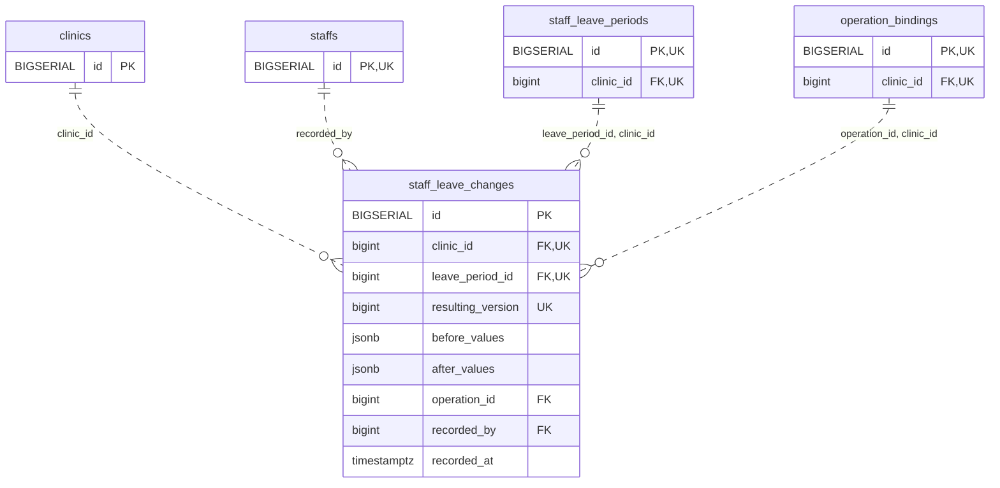

<!-- GENERATED: scripts/tools/generate-erd-detail.py; do not edit -->
# `staff_leave_changes`

[詳細ERD一覧](index.md) · [概要ERD](../erd.md)

このページは、マイグレーションをファイル名順に静的解析した最終定義です。稼働DBの状態は未確認です。

## カラム

型・DEFAULTはDDLの宣言表記です。`bigserial` は採番宣言であり、DBカタログ上の型名ではありません。

| カラム | 型（DDL） | NULL | DEFAULT（DDL） | キー構成列 | 定義元 |
|:---|:---|:---|:---|:---|:---|
| `id` | `BIGSERIAL` | NOT NULL | — | PK | [001_init.sql:10597](../../../backend/migrations/001_init.sql#L10597) |
| `clinic_id` | `bigint` | NOT NULL | — | FK, UK | [001_init.sql:10597](../../../backend/migrations/001_init.sql#L10597) |
| `leave_period_id` | `bigint` | NOT NULL | — | FK, UK | [001_init.sql:10598](../../../backend/migrations/001_init.sql#L10598) |
| `resulting_version` | `bigint` | NOT NULL | — | UK | [001_init.sql:10598](../../../backend/migrations/001_init.sql#L10598) |
| `before_values` | `jsonb` | NOT NULL | — | — | [001_init.sql:10599](../../../backend/migrations/001_init.sql#L10599) |
| `after_values` | `jsonb` | NOT NULL | — | — | [001_init.sql:10599](../../../backend/migrations/001_init.sql#L10599) |
| `operation_id` | `bigint` | NOT NULL | — | FK | [001_init.sql:10600](../../../backend/migrations/001_init.sql#L10600) |
| `recorded_by` | `bigint` | NOT NULL | — | FK | [001_init.sql:10600](../../../backend/migrations/001_init.sql#L10600) |
| `recorded_at` | `timestamptz` | NOT NULL | `clock_timestamp()` | — | [001_init.sql:10601](../../../backend/migrations/001_init.sql#L10601) |

PK/FK/UKはキーの構成列を示します。複合キーの各列が単独で一意という意味ではありません。部分uniqueは下記indexの述語を参照してください。

## ERD

このテーブルの全カラムと、すべての参照先を表示します。参照先はFKの対象列だけを表示し、全カラムは各テーブルのページに置きます。

親側の任意参照はFK列のNULL可否、子側の最大1件は無条件のPK/UNIQUEから導出します。部分uniqueによる条件付きの最大件数は図に反映せず、index一覧に記録します。実線はFK全列が子のPKに含まれる識別関係、破線はそれ以外です。

## 外部キー（全件）

| 制約 | 子の列（順序あり） | 参照先 | 親の列（順序あり） | 削除時の動作 | 定義元 |
|:---|:---|:---|:---|:---|:---|
| `staff_leave_changes_clinic_id_fkey` | `clinic_id` | [clinics](clinics.md) | `id` | `ON DELETE RESTRICT` | [001_init.sql:10597](../../../backend/migrations/001_init.sql#L10597) |
| `staff_leave_changes_recorded_by_fkey` | `recorded_by` | [staffs](staffs.md) | `id` | `ON DELETE RESTRICT` | [001_init.sql:10600](../../../backend/migrations/001_init.sql#L10600) |
| `staff_leave_changes_leave_period_id_clinic_id_fkey` | `leave_period_id, clinic_id` | [staff_leave_periods](staff_leave_periods.md) | `id, clinic_id` | `ON DELETE RESTRICT` | [001_init.sql:10602](../../../backend/migrations/001_init.sql#L10602) |
| `staff_leave_changes_operation_id_clinic_id_fkey` | `operation_id, clinic_id` | [operation_bindings](operation_bindings.md) | `id, clinic_id` | `ON DELETE RESTRICT` | [001_init.sql:10603](../../../backend/migrations/001_init.sql#L10603) |

正確なON UPDATE・MATCH・DEFERRABLE等を含む制約DDL:

- `staff_leave_changes_clinic_id_fkey`: `REFERENCES clinics(id) ON DELETE RESTRICT`
- `staff_leave_changes_recorded_by_fkey`: `REFERENCES staffs(id) ON DELETE RESTRICT`
- `staff_leave_changes_leave_period_id_clinic_id_fkey`: `FOREIGN KEY(leave_period_id,clinic_id) REFERENCES staff_leave_periods(id,clinic_id) ON DELETE RESTRICT`
- `staff_leave_changes_operation_id_clinic_id_fkey`: `FOREIGN KEY(operation_id,clinic_id) REFERENCES operation_bindings(id,clinic_id) ON DELETE RESTRICT`

## その他の制約

| 制約 | 種別 | DDL | 定義元 |
|:---|:---|:---|:---|
| `staff_leave_changes_pkey` | primary | `PRIMARY KEY` | [001_init.sql:10597](../../../backend/migrations/001_init.sql#L10597) |
| `staff_leave_changes_resulting_version_check` | check | `CHECK(resulting_version>0)` | [001_init.sql:10598](../../../backend/migrations/001_init.sql#L10598) |
| `staff_leave_changes_before_values_check` | check | `CHECK(jsonb_typeof(before_values)='object')` | [001_init.sql:10599](../../../backend/migrations/001_init.sql#L10599) |
| `staff_leave_changes_after_values_check` | check | `CHECK(jsonb_typeof(after_values)='object')` | [001_init.sql:10599](../../../backend/migrations/001_init.sql#L10599) |
| `staff_leave_changes_clinic_id_leave_period_id_resulting_ver_key` | unique | `UNIQUE(clinic_id,leave_period_id,resulting_version)` | [001_init.sql:10601](../../../backend/migrations/001_init.sql#L10601) |

## インデックス

明示的なCREATE INDEXなし。PK/UNIQUEに付随する暗黙のindexは制約欄を参照してください。
