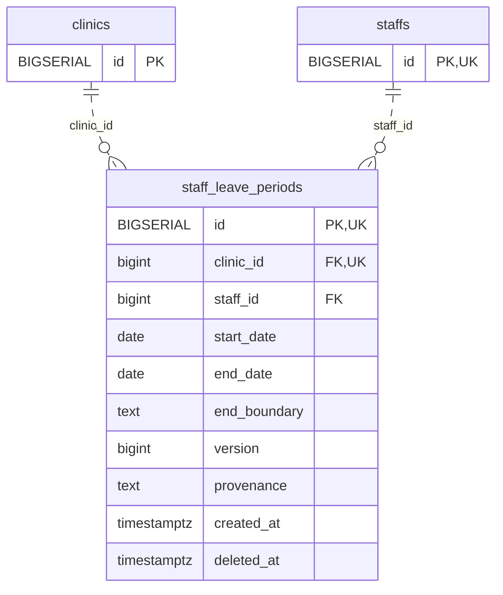

<!-- GENERATED: scripts/tools/generate-erd-detail.py; do not edit -->
# `staff_leave_periods`

[詳細ERD一覧](index.md) · [概要ERD](../erd.md)

このページは、マイグレーションをファイル名順に静的解析した最終定義です。稼働DBの状態は未確認です。

## カラム

型・DEFAULTはDDLの宣言表記です。`bigserial` は採番宣言であり、DBカタログ上の型名ではありません。

| カラム | 型（DDL） | NULL | DEFAULT（DDL） | キー構成列 | 定義元 |
|:---|:---|:---|:---|:---|:---|
| `id` | `BIGSERIAL` | NOT NULL | — | PK, UK | [001_init.sql:8974](../../../backend/migrations/001_init.sql#L8974) |
| `clinic_id` | `bigint` | NOT NULL | — | FK, UK | [001_init.sql:8975](../../../backend/migrations/001_init.sql#L8975) |
| `staff_id` | `bigint` | NOT NULL | — | FK | [001_init.sql:8976](../../../backend/migrations/001_init.sql#L8976) |
| `start_date` | `date` | NOT NULL | — | — | [001_init.sql:8977](../../../backend/migrations/001_init.sql#L8977) |
| `end_date` | `date` | NULL | — | — | [001_init.sql:8978](../../../backend/migrations/001_init.sql#L8978) |
| `end_boundary` | `text` | NULL | — | — | [001_init.sql:8979](../../../backend/migrations/001_init.sql#L8979) |
| `version` | `bigint` | NOT NULL | `1` | — | [001_init.sql:8980](../../../backend/migrations/001_init.sql#L8980) |
| `provenance` | `text` | NULL | — | — | [001_init.sql:8981](../../../backend/migrations/001_init.sql#L8981) |
| `created_at` | `timestamptz` | NOT NULL | `clock_timestamp()` | — | [001_init.sql:8982](../../../backend/migrations/001_init.sql#L8982) |
| `deleted_at` | `timestamptz` | NULL | — | — | [001_init.sql:8983](../../../backend/migrations/001_init.sql#L8983) |

PK/FK/UKはキーの構成列を示します。複合キーの各列が単独で一意という意味ではありません。部分uniqueは下記indexの述語を参照してください。

## ERD

このテーブルの全カラムと、すべての参照先を表示します。参照先はFKの対象列だけを表示し、全カラムは各テーブルのページに置きます。

親側の任意参照はFK列のNULL可否、子側の最大1件は無条件のPK/UNIQUEから導出します。部分uniqueによる条件付きの最大件数は図に反映せず、index一覧に記録します。実線はFK全列が子のPKに含まれる識別関係、破線はそれ以外です。

## 外部キー（全件）

| 制約 | 子の列（順序あり） | 参照先 | 親の列（順序あり） | 削除時の動作 | 定義元 |
|:---|:---|:---|:---|:---|:---|
| `staff_leave_periods_clinic_id_fkey` | `clinic_id` | [clinics](clinics.md) | `id` | `ON DELETE RESTRICT` | [001_init.sql:8975](../../../backend/migrations/001_init.sql#L8975) |
| `staff_leave_periods_staff_id_fkey` | `staff_id` | [staffs](staffs.md) | `id` | `ON DELETE RESTRICT` | [001_init.sql:8976](../../../backend/migrations/001_init.sql#L8976) |

正確なON UPDATE・MATCH・DEFERRABLE等を含む制約DDL:

- `staff_leave_periods_clinic_id_fkey`: `REFERENCES clinics(id) ON DELETE RESTRICT`
- `staff_leave_periods_staff_id_fkey`: `REFERENCES staffs(id) ON DELETE RESTRICT`

## その他の制約

| 制約 | 種別 | DDL | 定義元 |
|:---|:---|:---|:---|
| `staff_leave_periods_pkey` | primary | `PRIMARY KEY` | [001_init.sql:8974](../../../backend/migrations/001_init.sql#L8974) |
| `staff_leave_periods_end_boundary_check` | check | `CHECK (end_boundary IN ('inclusive','exclusive','unknown'))` | [001_init.sql:8979](../../../backend/migrations/001_init.sql#L8979) |
| `staff_leave_periods_version_check` | check | `CHECK (version > 0)` | [001_init.sql:8980](../../../backend/migrations/001_init.sql#L8980) |
| `staff_leave_periods_check` | check | `CHECK (end_date IS NULL OR end_date>=start_date)` | [001_init.sql:8984](../../../backend/migrations/001_init.sql#L8984) |
| `staff_leave_periods_check1` | check | `CHECK ((end_date IS NULL AND end_boundary IS NULL) OR (end_date IS NOT NULL AND end_boundary IS NOT NULL))` | [001_init.sql:8985](../../../backend/migrations/001_init.sql#L8985) |
| `staff_leave_periods_id_clinic_id_key` | unique | `UNIQUE (id,clinic_id)` | [001_init.sql:8986](../../../backend/migrations/001_init.sql#L8986) |

## インデックス

| 名前 | UNIQUE | 述語 | DDL | 定義元 |
|:---|:---|:---|:---|:---|
| `idx_staff_leave_clinic_staff_dates` | NO | `deleted_at IS NULL` | `CREATE INDEX idx_staff_leave_clinic_staff_dates ON staff_leave_periods(clinic_id,staff_id,start_date,end_date) WHERE deleted_at IS NULL` | [001_init.sql:8988](../../../backend/migrations/001_init.sql#L8988) |
