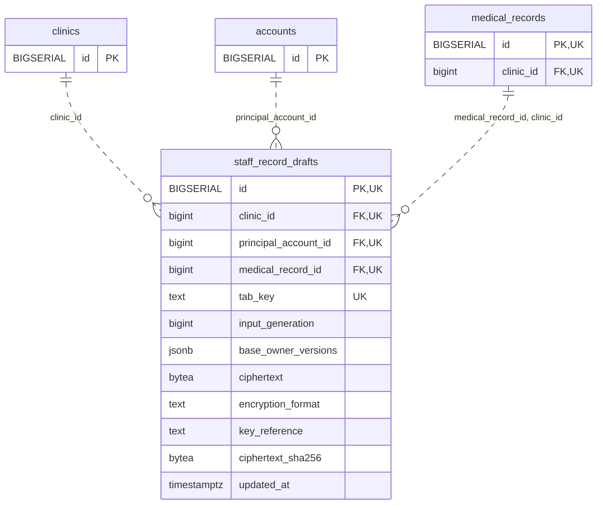

<!-- GENERATED: scripts/tools/generate-erd-detail.py; do not edit -->
# `staff_record_drafts`

[詳細ERD一覧](index.md) · [概要ERD](../erd.md)

このページは、マイグレーションをファイル名順に静的解析した最終定義です。稼働DBの状態は未確認です。

## カラム

型・DEFAULTはDDLの宣言表記です。`bigserial` は採番宣言であり、DBカタログ上の型名ではありません。

| カラム | 型（DDL） | NULL | DEFAULT（DDL） | キー構成列 | 定義元 |
|:---|:---|:---|:---|:---|:---|
| `id` | `BIGSERIAL` | NOT NULL | — | PK, UK | [001_init.sql:9032](../../../backend/migrations/001_init.sql#L9032) |
| `clinic_id` | `bigint` | NOT NULL | — | FK, UK | [001_init.sql:9033](../../../backend/migrations/001_init.sql#L9033) |
| `principal_account_id` | `bigint` | NOT NULL | — | FK, UK | [001_init.sql:9034](../../../backend/migrations/001_init.sql#L9034) |
| `medical_record_id` | `bigint` | NOT NULL | — | FK, UK | [001_init.sql:9035](../../../backend/migrations/001_init.sql#L9035) |
| `tab_key` | `text` | NOT NULL | — | UK | [001_init.sql:9036](../../../backend/migrations/001_init.sql#L9036) |
| `input_generation` | `bigint` | NOT NULL | — | — | [001_init.sql:9037](../../../backend/migrations/001_init.sql#L9037) |
| `base_owner_versions` | `jsonb` | NOT NULL | — | — | [001_init.sql:9038](../../../backend/migrations/001_init.sql#L9038) |
| `ciphertext` | `bytea` | NOT NULL | — | — | [001_init.sql:9039](../../../backend/migrations/001_init.sql#L9039) |
| `encryption_format` | `text` | NOT NULL | — | — | [001_init.sql:9040](../../../backend/migrations/001_init.sql#L9040) |
| `key_reference` | `text` | NOT NULL | — | — | [001_init.sql:9041](../../../backend/migrations/001_init.sql#L9041) |
| `ciphertext_sha256` | `bytea` | NOT NULL | — | — | [001_init.sql:9042](../../../backend/migrations/001_init.sql#L9042) |
| `updated_at` | `timestamptz` | NOT NULL | `clock_timestamp()` | — | [001_init.sql:9043](../../../backend/migrations/001_init.sql#L9043) |

PK/FK/UKはキーの構成列を示します。複合キーの各列が単独で一意という意味ではありません。部分uniqueは下記indexの述語を参照してください。

## ERD

このテーブルの全カラムと、すべての参照先を表示します。参照先はFKの対象列だけを表示し、全カラムは各テーブルのページに置きます。

親側の任意参照はFK列のNULL可否、子側の最大1件は無条件のPK/UNIQUEから導出します。部分uniqueによる条件付きの最大件数は図に反映せず、index一覧に記録します。実線はFK全列が子のPKに含まれる識別関係、破線はそれ以外です。

## 外部キー（全件）

| 制約 | 子の列（順序あり） | 参照先 | 親の列（順序あり） | 削除時の動作 | 定義元 |
|:---|:---|:---|:---|:---|:---|
| `staff_record_drafts_clinic_id_fkey` | `clinic_id` | [clinics](clinics.md) | `id` | `ON DELETE RESTRICT` | [001_init.sql:9033](../../../backend/migrations/001_init.sql#L9033) |
| `staff_record_drafts_principal_account_id_fkey` | `principal_account_id` | [accounts](accounts.md) | `id` | `ON DELETE RESTRICT` | [001_init.sql:9034](../../../backend/migrations/001_init.sql#L9034) |
| `staff_record_drafts_medical_record_id_clinic_id_fkey` | `medical_record_id, clinic_id` | [medical_records](medical_records.md) | `id, clinic_id` | `ON DELETE RESTRICT` | [001_init.sql:9046](../../../backend/migrations/001_init.sql#L9046) |

正確なON UPDATE・MATCH・DEFERRABLE等を含む制約DDL:

- `staff_record_drafts_clinic_id_fkey`: `REFERENCES clinics(id) ON DELETE RESTRICT`
- `staff_record_drafts_principal_account_id_fkey`: `REFERENCES accounts(id) ON DELETE RESTRICT`
- `staff_record_drafts_medical_record_id_clinic_id_fkey`: `FOREIGN KEY (medical_record_id,clinic_id) REFERENCES medical_records(id,clinic_id) ON DELETE RESTRICT`

## その他の制約

| 制約 | 種別 | DDL | 定義元 |
|:---|:---|:---|:---|
| `staff_record_drafts_pkey` | primary | `PRIMARY KEY` | [001_init.sql:9032](../../../backend/migrations/001_init.sql#L9032) |
| `staff_record_drafts_tab_key_check` | check | `CHECK (btrim(tab_key)<>'')` | [001_init.sql:9036](../../../backend/migrations/001_init.sql#L9036) |
| `staff_record_drafts_input_generation_check` | check | `CHECK (input_generation > 0)` | [001_init.sql:9037](../../../backend/migrations/001_init.sql#L9037) |
| `staff_record_drafts_base_owner_versions_check` | check | `CHECK (jsonb_typeof(base_owner_versions)='object')` | [001_init.sql:9038](../../../backend/migrations/001_init.sql#L9038) |
| `staff_record_drafts_encryption_format_check` | check | `CHECK (btrim(encryption_format)<>'')` | [001_init.sql:9040](../../../backend/migrations/001_init.sql#L9040) |
| `staff_record_drafts_key_reference_check` | check | `CHECK (btrim(key_reference)<>'')` | [001_init.sql:9041](../../../backend/migrations/001_init.sql#L9041) |
| `staff_record_drafts_ciphertext_sha256_check` | check | `CHECK (octet_length(ciphertext_sha256)=32)` | [001_init.sql:9042](../../../backend/migrations/001_init.sql#L9042) |
| `staff_record_drafts_id_clinic_id_key` | unique | `UNIQUE (id,clinic_id)` | [001_init.sql:9044](../../../backend/migrations/001_init.sql#L9044) |
| `staff_record_drafts_clinic_id_principal_account_id_medical__key` | unique | `UNIQUE (clinic_id,principal_account_id,medical_record_id,tab_key)` | [001_init.sql:9045](../../../backend/migrations/001_init.sql#L9045) |

## インデックス

明示的なCREATE INDEXなし。PK/UNIQUEに付随する暗黙のindexは制約欄を参照してください。
