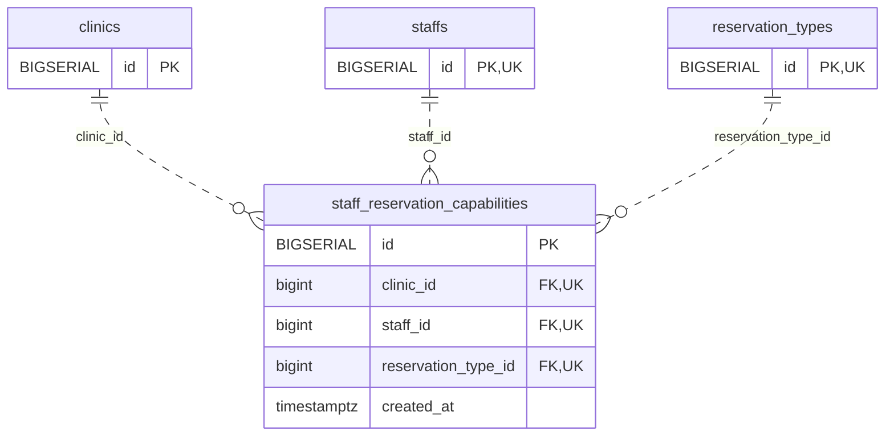

<!-- GENERATED: scripts/tools/generate-erd-detail.py; do not edit -->
# `staff_reservation_capabilities`

[詳細ERD一覧](index.md) · [概要ERD](../erd.md)

このページは、マイグレーションをファイル名順に静的解析した最終定義です。稼働DBの状態は未確認です。

## カラム

型・DEFAULTはDDLの宣言表記です。`bigserial` は採番宣言であり、DBカタログ上の型名ではありません。

| カラム | 型（DDL） | NULL | DEFAULT（DDL） | キー構成列 | 定義元 |
|:---|:---|:---|:---|:---|:---|
| `id` | `BIGSERIAL` | NOT NULL | — | PK | [001_init.sql:901](../../../backend/migrations/001_init.sql#L901) |
| `clinic_id` | `bigint` | NOT NULL | — | FK, UK | [001_init.sql:902](../../../backend/migrations/001_init.sql#L902) |
| `staff_id` | `bigint` | NOT NULL | — | FK, UK | [001_init.sql:903](../../../backend/migrations/001_init.sql#L903) |
| `reservation_type_id` | `bigint` | NOT NULL | — | FK, UK | [001_init.sql:904](../../../backend/migrations/001_init.sql#L904) |
| `created_at` | `timestamptz` | NOT NULL | `now()` | — | [001_init.sql:905](../../../backend/migrations/001_init.sql#L905) |

PK/FK/UKはキーの構成列を示します。複合キーの各列が単独で一意という意味ではありません。部分uniqueは下記indexの述語を参照してください。

## ERD

このテーブルの全カラムと、すべての参照先を表示します。参照先はFKの対象列だけを表示し、全カラムは各テーブルのページに置きます。

親側の任意参照はFK列のNULL可否、子側の最大1件は無条件のPK/UNIQUEから導出します。部分uniqueによる条件付きの最大件数は図に反映せず、index一覧に記録します。実線はFK全列が子のPKに含まれる識別関係、破線はそれ以外です。

## 外部キー（全件）

| 制約 | 子の列（順序あり） | 参照先 | 親の列（順序あり） | 削除時の動作 | 定義元 |
|:---|:---|:---|:---|:---|:---|
| `staff_reservation_capabilities_clinic_id_fkey` | `clinic_id` | [clinics](clinics.md) | `id` | `ON DELETE RESTRICT` | [001_init.sql:902](../../../backend/migrations/001_init.sql#L902) |
| `staff_reservation_capabilities_staff_id_fkey` | `staff_id` | [staffs](staffs.md) | `id` | `ON DELETE CASCADE` | [001_init.sql:903](../../../backend/migrations/001_init.sql#L903) |
| `staff_reservation_capabilities_reservation_type_id_fkey` | `reservation_type_id` | [reservation_types](reservation_types.md) | `id` | `ON DELETE CASCADE` | [001_init.sql:904](../../../backend/migrations/001_init.sql#L904) |

正確なON UPDATE・MATCH・DEFERRABLE等を含む制約DDL:

- `staff_reservation_capabilities_clinic_id_fkey`: `REFERENCES clinics(id) ON DELETE RESTRICT`
- `staff_reservation_capabilities_staff_id_fkey`: `REFERENCES staffs(id) ON DELETE CASCADE`
- `staff_reservation_capabilities_reservation_type_id_fkey`: `REFERENCES reservation_types(id) ON DELETE CASCADE`

## その他の制約

| 制約 | 種別 | DDL | 定義元 |
|:---|:---|:---|:---|
| `staff_reservation_capabilities_pkey` | primary | `PRIMARY KEY` | [001_init.sql:901](../../../backend/migrations/001_init.sql#L901) |
| `uq_staff_reservation_capability` | unique | `CONSTRAINT uq_staff_reservation_capability UNIQUE (clinic_id, staff_id, reservation_type_id)` | [001_init.sql:906](../../../backend/migrations/001_init.sql#L906) |

## インデックス

| 名前 | UNIQUE | 述語 | DDL | 定義元 |
|:---|:---|:---|:---|:---|
| `idx_staff_reservation_capabilities_clinic_staff` | NO | — | `CREATE INDEX idx_staff_reservation_capabilities_clinic_staff ON staff_reservation_capabilities(clinic_id, staff_id)` | [001_init.sql:909](../../../backend/migrations/001_init.sql#L909) |
| `idx_staff_reservation_capabilities_clinic_type` | NO | — | `CREATE INDEX idx_staff_reservation_capabilities_clinic_type  ON staff_reservation_capabilities(clinic_id, reservation_type_id)` | [001_init.sql:910](../../../backend/migrations/001_init.sql#L910) |
