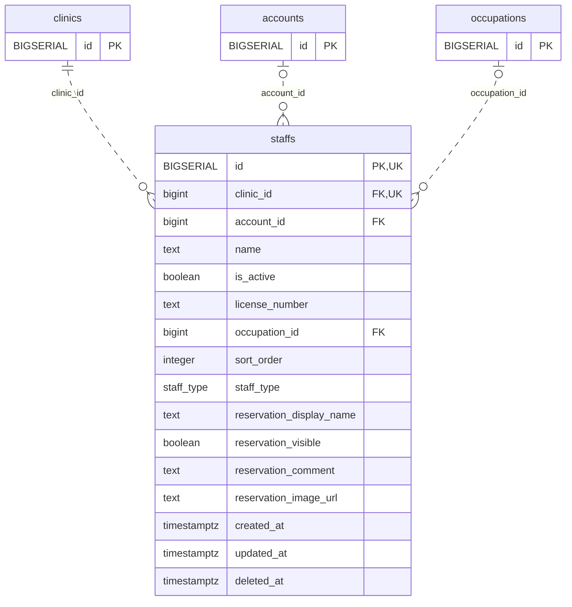

<!-- GENERATED: scripts/tools/generate-erd-detail.py; do not edit -->
# `staffs`

[詳細ERD一覧](index.md) · [概要ERD](../erd.md)

このページは、マイグレーションをファイル名順に静的解析した最終定義です。稼働DBの状態は未確認です。

## カラム

型・DEFAULTはDDLの宣言表記です。`bigserial` は採番宣言であり、DBカタログ上の型名ではありません。

| カラム | 型（DDL） | NULL | DEFAULT（DDL） | キー構成列 | 定義元 |
|:---|:---|:---|:---|:---|:---|
| `id` | `BIGSERIAL` | NOT NULL | — | PK, UK | [001_init.sql:269](../../../backend/migrations/001_init.sql#L269) |
| `clinic_id` | `bigint` | NOT NULL | — | FK, UK | [001_init.sql:270](../../../backend/migrations/001_init.sql#L270) |
| `account_id` | `bigint` | NULL | — | FK | [001_init.sql:271](../../../backend/migrations/001_init.sql#L271) |
| `name` | `text` | NOT NULL | — | — | [001_init.sql:272](../../../backend/migrations/001_init.sql#L272) |
| `is_active` | `boolean` | NOT NULL | `true` | — | [001_init.sql:273](../../../backend/migrations/001_init.sql#L273) |
| `license_number` | `text` | NOT NULL | `''` | — | [001_init.sql:274](../../../backend/migrations/001_init.sql#L274) |
| `occupation_id` | `bigint` | NULL | — | FK | [001_init.sql:275](../../../backend/migrations/001_init.sql#L275) |
| `sort_order` | `integer` | NULL | `0` | — | [001_init.sql:276](../../../backend/migrations/001_init.sql#L276) |
| `staff_type` | `staff_type` | NOT NULL | `'doctor'` | — | [001_init.sql:277](../../../backend/migrations/001_init.sql#L277) |
| `reservation_display_name` | `text` | NOT NULL | `''` | — | [001_init.sql:278](../../../backend/migrations/001_init.sql#L278) |
| `reservation_visible` | `boolean` | NOT NULL | `true` | — | [001_init.sql:279](../../../backend/migrations/001_init.sql#L279) |
| `reservation_comment` | `text` | NOT NULL | `''` | — | [001_init.sql:280](../../../backend/migrations/001_init.sql#L280) |
| `reservation_image_url` | `text` | NOT NULL | `''` | — | [001_init.sql:281](../../../backend/migrations/001_init.sql#L281) |
| `created_at` | `timestamptz` | NOT NULL | `now()` | — | [001_init.sql:282](../../../backend/migrations/001_init.sql#L282) |
| `updated_at` | `timestamptz` | NOT NULL | `now()` | — | [001_init.sql:283](../../../backend/migrations/001_init.sql#L283) |
| `deleted_at` | `timestamptz` | NULL | — | — | [001_init.sql:284](../../../backend/migrations/001_init.sql#L284) |

PK/FK/UKはキーの構成列を示します。複合キーの各列が単独で一意という意味ではありません。部分uniqueは下記indexの述語を参照してください。

## ERD

このテーブルの全カラムと、すべての参照先を表示します。参照先はFKの対象列だけを表示し、全カラムは各テーブルのページに置きます。

親側の任意参照はFK列のNULL可否、子側の最大1件は無条件のPK/UNIQUEから導出します。部分uniqueによる条件付きの最大件数は図に反映せず、index一覧に記録します。実線はFK全列が子のPKに含まれる識別関係、破線はそれ以外です。

## 外部キー（全件）

| 制約 | 子の列（順序あり） | 参照先 | 親の列（順序あり） | 削除時の動作 | 定義元 |
|:---|:---|:---|:---|:---|:---|
| `staffs_clinic_id_fkey` | `clinic_id` | [clinics](clinics.md) | `id` | `ON DELETE RESTRICT` | [001_init.sql:270](../../../backend/migrations/001_init.sql#L270) |
| `staffs_account_id_fkey` | `account_id` | [accounts](accounts.md) | `id` | `ON DELETE SET NULL` | [001_init.sql:271](../../../backend/migrations/001_init.sql#L271) |
| `staffs_occupation_id_fkey` | `occupation_id` | [occupations](occupations.md) | `id` | `ON DELETE SET NULL` | [001_init.sql:275](../../../backend/migrations/001_init.sql#L275) |

正確なON UPDATE・MATCH・DEFERRABLE等を含む制約DDL:

- `staffs_clinic_id_fkey`: `REFERENCES clinics(id) ON DELETE RESTRICT`
- `staffs_account_id_fkey`: `REFERENCES accounts(id) ON DELETE SET NULL`
- `staffs_occupation_id_fkey`: `REFERENCES occupations(id) ON DELETE SET NULL`

## その他の制約

| 制約 | 種別 | DDL | 定義元 |
|:---|:---|:---|:---|
| `staffs_pkey` | primary | `PRIMARY KEY` | [001_init.sql:269](../../../backend/migrations/001_init.sql#L269) |
| `uq_staffs_id_clinic` | unique | `CONSTRAINT uq_staffs_id_clinic         UNIQUE (id, clinic_id)` | [001_init.sql:5696](../../../backend/migrations/001_init.sql#L5696) |

## インデックス

| 名前 | UNIQUE | 述語 | DDL | 定義元 |
|:---|:---|:---|:---|:---|
| `idx_staffs_account` | NO | — | `CREATE INDEX idx_staffs_account ON staffs(account_id)` | [001_init.sql:287](../../../backend/migrations/001_init.sql#L287) |
| `idx_staffs_clinic` | NO | `deleted_at IS NULL` | `CREATE INDEX idx_staffs_clinic ON staffs(clinic_id) WHERE deleted_at IS NULL` | [001_init.sql:288](../../../backend/migrations/001_init.sql#L288) |
| `idx_staffs_occupation_id` | NO | — | `CREATE INDEX idx_staffs_occupation_id ON staffs(occupation_id)` | [001_init.sql:2428](../../../backend/migrations/001_init.sql#L2428) |
