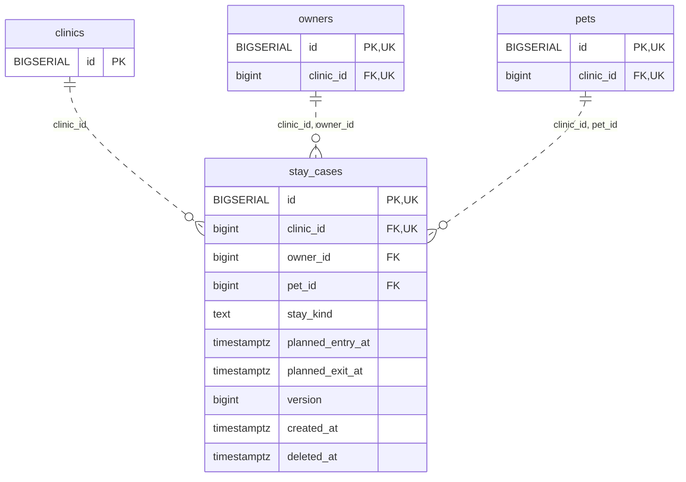

<!-- GENERATED: scripts/tools/generate-erd-detail.py; do not edit -->
# `stay_cases`

[詳細ERD一覧](index.md) · [概要ERD](../erd.md)

このページは、マイグレーションをファイル名順に静的解析した最終定義です。稼働DBの状態は未確認です。

## カラム

型・DEFAULTはDDLの宣言表記です。`bigserial` は採番宣言であり、DBカタログ上の型名ではありません。

| カラム | 型（DDL） | NULL | DEFAULT（DDL） | キー構成列 | 定義元 |
|:---|:---|:---|:---|:---|:---|
| `id` | `BIGSERIAL` | NOT NULL | — | PK, UK | [001_init.sql:9244](../../../backend/migrations/001_init.sql#L9244) |
| `clinic_id` | `bigint` | NOT NULL | — | FK, UK | [001_init.sql:9245](../../../backend/migrations/001_init.sql#L9245) |
| `owner_id` | `bigint` | NOT NULL | — | FK | [001_init.sql:9246](../../../backend/migrations/001_init.sql#L9246) |
| `pet_id` | `bigint` | NOT NULL | — | FK | [001_init.sql:9247](../../../backend/migrations/001_init.sql#L9247) |
| `stay_kind` | `text` | NOT NULL | — | — | [001_init.sql:9248](../../../backend/migrations/001_init.sql#L9248) |
| `planned_entry_at` | `timestamptz` | NULL | — | — | [001_init.sql:9249](../../../backend/migrations/001_init.sql#L9249) |
| `planned_exit_at` | `timestamptz` | NULL | — | — | [001_init.sql:9250](../../../backend/migrations/001_init.sql#L9250) |
| `version` | `bigint` | NOT NULL | `1` | — | [001_init.sql:9251](../../../backend/migrations/001_init.sql#L9251) |
| `created_at` | `timestamptz` | NOT NULL | `clock_timestamp()` | — | [001_init.sql:9252](../../../backend/migrations/001_init.sql#L9252) |
| `deleted_at` | `timestamptz` | NULL | — | — | [001_init.sql:9253](../../../backend/migrations/001_init.sql#L9253) |

PK/FK/UKはキーの構成列を示します。複合キーの各列が単独で一意という意味ではありません。部分uniqueは下記indexの述語を参照してください。

## ERD

このテーブルの全カラムと、すべての参照先を表示します。参照先はFKの対象列だけを表示し、全カラムは各テーブルのページに置きます。

親側の任意参照はFK列のNULL可否、子側の最大1件は無条件のPK/UNIQUEから導出します。部分uniqueによる条件付きの最大件数は図に反映せず、index一覧に記録します。実線はFK全列が子のPKに含まれる識別関係、破線はそれ以外です。

## 外部キー（全件）

| 制約 | 子の列（順序あり） | 参照先 | 親の列（順序あり） | 削除時の動作 | 定義元 |
|:---|:---|:---|:---|:---|:---|
| `stay_cases_clinic_id_fkey` | `clinic_id` | [clinics](clinics.md) | `id` | `ON DELETE RESTRICT` | [001_init.sql:9245](../../../backend/migrations/001_init.sql#L9245) |
| `stay_cases_clinic_id_owner_id_fkey` | `clinic_id, owner_id` | [owners](owners.md) | `clinic_id, id` | `ON DELETE RESTRICT` | [001_init.sql:9256](../../../backend/migrations/001_init.sql#L9256) |
| `stay_cases_clinic_id_pet_id_fkey` | `clinic_id, pet_id` | [pets](pets.md) | `clinic_id, id` | `ON DELETE RESTRICT` | [001_init.sql:9257](../../../backend/migrations/001_init.sql#L9257) |

正確なON UPDATE・MATCH・DEFERRABLE等を含む制約DDL:

- `stay_cases_clinic_id_fkey`: `REFERENCES clinics(id) ON DELETE RESTRICT`
- `stay_cases_clinic_id_owner_id_fkey`: `FOREIGN KEY (clinic_id,owner_id) REFERENCES owners(clinic_id,id) ON DELETE RESTRICT`
- `stay_cases_clinic_id_pet_id_fkey`: `FOREIGN KEY (clinic_id,pet_id) REFERENCES pets(clinic_id,id) ON DELETE RESTRICT`

## その他の制約

| 制約 | 種別 | DDL | 定義元 |
|:---|:---|:---|:---|
| `stay_cases_pkey` | primary | `PRIMARY KEY` | [001_init.sql:9244](../../../backend/migrations/001_init.sql#L9244) |
| `stay_cases_stay_kind_check` | check | `CHECK (stay_kind IN ('inpatient','hotel'))` | [001_init.sql:9248](../../../backend/migrations/001_init.sql#L9248) |
| `stay_cases_version_check` | check | `CHECK (version > 0)` | [001_init.sql:9251](../../../backend/migrations/001_init.sql#L9251) |
| `stay_cases_id_clinic_id_key` | unique | `UNIQUE (id,clinic_id)` | [001_init.sql:9254](../../../backend/migrations/001_init.sql#L9254) |
| `stay_cases_check` | check | `CHECK (planned_exit_at IS NULL OR planned_entry_at IS NULL OR planned_exit_at>planned_entry_at)` | [001_init.sql:9255](../../../backend/migrations/001_init.sql#L9255) |

## インデックス

明示的なCREATE INDEXなし。PK/UNIQUEに付随する暗黙のindexは制約欄を参照してください。
