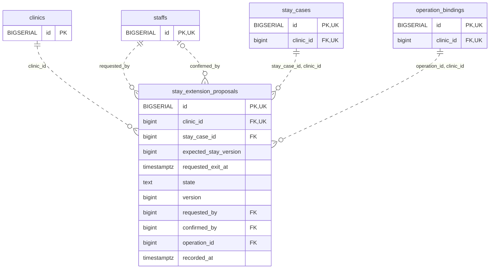

<!-- GENERATED: scripts/tools/generate-erd-detail.py; do not edit -->
# `stay_extension_proposals`

[詳細ERD一覧](index.md) · [概要ERD](../erd.md)

このページは、マイグレーションをファイル名順に静的解析した最終定義です。稼働DBの状態は未確認です。

## カラム

型・DEFAULTはDDLの宣言表記です。`bigserial` は採番宣言であり、DBカタログ上の型名ではありません。

| カラム | 型（DDL） | NULL | DEFAULT（DDL） | キー構成列 | 定義元 |
|:---|:---|:---|:---|:---|:---|
| `id` | `BIGSERIAL` | NOT NULL | — | PK, UK | [001_init.sql:9318](../../../backend/migrations/001_init.sql#L9318) |
| `clinic_id` | `bigint` | NOT NULL | — | FK, UK | [001_init.sql:9319](../../../backend/migrations/001_init.sql#L9319) |
| `stay_case_id` | `bigint` | NOT NULL | — | FK | [001_init.sql:9320](../../../backend/migrations/001_init.sql#L9320) |
| `expected_stay_version` | `bigint` | NOT NULL | — | — | [001_init.sql:9321](../../../backend/migrations/001_init.sql#L9321) |
| `requested_exit_at` | `timestamptz` | NOT NULL | — | — | [001_init.sql:9322](../../../backend/migrations/001_init.sql#L9322) |
| `state` | `text` | NOT NULL | — | — | [001_init.sql:9323](../../../backend/migrations/001_init.sql#L9323) |
| `version` | `bigint` | NOT NULL | `1` | — | [001_init.sql:9324](../../../backend/migrations/001_init.sql#L9324) |
| `requested_by` | `bigint` | NOT NULL | — | FK | [001_init.sql:9325](../../../backend/migrations/001_init.sql#L9325) |
| `confirmed_by` | `bigint` | NULL | — | FK | [001_init.sql:9326](../../../backend/migrations/001_init.sql#L9326) |
| `operation_id` | `bigint` | NOT NULL | — | FK | [001_init.sql:9327](../../../backend/migrations/001_init.sql#L9327) |
| `recorded_at` | `timestamptz` | NOT NULL | `clock_timestamp()` | — | [001_init.sql:9328](../../../backend/migrations/001_init.sql#L9328) |

PK/FK/UKはキーの構成列を示します。複合キーの各列が単独で一意という意味ではありません。部分uniqueは下記indexの述語を参照してください。

## ERD

このテーブルの全カラムと、すべての参照先を表示します。参照先はFKの対象列だけを表示し、全カラムは各テーブルのページに置きます。

親側の任意参照はFK列のNULL可否、子側の最大1件は無条件のPK/UNIQUEから導出します。部分uniqueによる条件付きの最大件数は図に反映せず、index一覧に記録します。実線はFK全列が子のPKに含まれる識別関係、破線はそれ以外です。

## 外部キー（全件）

| 制約 | 子の列（順序あり） | 参照先 | 親の列（順序あり） | 削除時の動作 | 定義元 |
|:---|:---|:---|:---|:---|:---|
| `stay_extension_proposals_clinic_id_fkey` | `clinic_id` | [clinics](clinics.md) | `id` | `ON DELETE RESTRICT` | [001_init.sql:9319](../../../backend/migrations/001_init.sql#L9319) |
| `stay_extension_proposals_requested_by_fkey` | `requested_by` | [staffs](staffs.md) | `id` | `ON DELETE RESTRICT` | [001_init.sql:9325](../../../backend/migrations/001_init.sql#L9325) |
| `stay_extension_proposals_confirmed_by_fkey` | `confirmed_by` | [staffs](staffs.md) | `id` | `ON DELETE RESTRICT` | [001_init.sql:9326](../../../backend/migrations/001_init.sql#L9326) |
| `stay_extension_proposals_stay_case_id_clinic_id_fkey` | `stay_case_id, clinic_id` | [stay_cases](stay_cases.md) | `id, clinic_id` | `ON DELETE RESTRICT` | [001_init.sql:9330](../../../backend/migrations/001_init.sql#L9330) |
| `stay_extension_proposals_operation_id_clinic_id_fkey` | `operation_id, clinic_id` | [operation_bindings](operation_bindings.md) | `id, clinic_id` | `ON DELETE RESTRICT` | [001_init.sql:9331](../../../backend/migrations/001_init.sql#L9331) |

正確なON UPDATE・MATCH・DEFERRABLE等を含む制約DDL:

- `stay_extension_proposals_clinic_id_fkey`: `REFERENCES clinics(id) ON DELETE RESTRICT`
- `stay_extension_proposals_requested_by_fkey`: `REFERENCES staffs(id) ON DELETE RESTRICT`
- `stay_extension_proposals_confirmed_by_fkey`: `REFERENCES staffs(id) ON DELETE RESTRICT`
- `stay_extension_proposals_stay_case_id_clinic_id_fkey`: `FOREIGN KEY (stay_case_id,clinic_id) REFERENCES stay_cases(id,clinic_id) ON DELETE RESTRICT`
- `stay_extension_proposals_operation_id_clinic_id_fkey`: `FOREIGN KEY (operation_id,clinic_id) REFERENCES operation_bindings(id,clinic_id) ON DELETE RESTRICT`

## その他の制約

| 制約 | 種別 | DDL | 定義元 |
|:---|:---|:---|:---|
| `stay_extension_proposals_pkey` | primary | `PRIMARY KEY` | [001_init.sql:9318](../../../backend/migrations/001_init.sql#L9318) |
| `stay_extension_proposals_expected_stay_version_check` | check | `CHECK (expected_stay_version > 0)` | [001_init.sql:9321](../../../backend/migrations/001_init.sql#L9321) |
| `stay_extension_proposals_state_check` | check | `CHECK (state IN ('pending','confirmed','cancelled'))` | [001_init.sql:9323](../../../backend/migrations/001_init.sql#L9323) |
| `stay_extension_proposals_version_check` | check | `CHECK (version > 0)` | [001_init.sql:9324](../../../backend/migrations/001_init.sql#L9324) |
| `stay_extension_proposals_id_clinic_id_key` | unique | `UNIQUE (id,clinic_id)` | [001_init.sql:9329](../../../backend/migrations/001_init.sql#L9329) |

## インデックス

明示的なCREATE INDEXなし。PK/UNIQUEに付随する暗黙のindexは制約欄を参照してください。
