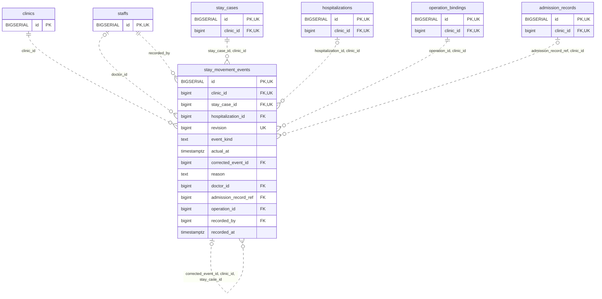

<!-- GENERATED: scripts/tools/generate-erd-detail.py; do not edit -->
# `stay_movement_events`

[詳細ERD一覧](index.md) · [概要ERD](../erd.md)

このページは、マイグレーションをファイル名順に静的解析した最終定義です。稼働DBの状態は未確認です。

## カラム

型・DEFAULTはDDLの宣言表記です。`bigserial` は採番宣言であり、DBカタログ上の型名ではありません。

| カラム | 型（DDL） | NULL | DEFAULT（DDL） | キー構成列 | 定義元 |
|:---|:---|:---|:---|:---|:---|
| `id` | `BIGSERIAL` | NOT NULL | — | PK, UK | [001_init.sql:9291](../../../backend/migrations/001_init.sql#L9291) |
| `clinic_id` | `bigint` | NOT NULL | — | FK, UK | [001_init.sql:9292](../../../backend/migrations/001_init.sql#L9292) |
| `stay_case_id` | `bigint` | NOT NULL | — | FK, UK | [001_init.sql:9293](../../../backend/migrations/001_init.sql#L9293) |
| `hospitalization_id` | `bigint` | NULL | — | FK | [001_init.sql:9294](../../../backend/migrations/001_init.sql#L9294) |
| `revision` | `bigint` | NOT NULL | — | UK | [001_init.sql:9295](../../../backend/migrations/001_init.sql#L9295) |
| `event_kind` | `text` | NOT NULL | — | — | [001_init.sql:9296](../../../backend/migrations/001_init.sql#L9296) |
| `actual_at` | `timestamptz` | NULL | — | — | [001_init.sql:9297](../../../backend/migrations/001_init.sql#L9297) |
| `corrected_event_id` | `bigint` | NULL | — | FK | [001_init.sql:9298](../../../backend/migrations/001_init.sql#L9298) |
| `reason` | `text` | NULL | — | — | [001_init.sql:9299](../../../backend/migrations/001_init.sql#L9299) |
| `doctor_id` | `bigint` | NULL | — | FK | [001_init.sql:9300](../../../backend/migrations/001_init.sql#L9300) |
| `admission_record_ref` | `bigint` | NULL | — | FK | [001_init.sql:9301](../../../backend/migrations/001_init.sql#L9301) |
| `operation_id` | `bigint` | NOT NULL | — | FK | [001_init.sql:9302](../../../backend/migrations/001_init.sql#L9302) |
| `recorded_by` | `bigint` | NOT NULL | — | FK | [001_init.sql:9303](../../../backend/migrations/001_init.sql#L9303) |
| `recorded_at` | `timestamptz` | NOT NULL | `clock_timestamp()` | — | [001_init.sql:9304](../../../backend/migrations/001_init.sql#L9304) |

PK/FK/UKはキーの構成列を示します。複合キーの各列が単独で一意という意味ではありません。部分uniqueは下記indexの述語を参照してください。

## ERD

このテーブルの全カラムと、すべての参照先を表示します。参照先はFKの対象列だけを表示し、全カラムは各テーブルのページに置きます。

親側の任意参照はFK列のNULL可否、子側の最大1件は無条件のPK/UNIQUEから導出します。部分uniqueによる条件付きの最大件数は図に反映せず、index一覧に記録します。実線はFK全列が子のPKに含まれる識別関係、破線はそれ以外です。

## 外部キー（全件）

| 制約 | 子の列（順序あり） | 参照先 | 親の列（順序あり） | 削除時の動作 | 定義元 |
|:---|:---|:---|:---|:---|:---|
| `stay_movement_events_clinic_id_fkey` | `clinic_id` | [clinics](clinics.md) | `id` | `ON DELETE RESTRICT` | [001_init.sql:9292](../../../backend/migrations/001_init.sql#L9292) |
| `stay_movement_events_doctor_id_fkey` | `doctor_id` | [staffs](staffs.md) | `id` | `ON DELETE RESTRICT` | [001_init.sql:9300](../../../backend/migrations/001_init.sql#L9300) |
| `stay_movement_events_recorded_by_fkey` | `recorded_by` | [staffs](staffs.md) | `id` | `ON DELETE RESTRICT` | [001_init.sql:9303](../../../backend/migrations/001_init.sql#L9303) |
| `stay_movement_events_stay_case_id_clinic_id_fkey` | `stay_case_id, clinic_id` | [stay_cases](stay_cases.md) | `id, clinic_id` | `ON DELETE RESTRICT` | [001_init.sql:9309](../../../backend/migrations/001_init.sql#L9309) |
| `stay_movement_events_hospitalization_id_clinic_id_fkey` | `hospitalization_id, clinic_id` | [hospitalizations](hospitalizations.md) | `id, clinic_id` | `ON DELETE RESTRICT` | [001_init.sql:9310](../../../backend/migrations/001_init.sql#L9310) |
| `stay_movement_events_corrected_event_id_clinic_id_stay_cas_fkey` | `corrected_event_id, clinic_id, stay_case_id` | [stay_movement_events](stay_movement_events.md) | `id, clinic_id, stay_case_id` | `ON DELETE RESTRICT` | [001_init.sql:9311](../../../backend/migrations/001_init.sql#L9311) |
| `stay_movement_events_operation_id_clinic_id_fkey` | `operation_id, clinic_id` | [operation_bindings](operation_bindings.md) | `id, clinic_id` | `ON DELETE RESTRICT` | [001_init.sql:9312](../../../backend/migrations/001_init.sql#L9312) |
| `fk_stay_admission_record` | `admission_record_ref, clinic_id` | [admission_records](admission_records.md) | `id, clinic_id` | `ON DELETE RESTRICT` | [001_init.sql:9327](../../../backend/migrations/001_init.sql#L9327) |

正確なON UPDATE・MATCH・DEFERRABLE等を含む制約DDL:

- `stay_movement_events_clinic_id_fkey`: `REFERENCES clinics(id) ON DELETE RESTRICT`
- `stay_movement_events_doctor_id_fkey`: `REFERENCES staffs(id) ON DELETE RESTRICT`
- `stay_movement_events_recorded_by_fkey`: `REFERENCES staffs(id) ON DELETE RESTRICT`
- `stay_movement_events_stay_case_id_clinic_id_fkey`: `FOREIGN KEY (stay_case_id,clinic_id) REFERENCES stay_cases(id,clinic_id) ON DELETE RESTRICT`
- `stay_movement_events_hospitalization_id_clinic_id_fkey`: `FOREIGN KEY (hospitalization_id,clinic_id) REFERENCES hospitalizations(id,clinic_id) ON DELETE RESTRICT`
- `stay_movement_events_corrected_event_id_clinic_id_stay_cas_fkey`: `FOREIGN KEY (corrected_event_id,clinic_id,stay_case_id) REFERENCES stay_movement_events(id,clinic_id,stay_case_id) ON DELETE RESTRICT`
- `stay_movement_events_operation_id_clinic_id_fkey`: `FOREIGN KEY (operation_id,clinic_id) REFERENCES operation_bindings(id,clinic_id) ON DELETE RESTRICT`
- `fk_stay_admission_record`: `CONSTRAINT fk_stay_admission_record  FOREIGN KEY (admission_record_ref,clinic_id) REFERENCES admission_records(id,clinic_id) ON DELETE RESTRICT DEFERRABLE INITIALLY DEFERRED`

## その他の制約

| 制約 | 種別 | DDL | 定義元 |
|:---|:---|:---|:---|
| `stay_movement_events_pkey` | primary | `PRIMARY KEY` | [001_init.sql:9291](../../../backend/migrations/001_init.sql#L9291) |
| `stay_movement_events_revision_check` | check | `CHECK (revision > 0)` | [001_init.sql:9295](../../../backend/migrations/001_init.sql#L9295) |
| `stay_movement_events_event_kind_check` | check | `CHECK (event_kind IN ('admit','discharge','correction','cancel','no_show'))` | [001_init.sql:9296](../../../backend/migrations/001_init.sql#L9296) |
| `stay_movement_events_id_clinic_id_stay_case_id_key` | unique | `UNIQUE (id,clinic_id,stay_case_id)` | [001_init.sql:9305](../../../backend/migrations/001_init.sql#L9305) |
| `stay_movement_events_clinic_id_stay_case_id_revision_key` | unique | `UNIQUE (clinic_id,stay_case_id,revision)` | [001_init.sql:9306](../../../backend/migrations/001_init.sql#L9306) |
| `stay_movement_events_check` | check | `CHECK ((event_kind IN ('admit','discharge') AND actual_at IS NOT NULL) OR event_kind IN ('correction','cancel','no_show'))` | [001_init.sql:9307](../../../backend/migrations/001_init.sql#L9307) |
| `stay_movement_events_check1` | check | `CHECK (event_kind<>'correction' OR (corrected_event_id IS NOT NULL AND reason IS NOT NULL AND btrim(reason)<>''))` | [001_init.sql:9308](../../../backend/migrations/001_init.sql#L9308) |

## インデックス

| 名前 | UNIQUE | 述語 | DDL | 定義元 |
|:---|:---|:---|:---|:---|
| `idx_stay_movement_actual` | NO | — | `CREATE INDEX idx_stay_movement_actual ON stay_movement_events(clinic_id,event_kind,actual_at,stay_case_id)` | [001_init.sql:9314](../../../backend/migrations/001_init.sql#L9314) |
